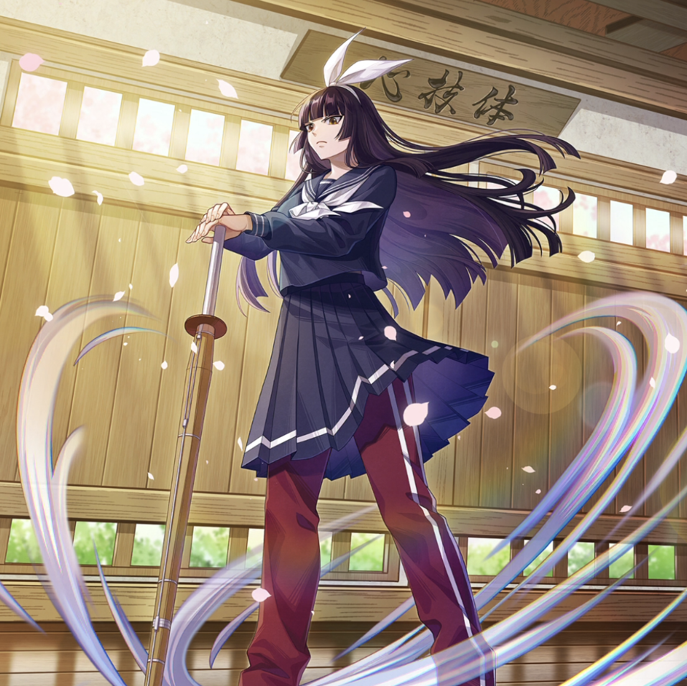

**Rarity:** UR

**Attribute:** ❤️ Brave

**Class:** Melee

**Identity:** Kagura Mikazuchi

**Normal attack range:** Ranged

**Signature lacrima:** [[lacrimas/academy-kagura-lacrima-8bf72131|✨ Academy Kagura Lacrima]]

## Game text

### 🗡️ Normal Skill (Ranged)

Deal 150% ATK damage to the target. On hit, there is a 30% chance to grant yourself &#91;High&#93; Critical Rate Increase for 3s.

### 🗡️ Special Skill – Mid Stance

Every 5s, grant yourself &#91;Top&#93; Critical Damage Increase and &#91;Top&#93; Accuracy Increase for 5s.

### 💥 Ultimate – All-In Strike

Every 8s, deal 800% ATK damage to all enemies. On hit, each target has a 50% chance to be inflicted for 5s with &#91;Top&#93; Paralysis and &#91;Top&#93; Critical Defense Decrease.

## Effect applications

### Top Critical Damage Increase
| Property | Value |
| --- | --- |
| Family | Critical Damage |
| Target | Self |
| Activation | Every 5 sec |
| Duration | 5 sec |
| Value | 50 Percent |
| Source skill | Special Skill |

Every 5s, grant yourself &#91;Top&#93; Critical Damage Increase and &#91;Top&#93; Accuracy Increase for 5s.

### Top Accuracy Increase
| Property | Value |
| --- | --- |
| Family | Accuracy |
| Target | Self |
| Activation | Every 5 sec |
| Duration | 5 sec |
| Value | 20 Percent |
| Source skill | Special Skill |

Every 5s, grant yourself &#91;Top&#93; Critical Damage Increase and &#91;Top&#93; Accuracy Increase for 5s.

### Top Paralysis
| Property | Value |
| --- | --- |
| Family | Paralysis |
| Target | Each Target Hit |
| Activation | Every 8 sec, After Attack Hits |
| Chance | 50% |
| Duration | 5 sec |
| Value | 30 Percent of ATK per sec |
| Source skill | Ultimate |

Every 8s, deal 800% ATK damage to all enemies. On hit, each target has a 50% chance to be inflicted for 5s with &#91;Top&#93; Paralysis and &#91;Top&#93; Critical Defense Decrease.

### Top Critical Defense Decrease
| Property | Value |
| --- | --- |
| Family | Critical Defense |
| Target | Each Target Hit |
| Activation | Every 8 sec, After Attack Hits |
| Chance | 50% |
| Duration | 5 sec |
| Value | 50 Percent |
| Source skill | Ultimate |

Every 8s, deal 800% ATK damage to all enemies. On hit, each target has a 50% chance to be inflicted for 5s with &#91;Top&#93; Paralysis and &#91;Top&#93; Critical Defense Decrease.

### High Critical Rate Increase
| Property | Value |
| --- | --- |
| Family | Critical Rate |
| Target | Self |
| Activation | Normal SKill Hit |
| Chance | 30% |
| Duration | 3 sec |
| Value | 15 Percent |
| Source skill | Normal Attack |

Deal 150% ATK damage to the target. On hit, there is a 30% chance to grant yourself &#91;High&#93; Critical Rate Increase for 3s.

Unspecified values remain unknown. Text is transcribed from game records; localization and entry errors may remain.
