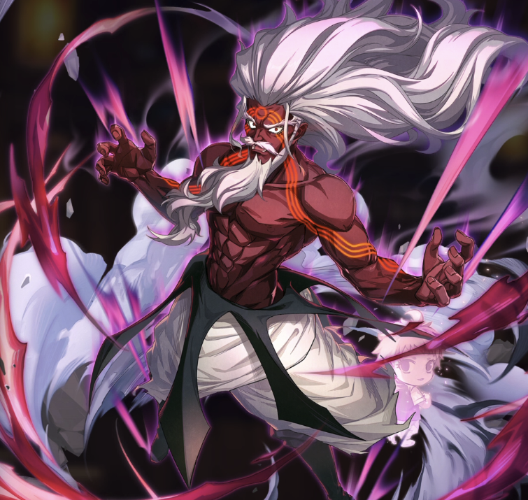

**Rarity:** UR

**Attribute:** 💚 Technique

**Class:** Ranged

**Identity:** August

**Normal attack range:** Ranged

**Signature lacrima:** [[lacrimas/august-lacrima-3cce6e2f|✨ August Lacrima]]

## Game text

### Normal Skill (Ranged)

Deals 140% ATK damage to the target.

### Special Skill — The Power of the Sorcerer King

After a normal skill hits, there is a 20% chance to grant each ally for 5 sec &#91;Top&#93; Critical Damage Increase.

### Ultimate — Ars Magia

Every 11 sec, deal damage equal to 700% of ATK to enemies within the target area. After the attack hits, there is a 20% chance to inflict on each target for 5 sec Bind.

## Effect applications

### Top Critical Damage Increase
| Property | Value |
| --- | --- |
| Family | Critical Damage |
| Target | All Allies |
| Activation | Normal SKill Hit |
| Chance | 20% |
| Duration | 5 sec |
| Value | 50 Percent |
| Source skill | Special Skill |

After a normal skill hits, there is a 20% chance to grant each ally for 5 sec &#91;Top&#93; Critical Damage Increase.

### Bind
| Property | Value |
| --- | --- |
| Family | Bind |
| Target | Each Target Hit |
| Activation | Every 11 sec, After Attack Hits |
| Chance | 20% |
| Duration | 5 sec |
| Source skill | Ultimate |

Every 11 sec... After the attack hits, there is a 40% chance to inflict on each target for 5 sec Bind.

Unspecified values remain unknown. Text is transcribed from game records; localization and entry errors may remain.
