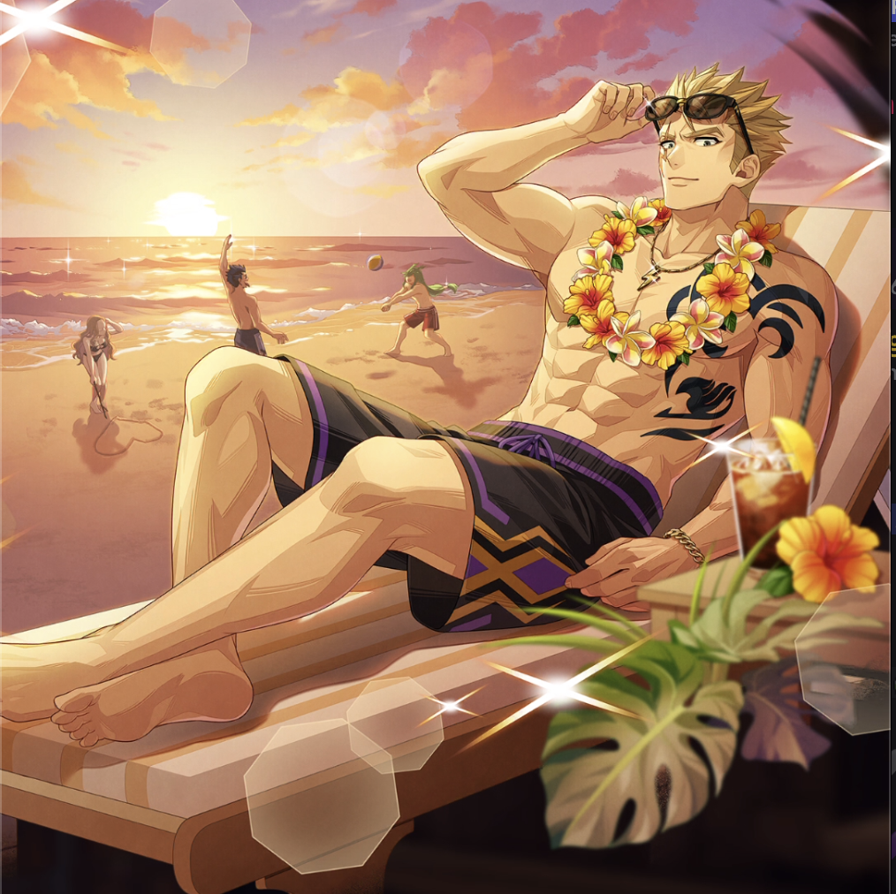

**Rarity:** UR

**Attribute:** 💙 Mind

**Class:** Heal

**Identity:** Laxus Dreyar

**Normal attack range:** Ranged

**Signature lacrima:** [[lacrimas/blazing-beach-vacation-laxus-lacrima-7cf393a5|✨ Blazing Beach Vacation Laxus Lacrima]]

## Game text

### 🗡️ Normal Skill (Ranged)

Deals damage equal to 150% of ATK to the target. After the attack hits, restores HP of the ally with the lowest HP by 130% of own ATK.

### 🗡️ Special Skill – Peaceful Sunset

After a normal skill hits, has a 30% chance to grant all allies for 5 sec, &#91;Top&#93; Shield, &#91;Top&#93; ATK Increase, and &#91;Top&#93; Accuracy Increase, and advances the Special Skill Gauge by 0.7 sec.

### 💥 Ultimate – Lightning Dragon&#x27;s Rest

Every 11 sec, restores all allies HP by 750% of own ATK. Increases damage by 50% for each INT ally (up to 350%). Also grants the targets &#91;Top&#93; Continous Heal and &#91;Top&#93; DEF Increase for 5 sec., and removes all debuffs from all allies. Additionally, grants all INT allies &#91;High&#93; Critical Rate Increase and &#91;High&#93; ATK Increase for 5 sec.

## Effect applications

### Heal
| Property | Value |
| --- | --- |
| Family | Heal |
| Target | Lowest HP Ally |
| Activation | Normal SKill Hit |
| Value | 130 Percent of own ATK |
| Source skill | Normal Attack |

Deals damage equal to 150% of ATK to the target. After the attack hits, restores HP of the ally with the lowest HP by 130% of own ATK.

### Top Shield
| Property | Value |
| --- | --- |
| Family | Shield |
| Target | All Allies |
| Activation | Normal SKill Hit |
| Chance | 30% |
| Duration | 5 sec |
| Value | 25 Percent of Max HP |
| Source skill | Special Skill |

After a normal skill hits, has a 30% chance to grant all allies for 5 sec, &#91;Top&#93; Shield, &#91;Top&#93; ATK Increase, and &#91;Top&#93; Accuracy Increase, and advances the Special Skill Gauge by 0.7 sec.

### Top ATK Increase
| Property | Value |
| --- | --- |
| Family | ATK |
| Target | All Allies |
| Activation | Normal SKill Hit |
| Chance | 30% |
| Duration | 5 sec |
| Value | 30 Percent |
| Source skill | Special Skill |

After a normal skill hits, has a 30% chance to grant all allies for 5 sec, &#91;Top&#93; Shield, &#91;Top&#93; ATK Increase, and &#91;Top&#93; Accuracy Increase, and advances the Special Skill Gauge by 0.7 sec.

### Top Accuracy Increase
| Property | Value |
| --- | --- |
| Family | Accuracy |
| Target | All Allies |
| Activation | Normal SKill Hit |
| Chance | 30% |
| Duration | 5 sec |
| Value | 20 Percent |
| Source skill | Special Skill |

After a normal skill hits, has a 30% chance to grant all allies for 5 sec, &#91;Top&#93; Shield, &#91;Top&#93; ATK Increase, and &#91;Top&#93; Accuracy Increase, and advances the Special Skill Gauge by 0.7 sec.

### Advance Special Skill Gauge
| Property | Value |
| --- | --- |
| Family | Special Skill Gauge |
| Target | All Allies |
| Activation | Normal SKill Hit |
| Chance | 30% |
| Value | 0.7 Seconds |
| Source skill | Special Skill |

After a normal skill hits, has a 30% chance to grant all allies for 5 sec, &#91;Top&#93; Shield, &#91;Top&#93; ATK Increase, and &#91;Top&#93; Accuracy Increase, and advances the Special Skill Gauge by 0.7 sec.

### Heal
| Property | Value |
| --- | --- |
| Family | Heal |
| Target | All Allies |
| Activation | Every 11 sec |
| Value | 750 Percent of own ATK |
| Source skill | Ultimate |

Every 11 sec, restores all allies HP by 750% of own ATK. Increases damage by 50% for each INT ally (up to 350%). Also grants the targets &#91;Top&#93; Continous Heal and &#91;Top&#93; DEF Increase for 5 sec., and removes all debuffs from all allies. Additionally, grants all INT allies &#91;High&#93; Critical Rate Increase and &#91;High&#93; ATK Increase for 5 sec.

### Top Continuous Heal
| Property | Value |
| --- | --- |
| Family | Heal |
| Target | All Allies |
| Activation | Every 11 sec |
| Duration | 5 sec |
| Value | 120 Percent of ATK per sec |
| Source skill | Ultimate |

Every 11 sec, restores all allies HP by 750% of own ATK. Increases damage by 50% for each INT ally (up to 350%). Also grants the targets &#91;Top&#93; Continous Heal and &#91;Top&#93; DEF Increase for 5 sec., and removes all debuffs from all allies. Additionally, grants all INT allies &#91;High&#93; Critical Rate Increase and &#91;High&#93; ATK Increase for 5 sec.

### Top DEF Increase
| Property | Value |
| --- | --- |
| Family | DEF |
| Target | All Allies |
| Activation | Every 11 sec |
| Duration | 5 sec |
| Value | 30 Percent |
| Source skill | Ultimate |

Every 11 sec, restores all allies HP by 750% of own ATK. Increases damage by 50% for each INT ally (up to 350%). Also grants the targets &#91;Top&#93; Continous Heal and &#91;Top&#93; DEF Increase for 5 sec., and removes all debuffs from all allies. Additionally, grants all INT allies &#91;High&#93; Critical Rate Increase and &#91;High&#93; ATK Increase for 5 sec.

### Remove All Debuffs
| Property | Value |
| --- | --- |
| Family | Cleanse |
| Target | All Allies |
| Activation | Every 11 sec |
| Source skill | Ultimate |

Every 11 sec, restores all allies HP by 750% of own ATK. Increases damage by 50% for each INT ally (up to 350%). Also grants the targets &#91;Top&#93; Continous Heal and &#91;Top&#93; DEF Increase for 5 sec., and removes all debuffs from all allies. Additionally, grants all INT allies &#91;High&#93; Critical Rate Increase and &#91;High&#93; ATK Increase for 5 sec.

### High Critical Rate Increase
| Property | Value |
| --- | --- |
| Family | Critical Rate |
| Target | Mind Allies |
| Activation | Every 11 sec |
| Duration | 5 sec |
| Value | 15 Percent |
| Source skill | Ultimate |

Every 11 sec, restores all allies HP by 750% of own ATK. Increases damage by 50% for each INT ally (up to 350%). Also grants the targets &#91;Top&#93; Continous Heal and &#91;Top&#93; DEF Increase for 5 sec., and removes all debuffs from all allies. Additionally, grants all INT allies &#91;High&#93; Critical Rate Increase and &#91;High&#93; ATK Increase for 5 sec.

### High ATK Increase
| Property | Value |
| --- | --- |
| Family | ATK |
| Target | Mind Allies |
| Activation | Every 11 sec |
| Duration | 5 sec |
| Value | 25 Percent |
| Source skill | Ultimate |

Every 11 sec, restores all allies HP by 750% of own ATK. Increases damage by 50% for each INT ally (up to 350%). Also grants the targets &#91;Top&#93; Continous Heal and &#91;Top&#93; DEF Increase for 5 sec., and removes all debuffs from all allies. Additionally, grants all INT allies &#91;High&#93; Critical Rate Increase and &#91;High&#93; ATK Increase for 5 sec.

Unspecified values remain unknown. Text is transcribed from game records; localization and entry errors may remain.
