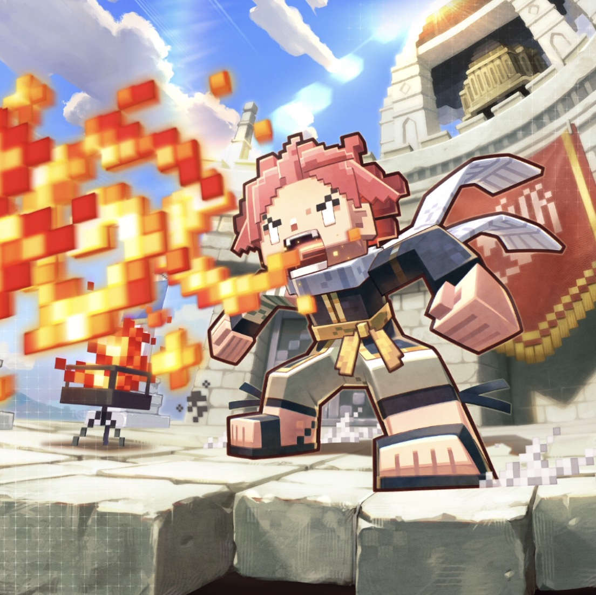

**Rarity:** UR

**Attribute:** 💚 Technique

**Class:** Melee

**Identity:** Natsu Dragneel

**Normal attack range:** Ranged

**Signature lacrima:** [[lacrimas/block-natsu-lacrima-f4724f58|✨ Block Natsu Lacrima]]

## Game text

### 🗡️ Normal Skill (Ranged)

Deals damage equal to 170% of ATK to the target. After the attack hits, has a 30% chance to inflict on the target for 3s: &#91;High&#93; Burn.

### 🗡️ Special Skill – Fire Dragon Slayer

After a normal skill hits, has a 30% chance to grant self for 5s: &#91;Top&#93; ATK Increase, &#91;Top&#93; Critical Damage Increase, and &#91;Top&#93; Shield.

### 💥 Ultimate – Roar of the Fire Dragon

Deals damage equal to 900% of ATK to targets within range every 10s. If the target is afflicted with Burn after the attack hits, applies to each target for 5s: &#91;Top&#93; ATK Decrease and &#91;Top&#93; Critical Damage Decrease.

## Effect applications

### High Burn
| Property | Value |
| --- | --- |
| Family | Burn |
| Target | Single Enemy |
| Activation | Normal SKill Hit |
| Chance | 30% |
| Duration | 3 sec |
| Value | 25 Percentage of Source ATK per second |
| Source skill | Normal Attack |

Deals damage equal to 170% of ATK to the target. After the attack hits, has a 30% chance to inflict on the target for 3s: &#91;High&#93; Burn.

### Top ATK Increase
| Property | Value |
| --- | --- |
| Family | ATK |
| Target | Self |
| Activation | Normal SKill Hit |
| Chance | 30% |
| Duration | 5 sec |
| Value | 30 Percent |
| Source skill | Special Skill |

After a normal skill hits, has a 30% chance to grant self for 5s: &#91;Top&#93; ATK Increase, &#91;Top&#93; Critical Damage Increase, and &#91;Top&#93; Shield.

### Top Critical Damage Increase
| Property | Value |
| --- | --- |
| Family | Critical Damage |
| Target | Self |
| Activation | Normal SKill Hit |
| Chance | 30% |
| Duration | 5 sec |
| Value | 50 Percent |
| Source skill | Special Skill |

After a normal skill hits, has a 30% chance to grant self for 5s: &#91;Top&#93; ATK Increase, &#91;Top&#93; Critical Damage Increase, and &#91;Top&#93; Shield.

### Top Shield
| Property | Value |
| --- | --- |
| Family | Shield |
| Target | Self |
| Activation | Normal SKill Hit |
| Chance | 30% |
| Duration | 5 sec |
| Value | 25 Percent of Max HP |
| Source skill | Special Skill |

After a normal skill hits, has a 30% chance to grant self for 5s: &#91;Top&#93; ATK Increase, &#91;Top&#93; Critical Damage Increase, and &#91;Top&#93; Shield.

### Top ATK Decrease
| Property | Value |
| --- | --- |
| Family | ATK |
| Target | Each Target Hit |
| Activation | Every 10 sec |
| Duration | 5 sec |
| Value | 30 Percent |
| Required effects | Burn |
| Match rule | Any |
| Condition subject | Target Hit |
| Evaluation timing | After Attack Hits |
| Required state | Present |
| Source skill | Ultimate |

Deals damage equal to 900% of ATK to targets within range every 10s. If the target is afflicted with Burn after the attack hits, applies to each target for 5s: &#91;Top&#93; ATK Decrease and &#91;Top&#93; Critical Damage Decrease.

### Top Critical Damage Decrease
| Property | Value |
| --- | --- |
| Family | Critical Damage |
| Target | Each Target Hit |
| Activation | Every 10 sec |
| Duration | 5 sec |
| Value | 50 Percent |
| Required effects | Burn |
| Match rule | Any |
| Condition subject | Target Hit |
| Evaluation timing | After Attack Hits |
| Required state | Present |
| Source skill | Ultimate |

Deals damage equal to 900% of ATK to targets within range every 10s. If the target is afflicted with Burn after the attack hits, applies to each target for 5s: &#91;Top&#93; ATK Decrease and &#91;Top&#93; Critical Damage Decrease.

Unspecified values remain unknown. Text is transcribed from game records; localization and entry errors may remain.
