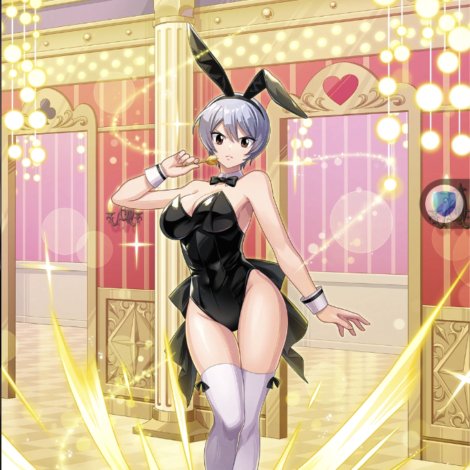

**Rarity:** UR

**Attribute:** 💛 Heart

**Class:** Ranged

**Identity:** Yukino Aguria

**Normal attack range:** Ranged

**Signature lacrima:** [[lacrimas/bunny-yukino-lacrima-f5fa8738|✨ Bunny Yukino Lacrima]]

## Game text

### 🗡️ Normal Skill (Ranged)

Deal damage equal to 160% of ATK to the target. After the attack hits, there is a 20% chance to grant yourself, for 3 seconds &#91;High&#93; ATK Increase.

### 🗡️ Special Skill – Bunny Enchant

After a normal skill hits, there is a 20% chance to grant all Heart-element allies, for 5 seconds, &#91;Top&#93; ATK Increase and &#91;Top&#93; DEF Increase, and advance the current Ultimate Skill Gauge by 0.7 seconds.

### 💥 Ultimate – Lucky Rapid Rain

Every 10 seconds, deal damage equal to 850% of ATK to enemies within the target area. After the attack hits, there is a 50% chance per target to apply, for 5 seconds, Silence.

## Effect applications

### High ATK Increase
| Property | Value |
| --- | --- |
| Family | ATK |
| Target | Self |
| Activation | Normal SKill Hit |
| Chance | 20% |
| Duration | 3 sec |
| Value | 25 Percent |
| Source skill | Normal Attack |

Deal damage equal to 160% of ATK to the target. After the attack hits, there is a 20% chance to grant yourself, for 3 seconds &#91;High&#93; ATK Increase.

### Top ATK Increase
| Property | Value |
| --- | --- |
| Family | ATK |
| Target | Heart Allies |
| Activation | Normal SKill Hit |
| Chance | 20% |
| Duration | 5 sec |
| Value | 30 Percent |
| Source skill | Special Skill |

After a normal skill hits, there is a 20% chance to grant all Heart-element allies, for 5 seconds, &#91;Top&#93; ATK Increase and &#91;Top&#93; DEF Increase, and advance the current Ultimate Skill Gauge by 0.7 seconds.

### Top DEF Increase
| Property | Value |
| --- | --- |
| Family | DEF |
| Target | Heart Allies |
| Activation | Normal SKill Hit |
| Chance | 20% |
| Duration | 5 sec |
| Value | 30 Percent |
| Source skill | Special Skill |

After a normal skill hits, there is a 20% chance to grant all Heart-element allies, for 5 seconds, &#91;Top&#93; ATK Increase and &#91;Top&#93; DEF Increase, and advance the current Ultimate Skill Gauge by 0.7 seconds.

### Advance Ultimate Skill Gauge
| Property | Value |
| --- | --- |
| Family | Ultimate Skill Gauge |
| Target | Current Ultimate Skill Gauge |
| Activation | Normal SKill Hit |
| Value | 0.7 Seconds |
### Silence
| Property | Value |
| --- | --- |
| Family | Silence |
| Target | Each Target Hit |
| Activation | Every 10 sec, After Attack Hits |
| Chance | 50% |
| Duration | 5 sec |
| Source skill | Ultimate |

Every 10 seconds, deal damage equal to 850% of ATK to enemies within the target area. After the attack hits, there is a 50% chance per target to apply, for 5 seconds, Silence.

Unspecified values remain unknown. Text is transcribed from game records; localization and entry errors may remain.
