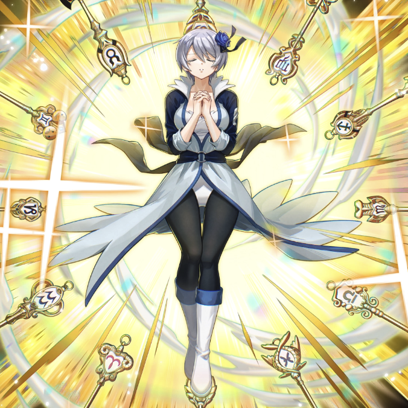

**Rarity:** UR

**Attribute:** 💚 Technique

**Class:** Ranged

**Identity:** Yukino Aguria

**Normal attack range:** Ranged

**Signature lacrima:** [[lacrimas/contractor-of-the-twelve-gates-yukino-lacrima-e3a2cc2e|✨ Contractor of the Twelve Gates Yukino Lacrima]]

## Game text

### 🗡️ Normal Skill (Ranged)

Deals 180% ATK damage to the target. When a critical hit occurs, grants all Technique-type allies &#91;High&#93; ATK Increase and &#91;High&#93; Critical Damage Increase for 3 sec.

### 🗡️ Special Skill – Unleashed Power of the Zodiac

After a normal skill hits, has a 30% chance to inflict Heal Block and &#91;Top&#93; Critical Resistance Decrease, &#91;Top&#93; DEF Decrease on the target for 5 sec.

### 💥 Ultimate – Zodiac

Every 10 sec, deals 1000% ATK damage to targets within range. Increases damage by 50% for each Technique-type ally (up to 350%). After the attack hits, has a 40% chance for each target to inflict &#91;Top&#93; Bleed and &#91;Top&#93; Burn, &#91;Top&#93; ATK Decrease for 5 sec.

## Effect applications

### High ATK Increase
| Property | Value |
| --- | --- |
| Family | ATK |
| Target | Technique Allies |
| Activation | Critical Hit |
| Duration | 3 sec |
| Value | 25 Percent |
| Source skill | Normal Attack |

Deals 180% ATK damage to the target. When a critical hit occurs, grants all Technique-type allies &#91;High&#93; ATK Increase and &#91;High&#93; Critical Damage Increase for 3 sec.

### High Critical Damage Increase
| Property | Value |
| --- | --- |
| Family | Critical Damage |
| Target | Technique Allies |
| Activation | Critical Hit |
| Duration | 3 sec |
| Value | 40 Percent |
| Source skill | Normal Attack |

Deals 180% ATK damage to the target. When a critical hit occurs, grants all Technique-type allies &#91;High&#93; ATK Increase and &#91;High&#93; Critical Damage Increase for 3 sec.

### Heal Block
| Property | Value |
| --- | --- |
| Family | Heal Block |
| Target | Single Enemy |
| Activation | Normal SKill Hit |
| Chance | 30% |
| Duration | 5 sec |
| Source skill | Special Skill |

After a normal skill hits, has a 30% chance to inflict Heal Block and &#91;Top&#93; Critical Resistance Decrease, &#91;Top&#93; DEF Decrease on the target for 5 sec.

### Top Critical Resistance Decrease
| Property | Value |
| --- | --- |
| Family | Critical Resistance |
| Target | Single Enemy |
| Activation | Normal SKill Hit |
| Chance | 30% |
| Duration | 5 sec |
| Value | 20 Percent |
| Source skill | Special Skill |

After a normal skill hits, has a 30% chance to inflict Heal Block and &#91;Top&#93; Critical Resistance Decrease, &#91;Top&#93; DEF Decrease on the target for 5 sec.

### Top DEF Decrease
| Property | Value |
| --- | --- |
| Family | DEF |
| Target | Single Enemy |
| Activation | Normal SKill Hit |
| Chance | 30% |
| Duration | 5 sec |
| Value | 30 Percent |
| Source skill | Special Skill |

After a normal skill hits, has a 30% chance to inflict Heal Block and &#91;Top&#93; Critical Resistance Decrease, &#91;Top&#93; DEF Decrease on the target for 5 sec.

### Top Bleed
| Property | Value |
| --- | --- |
| Family | Bleed |
| Target | Each Target Hit |
| Activation | Every 10 sec, After Attack Hits |
| Chance | 40% |
| Duration | 5 sec |
| Value | 40 Percent of ATK per sec |
| Source skill | Ultimate |

Every 10 sec, deals 1000% ATK damage to targets within range. Increases damage by 50% for each Technique-type ally (up to 350%). After the attack hits, has a 40% chance for each target to inflict &#91;Top&#93; Bleed and &#91;Top&#93; Burn, &#91;Top&#93; ATK Decrease for 5 sec.

### Top Burn
| Property | Value |
| --- | --- |
| Family | Burn |
| Target | Each Target Hit |
| Activation | Every 10 sec, After Attack Hits |
| Chance | 40% |
| Duration | 5 sec |
| Value | 30 Percent of ATK per sec |
| Source skill | Ultimate |

Every 10 sec, deals 1000% ATK damage to targets within range. Increases damage by 50% for each Technique-type ally (up to 350%). After the attack hits, has a 40% chance for each target to inflict &#91;Top&#93; Bleed and &#91;Top&#93; Burn, &#91;Top&#93; ATK Decrease for 5 sec.

### Top ATK Decrease
| Property | Value |
| --- | --- |
| Family | ATK |
| Target | Each Target Hit |
| Activation | Every 10 sec, After Attack Hits |
| Chance | 40% |
| Duration | 5 sec |
| Value | 30 Percent |
| Source skill | Ultimate |

Every 10 sec, deals 1000% ATK damage to targets within range. Increases damage by 50% for each Technique-type ally (up to 350%). After the attack hits, has a 40% chance for each target to inflict &#91;Top&#93; Bleed and &#91;Top&#93; Burn, &#91;Top&#93; ATK Decrease for 5 sec.

Unspecified values remain unknown. Text is transcribed from game records; localization and entry errors may remain.
