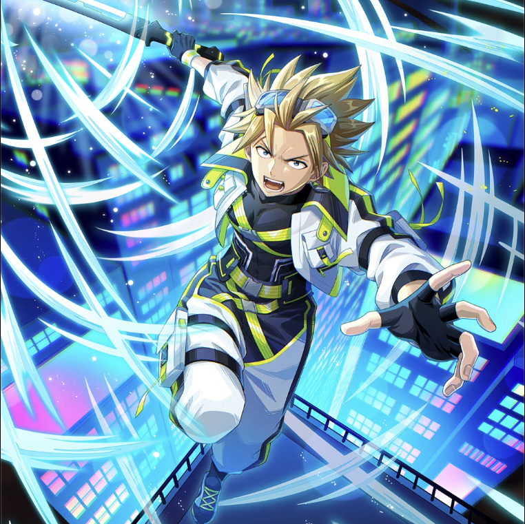

**Rarity:** UR

**Attribute:** 💚 Technique

**Class:** Melee

**Identity:** Sting Eucliffe

**Normal attack range:** Ranged

**Signature lacrima:** [[lacrimas/cyberpunk-sting-lacrima-08f3386f|✨ Cyberpunk Sting Lacrima]]

## Game text

### 🗡️ Normal Skill (Ranged)

Deal 160% ATK damage to the target. Aftet the attack hits, there is a 20% chance to grant yourself for 3 seconds, &#91;High&#93; Critical Rate Increase.

### 🗡️ Special Skill - Luminous Gear

While this unit is on the field, grants all Tech-type allies &#91;Top&#93; Critical Damage Increase and &#91;Top&#93; Accuracy Increase.

### 💥 Ultimate - Dragon Sync Photon Slash

Deals damage equal to 850% of ATK to enemies within the target area every 11 seconds. After the attack hits, grants self for 5 seconds: &#91;Top&#93; Shield and &#91;Top&#93; ATK Increase.

## Effect applications

### High Critical Rate Increase
| Property | Value |
| --- | --- |
| Family | Critical Rate |
| Target | Self |
| Activation | Normal SKill Hit |
| Chance | 20% |
| Duration | 3 sec |
| Value | 15 Percent |
| Source skill | Normal Attack |

Deal 160% ATK damage to the target. Aftet the attack hits, there is a 20% chance to grant yourself for 3 seconds, &#91;High&#93; Critical Rate Increase.

### Top Critical Damage Increase
| Property | Value |
| --- | --- |
| Family | Critical Damage |
| Target | Technique Allies |
| Activation | While Unit is on the Field |
| Value | 50 Percent |
| Source skill | Special Skill |

While this unit is on the field, grants all Tech-type allies &#91;Top&#93; Critical Damage Increase and &#91;Top&#93; Accuracy Increase.

### Top Accuracy Increase
| Property | Value |
| --- | --- |
| Family | Accuracy |
| Target | Technique Allies |
| Activation | While Unit is on the Field |
| Value | 20 Percent |
| Source skill | Special Skill |

While this unit is on the field, grants all Tech-type allies &#91;Top&#93; Critical Damage Increase and &#91;Top&#93; Accuracy Increase.

### Top Shield
| Property | Value |
| --- | --- |
| Family | Shield |
| Target | Self |
| Activation | Every 11 sec, After Attack Hits |
| Duration | 5 sec |
| Value | 25 Percent of Max HP |
| Source skill | Ultimate |

Deals damage equal to 850% of ATK to enemies within the target area every 11 seconds. After the attack hits, grants self for 5 seconds: &#91;Top&#93; Shield and &#91;Top&#93; ATK Increase.

### Top ATK Increase
| Property | Value |
| --- | --- |
| Family | ATK |
| Target | Self |
| Activation | Every 11 sec, After Attack Hits |
| Duration | 5 sec |
| Value | 30 Percent |
| Source skill | Ultimate |

Deals damage equal to 850% of ATK to enemies within the target area every 11 seconds. After the attack hits, grants self for 5 seconds: &#91;Top&#93; Shield and &#91;Top&#93; ATK Increase.

Unspecified values remain unknown. Text is transcribed from game records; localization and entry errors may remain.
