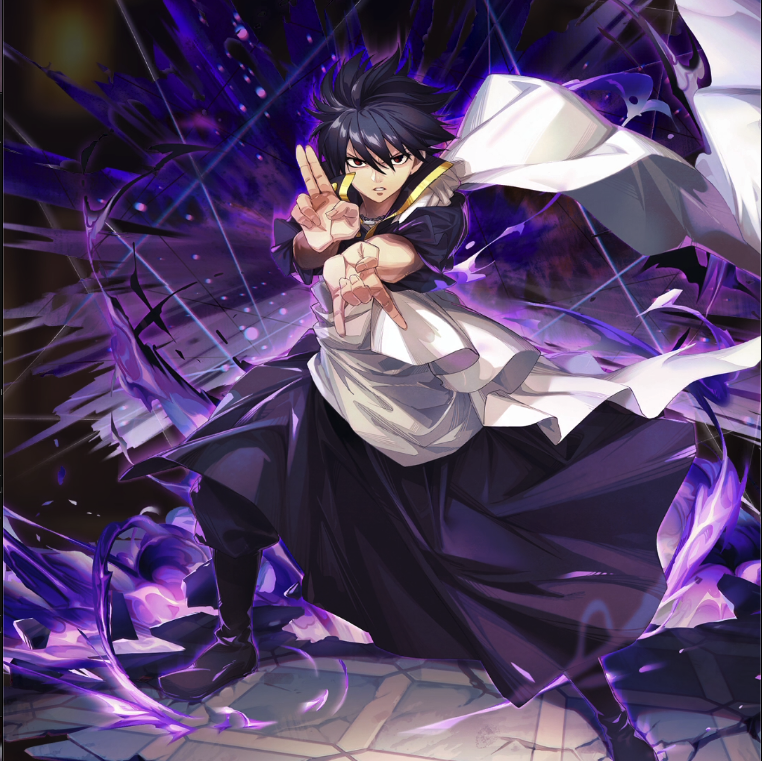

**Rarity:** UR

**Attribute:** 💚 Technique

**Class:** Disrupt

**Identity:** Zeref Dragneel

**Normal attack range:** Ranged

**Signature lacrima:** [[lacrimas/dark-mage-zeref-lacrima-0a1a092e|✨ Dark Mage Zeref Lacrima]]

## Game text

### 🗡️ Normal Skill (Ranged)

Deals 150% ATK damage to the target. After hitting, 20% chance to inflict 1s of Bind.

### 🗡️ Special Skill - Deadly Predation

After a normal skill hits, there is a 20% chance to deal damage equal to 200% of ATK to all enemies. After the attack hits, there is a 50% chance to inflict for 5 sec &#91;Top&#93; Bleed on each target.

### 💥 Ultimate - Repent

Every 11 sec, deal damage equal to 850% of ATK to enemies within the target area. After the attack hits, if the target is in Bleed status, inflict on the target for 5 sec &#91;Top&#93; DEF Decrease, &#91;Top&#93; Critical Defense Decrease, &#91;Top&#93; Evasion Decrease and Bind.

## Effect applications

### Bind
| Property | Value |
| --- | --- |
| Family | Bind |
| Target | Single Enemy |
| Activation | Normal SKill Hit |
| Chance | 20% |
| Duration | 1 sec |
| Source skill | Normal Attack |

Deals 150% ATK damage to the target. After hitting, 20% chance to inflict 1s of Bind.

### Top Bleed
| Property | Value |
| --- | --- |
| Family | Bleed |
| Target | Each Target Hit |
| Activation | Special Skill Hit |
| Chance | 50% |
| Parent skill chance | 20% |
| Duration | 5 sec |
| Value | 40 Percent of ATK per sec |
| Condition | Requires Deadly Predation to trigger (20% chance after a Normal Skill hit). |
| Source skill | Special Skill |

After the attack hits, there is a 50% chance to inflict for 5 sec &#91;Top&#93; Bleed on each target.

### Top Critical Defense Decrease
| Property | Value |
| --- | --- |
| Family | Critical Defense |
| Target | Each Target Hit |
| Activation | Every 11 sec, After Attack Hits |
| Duration | 5 sec |
| Value | 50 Percent |
| Required effects | Bleed |
| Match rule | Any |
| Condition subject | Target Hit |
| Evaluation timing | After Attack Hits |
| Required state | Present |
### Top DEF Decrease
| Property | Value |
| --- | --- |
| Family | DEF |
| Target | Each Target Hit |
| Activation | Every 11 sec, After Attack Hits |
| Duration | 5 sec |
| Value | 30 Percent |
| Required effects | Bleed |
| Match rule | Any |
| Condition subject | Target Hit |
| Evaluation timing | After Attack Hits |
| Required state | Present |
### Top Evasion Decrease
| Property | Value |
| --- | --- |
| Family | Evasion |
| Target | Each Target Hit |
| Activation | Every 11 sec, After Attack Hits |
| Duration | 5 sec |
| Value | 20 Percent |
| Required effects | Bleed |
| Match rule | Any |
| Condition subject | Target Hit |
| Evaluation timing | After Attack Hits |
| Required state | Present |
### Bind
| Property | Value |
| --- | --- |
| Family | Bind |
| Target | Each Target Hit |
| Activation | Every 11 sec, After Attack Hits |
| Duration | 5 sec |
| Required effects | Bleed |
| Match rule | Any |
| Condition subject | Target Hit |
| Evaluation timing | After Attack Hits |
| Required state | Present |

Every 11 sec... After the attack hits, the target is in Bleed status. inflict on the target for 5 sec...and Bind.

Unspecified values remain unknown. Text is transcribed from game records; localization and entry errors may remain.
