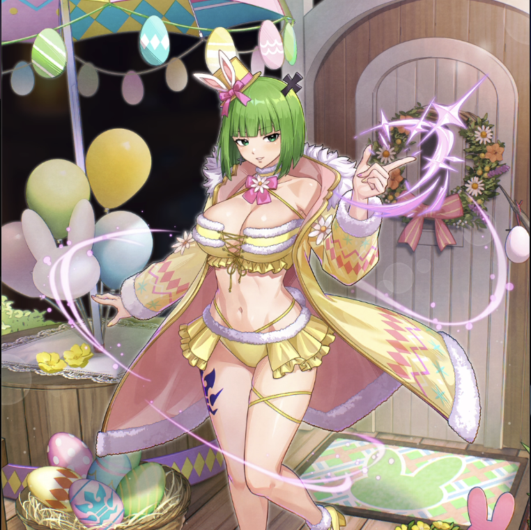

**Rarity:** UR

**Attribute:** 💛 Heart

**Class:** Melee

**Identity:** Brandish

**Normal attack range:** Ranged

**Signature lacrima:** [[lacrimas/egg-hunt-brandish-lacrima-dafb2d57|✨ Egg Hunt Brandish Lacrima]]

## Game text

### 🗡️ Normal Skill (Ranged)

Deals damage equal to 150% of ATK to the target. After the attack hits, there is a 20% chance to inflict Silence on the target for 2 sec.

### 🗡️ Special Skill - Egg Diminish

After a normal skill hits, if enemies within the target area are affected by Silence, there is a 5 sec effect applied to each enemy: &#91;Top&#93; Critical Resistance Decrease, &#91;Top&#93; Critical Defense Decrease, and Heal Block.

### 💥 Ultimate - Command of T Ultra Expand

Deals damage equal to 800% of ATK to all enemies every 9 sec. After the atttack hits, there is a 40% chance for each target to inflict Silence and &#91;Top&#93; ATK Decrease for 5 sec.

## Effect applications

### Top Critical Resistance Decrease
| Property | Value |
| --- | --- |
| Family | Critical Resistance |
| Target | Enemies in Target Area |
| Activation | Normal SKill Hit |
| Duration | 5 sec |
| Value | 20 Percent |
| Required effects | Silence |
| Match rule | Any |
| Condition subject | Target Hit |
| Evaluation timing | After Attack Hits |
| Required state | Present |
### Top Critical Defense Decrease
| Property | Value |
| --- | --- |
| Family | Critical Defense |
| Target | Enemies in Target Area |
| Activation | Normal SKill Hit |
| Duration | 5 sec |
| Value | 50 Percent |
| Required effects | Silence |
| Match rule | Any |
| Condition subject | Target Hit |
| Evaluation timing | After Attack Hits |
| Required state | Present |

After normal skill hits, if enemies within the target area are affected by Silence, there is a 5 sec effect applied to each enemy: &#91;Top&#93; Critical Defense Decrease...

### Heal Block
| Property | Value |
| --- | --- |
| Family | Heal Block |
| Target | Enemies in Target Area |
| Activation | Normal SKill Hit, After Attack Hits |
| Duration | 5 sec |
| Required effects | Silence |
| Match rule | Any |
| Condition subject | Target Hit |
| Evaluation timing | After Attack Hits |
| Required state | Present |

Enemy within target area is affected by Silence

### Silence
| Property | Value |
| --- | --- |
| Family | Silence |
| Target | Each Target Hit |
| Activation | Every 9 sec, After Attack Hits |
| Chance | 40% |
| Duration | 5 sec |
| Source skill | Ultimate |

Deals damage equal to 800% of ATK to all enemies every 9 sec. After the atttack hits, there is a 40% chance for each target to inflict Silence and &#91;Top&#93; ATK Decrease for 5 sec.

### Top ATK Decrease
| Property | Value |
| --- | --- |
| Family | ATK |
| Target | Each Target Hit |
| Activation | Every 9 sec, After Attack Hits |
| Chance | 40% |
| Duration | 5 sec |
| Value | 30 Percent |
| Source skill | Ultimate |

Deals damage equal to 800% of ATK to all enemies every 9 sec. After the atttack hits, there is a 40% chance for each target to inflict Silence and &#91;Top&#93; ATK Decrease for 5 sec.

Unspecified values remain unknown. Text is transcribed from game records; localization and entry errors may remain.
