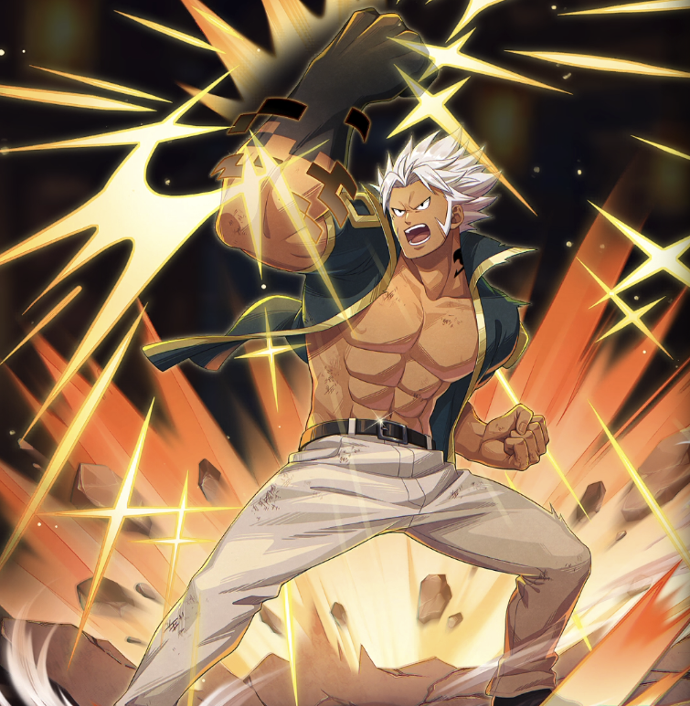

**Rarity:** UR

**Attribute:** ❤️ Brave

**Class:** Defense

**Identity:** Elfman Strauss

**Signature lacrima:** [[lacrimas/elfman-lacrima-be032f64|✨ Elfman Lacrima]]

## Game text

### 🗡️ Normal Skill

Deal 130% ATK damage to the target.

### 🗡️ Special Skill - He&#x27;s a Real Man!!

When a critical hit occurs, for 4 sec, taunt enemies around the target with Taunt, and grant yourself for 4 sec &#91;High&#93; DEF Increase.

### 💥 Ultimate – Beast Arm Black Bull

Every 9 sec, deal damage equal to 1000% of ATK to the target. After the attack hits, grant yourself for 5 sec &#91;High&#93; DEF Increase.

## Effect applications

### Taunt
| Property | Value |
| --- | --- |
| Family | Taunt |
| Target | Enemies Around Target |
| Activation | Critical Hit |
| Duration | 4 sec |
| Source skill | Special Skill |

When a critical hit occurs, for 4 sec, taunt enemies around the target with Taunt, and grant yourself for 4 sec &#91;High&#93; DEF Increase.

### High DEF Increase
| Property | Value |
| --- | --- |
| Family | DEF |
| Target | Self |
| Activation | Critical Hit |
| Duration | 4 sec |
| Value | 25 Percent |
| Source skill | Special Skill |

When a critical hit occurs, for 4 sec, taunt enemies around the target with Taunt, and grant yourself for 4 sec &#91;High&#93; DEF Increase.

### High DEF Increase
| Property | Value |
| --- | --- |
| Family | DEF |
| Target | Self |
| Activation | Every 9 sec, After Attack Hits |
| Duration | 5 sec |
| Value | 25 Percent |
| Source skill | Ultimate |

Every 9 sec, deal damage equal to 1000% of ATK to the target. After the attack hits, grant yourself for 5 sec &#91;High&#93; DEF Increase.

Unspecified values remain unknown. Text is transcribed from game records; localization and entry errors may remain.
