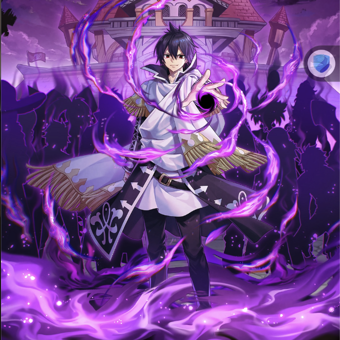

**Rarity:** UR

**Attribute:** 💛 Heart

**Class:** Melee

**Identity:** Zeref Dragneel

**Normal attack range:** Ranged

**Signature lacrima:** [[lacrimas/emperor-spriggan-zeref-lacrima-c5d240e5|✨ Emperor Spriggan Zeref Lacrima]]

## Game text

### 🗡️ Normal Skill (Ranged)

Deals 190% ATK damage to the target. After the attack hits, has a 30% chance to restore own HP by 600% of ATK and grants &#91;Top&#93; DEF Increase for 3 sec.

### 🗡️ Special Skill – Death Wave

After a normal skill hits, has a 30% chance to deal 400% damage to targets within range. If the target is affected by Burn, Paralysis, Silence, or Blind when the attack hits, deals and additional 400% ATK damage and inflicts &#91;Top&#93; ATK Decrease and &#91;Top&#93; Critical Rate Decrease for 5 sec.

### 💥 Ultimate – Ankhseram Black Palm

Deals damage equal to 1050% of ATK to all enemies every 8 sec. After the attack hits, inflicts Blind and Heal Block on the target for 5 sec., and removes all buffs from the target.

## Effect applications

### Heal
| Property | Value |
| --- | --- |
| Family | Heal |
| Target | Self |
| Activation | Normal SKill Hit |
| Chance | 30% |
| Value | 600 Percent of own ATK |
| Source skill | Normal Attack |

Deals 190% ATK damage to the target. After the attack hits, has a 30% chance to restore own HP by 600% of ATK and grants &#91;Top&#93; DEF Increase for 3 sec.

### Top DEF Increase
| Property | Value |
| --- | --- |
| Family | DEF |
| Target | Self |
| Activation | Normal SKill Hit |
| Chance | 30% |
| Duration | 3 sec |
| Value | 30 Percent |
| Source skill | Normal Attack |

Deals 190% ATK damage to the target. After the attack hits, has a 30% chance to restore own HP by 600% of ATK and grants &#91;Top&#93; DEF Increase for 3 sec.

### Additional Damage
| Property | Value |
| --- | --- |
| Family | Damage |
| Target | Each Target Hit |
| Activation | Special Skill Hit |
| Parent skill chance | 30% |
| Value | 400 Percent of own ATK |
| Required effects | Burn, Paralysis, Silence, Blind |
| Match rule | Any |
| Condition subject | Target Hit |
| Evaluation timing | At Attack Hit |
| Required state | Present |
| Source skill | Special Skill |

After a normal skill hits, has a 30% chance to deal 400% damage to targets within range. If the target is affected by Burn, Paralysis, Silence, or Blind when the attack hits, deals and additional 400% ATK damage and inflicts &#91;Top&#93; ATK Decrease and &#91;Top&#93; Critical Rate Decrease for 5 sec.

### Top ATK Decrease
| Property | Value |
| --- | --- |
| Family | ATK |
| Target | Each Target Hit |
| Activation | Special Skill Hit |
| Parent skill chance | 30% |
| Duration | 5 sec |
| Value | 30 Percent |
| Required effects | Burn, Paralysis, Silence, Blind |
| Match rule | Any |
| Condition subject | Target Hit |
| Evaluation timing | At Attack Hit |
| Required state | Present |
| Source skill | Special Skill |

After a normal skill hits, has a 30% chance to deal 400% damage to targets within range. If the target is affected by Burn, Paralysis, Silence, or Blind when the attack hits, deals and additional 400% ATK damage and inflicts &#91;Top&#93; ATK Decrease and &#91;Top&#93; Critical Rate Decrease for 5 sec.

### Top Critical Rate Decrease
| Property | Value |
| --- | --- |
| Family | Critical Rate |
| Target | Each Target Hit |
| Activation | Special Skill Hit |
| Parent skill chance | 30% |
| Duration | 5 sec |
| Value | 20 Percent |
| Required effects | Burn, Paralysis, Silence, Blind |
| Match rule | Any |
| Condition subject | Target Hit |
| Evaluation timing | At Attack Hit |
| Required state | Present |
| Source skill | Special Skill |

After a normal skill hits, has a 30% chance to deal 400% damage to targets within range. If the target is affected by Burn, Paralysis, Silence, or Blind when the attack hits, deals and additional 400% ATK damage and inflicts &#91;Top&#93; ATK Decrease and &#91;Top&#93; Critical Rate Decrease for 5 sec.

### Blind
| Property | Value |
| --- | --- |
| Family | Blind |
| Target | Each Target Hit |
| Activation | Every 8 sec, After Attack Hits |
| Duration | 5 sec |
| Source skill | Ultimate |

Deals damage equal to 1050% of ATK to all enemies every 8 sec. After the attack hits, inflicts Blind and Heal Block on the target for 5 sec., and removes all buffs from the target.

### Heal Block
| Property | Value |
| --- | --- |
| Family | Heal Block |
| Target | Each Target Hit |
| Activation | Every 8 sec, After Attack Hits |
| Duration | 5 sec |
| Source skill | Ultimate |

Deals damage equal to 1050% of ATK to all enemies every 8 sec. After the attack hits, inflicts Blind and Heal Block on the target for 5 sec., and removes all buffs from the target.

### Removes All Buffs
| Property | Value |
| --- | --- |
| Family | Cleanse |
| Target | Each Target Hit |
| Activation | Every 8 sec, After Attack Hits |
| Source skill | Ultimate |

Deals damage equal to 1050% of ATK to all enemies every 8 sec. After the attack hits, inflicts Blind and Heal Block on the target for 5 sec., and removes all buffs from the target.

Unspecified values remain unknown. Text is transcribed from game records; localization and entry errors may remain.
