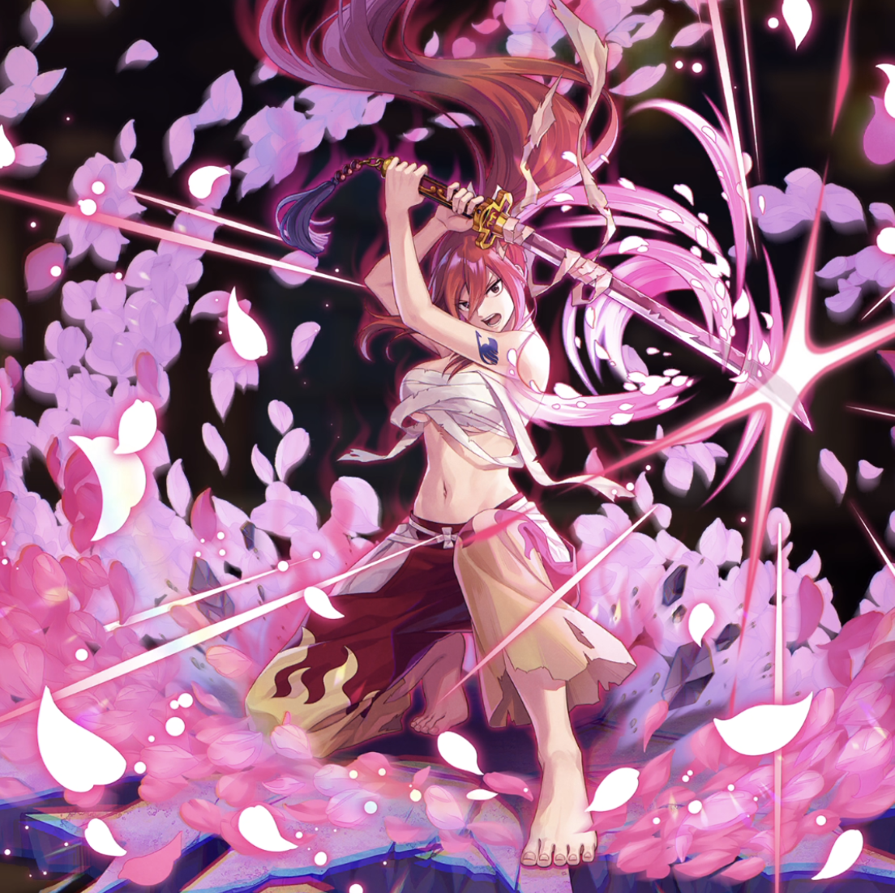

**Rarity:** UR

**Attribute:** 💛 Heart

**Class:** Melee

**Identity:** Erza Scarlet

**Normal attack range:** Ranged

**Signature lacrima:** [[lacrimas/erza-demon-blade-benizakura-lacrima-48166ff7|✨ Erza -Demon Blade Benizakura- Lacrima]]

## Game text

### 🗡️ Normal Skill (Ranged)

Deals 170% ATK damage to the target. After the attack hits, there is a 30% chance to grant yourself for 3s &#91;High&#93; ATK Increase.

### 🗡️ Special Skill – Titania&#x27;s Command

While you are on the field, all allies with Heart attribute gain &#91;Top&#93; ATK Increase, &#91;Top&#93; Critical Damage Increase, &#91;Top&#93; Accuracy Increase, and &#91;High&#93; DEF Decrease.

### 💥 Ultimate – Demon Blade Benizakura Flash

Deals 900% ATK damage to targets within range every 10s. After the attack hits, there is a 50% chance to apply for 5s to each target: &#91;Top&#93; Bleed and Silence.

## Effect applications

### High ATK Increase
| Property | Value |
| --- | --- |
| Family | ATK |
| Target | Self |
| Activation | Normal SKill Hit |
| Chance | 30% |
| Duration | 3 sec |
| Value | 25 Percent |
| Source skill | Normal Attack |

Deals 170% ATK damage to the target. After the attack hits, there is a 30% chance to grant yourself for 3s &#91;High&#93; ATK Increase.

### Top ATK Increase
| Property | Value |
| --- | --- |
| Family | ATK |
| Target | Heart Allies |
| Activation | While Unit is on the Field |
| Value | 30 Percent |
| Source skill | Special Skill |

While you are on the field, all allies with Heart attribute gain &#91;Top&#93; ATK Increase, &#91;Top&#93; Critical Damage Increase, &#91;Top&#93; Accuracy Increase, and &#91;High&#93; DEF Decrease.

### Top Critical Damage Increase
| Property | Value |
| --- | --- |
| Family | Critical Damage |
| Target | Heart Allies |
| Activation | While Unit is on the Field |
| Value | 50 Percent |
| Source skill | Special Skill |

While you are on the field, all allies with Heart attribute gain &#91;Top&#93; ATK Increase, &#91;Top&#93; Critical Damage Increase, &#91;Top&#93; Accuracy Increase, and &#91;High&#93; DEF Decrease.

### Top Accuracy Increase
| Property | Value |
| --- | --- |
| Family | Accuracy |
| Target | Heart Allies |
| Activation | While Unit is on the Field |
| Value | 20 Percent |
| Source skill | Special Skill |

While you are on the field, all allies with Heart attribute gain &#91;Top&#93; ATK Increase, &#91;Top&#93; Critical Damage Increase, &#91;Top&#93; Accuracy Increase, and &#91;High&#93; DEF Decrease.

### High DEF Increase
| Property | Value |
| --- | --- |
| Family | DEF |
| Target | Heart Allies |
| Activation | While Unit is on the Field |
| Value | 25 Percent |
| Source skill | Special Skill |

While you are on the field, all allies with Heart attribute gain &#91;Top&#93; ATK Increase, &#91;Top&#93; Critical Damage Increase, &#91;Top&#93; Accuracy Increase, and &#91;High&#93; DEF Decrease.

### Top Bleed
| Property | Value |
| --- | --- |
| Family | Bleed |
| Target | Each Target Hit |
| Activation | Every 10 sec, After Attack Hits |
| Chance | 50% |
| Duration | 5 sec |
| Value | 40 Percent of ATK per sec |
| Source skill | Ultimate |

After a successful hit, has a 50% chance to inflict for 5 sec &#91;Top&#93; Bleed on each target for 5 seconds

### Silence
| Property | Value |
| --- | --- |
| Family | Silence |
| Target | Each Target Hit |
| Activation | Every 10 sec, After Attack Hits |
| Chance | 50% |
| Duration | 5 sec |
| Source skill | Ultimate |

Deals 900% ATK damage to targets within range every 10s. After the attack hits, there is a 50% chance to apply for 5s to each target: &#91;Top&#93; Bleed and Silence.

Unspecified values remain unknown. Text is transcribed from game records; localization and entry errors may remain.
