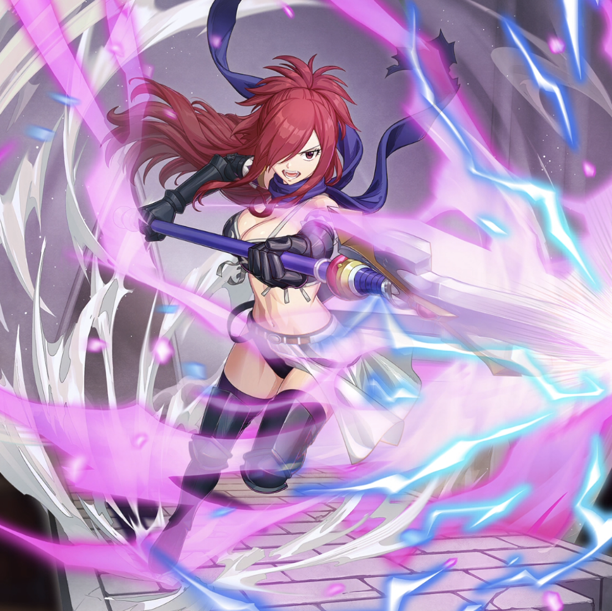

**Rarity:** UR

**Attribute:** 💛 Heart

**Class:** Defense

**Identity:** Erza Knightwalker

**Normal attack range:** Ranged

**Signature lacrima:** [[lacrimas/erza-knightwalker-lacrima-059f8bfa|✨ Erza Knightwalker Lacrima]]

## Game text

### 🗡️ Normal Skill (Ranged)

Deals 130% ATK damage to the target. After the attack hits, has a 30% chance to grant self for 3 seconds: &#91;High&#93; DEF Increase and &#91;High&#93; Critical Defense Increase.

### 🗡️ Special Skill – Spear Mage

While on the field, grants all Heart allies: &#91;Top&#93; DEF Increase and &#91;Top&#93; Critical Resistance Increase.

### 💥 Ultimate – Saint Spear, Ravelt

Deals 850% ATK damage to enemies within range every 9 seconds. After the attack hits,  grants self for 7 seconds: &#91;Top&#93; Shield, &#91;Top&#93; ATK Increase, and &#91;Top&#93; DEF Increase. Additionally, has a 50% chance to grant each ally for 5 seconds: &#91;Top&#93; ATK Increase and &#91;Top&#93; Shield.

## Effect applications

### High DEF Increase
| Property | Value |
| --- | --- |
| Family | DEF |
| Target | Self |
| Activation | Normal SKill Hit |
| Chance | 30% |
| Duration | 3 sec |
| Value | 25 Percent |
| Source skill | Normal Attack |

After the attack hits, has a 30% chance to grant self for 3 seconds &#91;High&#93; DEF Increase...

### High Critical Defense Increase
| Property | Value |
| --- | --- |
| Family | Critical Defense |
| Target | Self |
| Activation | Normal SKill Hit |
| Chance | 30% |
| Duration | 3 sec |
| Value | 40 Percent |
| Source skill | Normal Attack |

Deals 130% ATK damage to the target. After the attack hits, has a 30% chance to grant self for 3 seconds: &#91;High&#93; DEF Increase and &#91;High&#93; Critical Defense Increase.

### Top DEF Increase
| Property | Value |
| --- | --- |
| Family | DEF |
| Target | Heart Allies |
| Activation | While Unit is on the Field |
| Value | 30 Percent |
| Source skill | Special Skill |

While on the field, grants all Heart allies: &#91;Top&#93; DEF Increase and &#91;Top&#93; Critical Resistance Increase.

### Top Critical Resistance Increase
| Property | Value |
| --- | --- |
| Family | Critical Resistance |
| Target | Heart Allies |
| Activation | While Unit is on the Field |
| Value | 20 Percent |
| Source skill | Special Skill |

While on the field, grants all Heart allies: &#91;Top&#93; DEF Increase and &#91;Top&#93; Critical Resistance Increase.

### Top Shield
| Property | Value |
| --- | --- |
| Family | Shield |
| Target | Self |
| Activation | Every 9 sec, After Attack Hits |
| Duration | 7 sec |
| Value | 25 Percent of Max HP |
| Source skill | Ultimate |

Deals 850% ATK damage to enemies within range every 9 seconds. After the attack hits,  grants self for 7 seconds: &#91;Top&#93; Shield, &#91;Top&#93; ATK Increase, and &#91;Top&#93; DEF Increase. Additionally, has a 50% chance to grant each ally for 5 seconds: &#91;Top&#93; ATK Increase and &#91;Top&#93; Shield.

### Top ATK Increase
| Property | Value |
| --- | --- |
| Family | ATK |
| Target | Self |
| Activation | Every 9 sec, After Attack Hits |
| Duration | 7 sec |
| Value | 30 Percent |
| Source skill | Ultimate |

Deals 850% ATK damage to enemies within range every 9 seconds. After the attack hits,  grants self for 7 seconds: &#91;Top&#93; Shield, &#91;Top&#93; ATK Increase, and &#91;Top&#93; DEF Increase. Additionally, has a 50% chance to grant each ally for 5 seconds: &#91;Top&#93; ATK Increase and &#91;Top&#93; Shield.

### Top DEF Increase
| Property | Value |
| --- | --- |
| Family | DEF |
| Target | Self |
| Activation | Every 9 sec, After Attack Hits |
| Duration | 7 sec |
| Value | 30 Percent |
| Source skill | Ultimate |

Deals 850% ATK damage to enemies within range every 9 seconds. After the attack hits,  grants self for 7 seconds: &#91;Top&#93; Shield, &#91;Top&#93; ATK Increase, and &#91;Top&#93; DEF Increase. Additionally, has a 50% chance to grant each ally for 5 seconds: &#91;Top&#93; ATK Increase and &#91;Top&#93; Shield.

### Top Shield
| Property | Value |
| --- | --- |
| Family | Shield |
| Target | All Allies |
| Activation | Every 9 sec, After Attack Hits |
| Chance | 50% |
| Duration | 5 sec |
| Value | 25 Percent of Max HP |
| Source skill | Ultimate |

Deals 850% ATK damage to enemies within range every 9 seconds. After the attack hits,  grants self for 7 seconds: &#91;Top&#93; Shield, &#91;Top&#93; ATK Increase, and &#91;Top&#93; DEF Increase. Additionally, has a 50% chance to grant each ally for 5 seconds: &#91;Top&#93; ATK Increase and &#91;Top&#93; Shield.

### Top ATK Increase
| Property | Value |
| --- | --- |
| Family | ATK |
| Target | All Allies |
| Activation | Every 9 sec, After Attack Hits |
| Chance | 50% |
| Duration | 5 sec |
| Value | 30 Percent |
| Source skill | Ultimate |

Deals 850% ATK damage to enemies within range every 9 seconds. After the attack hits,  grants self for 7 seconds: &#91;Top&#93; Shield, &#91;Top&#93; ATK Increase, and &#91;Top&#93; DEF Increase. Additionally, has a 50% chance to grant each ally for 5 seconds: &#91;Top&#93; ATK Increase and &#91;Top&#93; Shield.

Unspecified values remain unknown. Text is transcribed from game records; localization and entry errors may remain.
