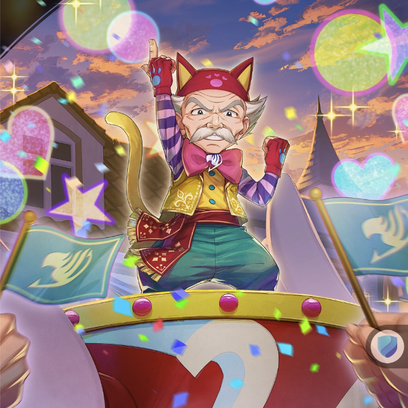

**Rarity:** UR

**Attribute:** 💛 Heart

**Class:** Heal

**Identity:** Makarov Dreyar

**Normal attack range:** Ranged

**Signature lacrima:** [[lacrimas/fairy-harvest-festival-makarov-lacrima-2ea9a551|✨ Fairy Harvest Festival Makarov Lacrima]]

## Game text

### 🗡️ Normal Skill (Ranged)

Deals 150% ATK damage to the target. After the attack hits, restores the HP of the ally with the lowest HP by 150% of own ATK.

### 🗡️ Special Skill - Grand Harvest Feast

Every 7 sec, grants all allies &#91;Top&#93; ATK Increase and &#91;Top&#93; Critical Damage Increase for 5 sec, and advances the current Ultimate Skill Gauge by 0.9 sec.

### 💥 Ultimate – Fairy Fantasia

Every 11 sec, restores all allies HP by 1000% of Own ATK. increases the healing amount by 50% for each Heart-type ally (up to 350%). Also grants targets &#91;Top&#93; Shield and &#91;Top&#93; Continuous Healing, &#91;Top&#93; Critical Rate Increase for 5 sec, and removes all debuffs from all allies.

## Effect applications

### Heal
| Property | Value |
| --- | --- |
| Family | Heal |
| Target | Lowest HP Ally |
| Activation | Normal SKill Hit |
| Value | 150 Percent of own ATK |
| Source skill | Normal Attack |

Deals 150% ATK damage to the target. After the attack hits, restores the HP of the ally with the lowest HP by 150% of own ATK.

### Top ATK Increase
| Property | Value |
| --- | --- |
| Family | ATK |
| Target | All Allies |
| Activation | Every 7 sec |
| Duration | 5 sec |
| Value | 30 Percent |
| Source skill | Special Skill |

Every 7 sec, grants all allies &#91;Top&#93; ATK Increase and &#91;Top&#93; Critical Damage Increase for 5 sec, and advances the current Ultimate Skill Gauge by 0.9 sec.

### Top Critical Damage Increase
| Property | Value |
| --- | --- |
| Family | Critical Damage |
| Target | All Allies |
| Activation | Every 7 sec |
| Duration | 5 sec |
| Value | 50 Percent |
| Source skill | Special Skill |

Every 7 sec, grants all allies &#91;Top&#93; ATK Increase and &#91;Top&#93; Critical Damage Increase for 5 sec, and advances the current Ultimate Skill Gauge by 0.9 sec.

### Advance Ultimate Skill Gauge
| Property | Value |
| --- | --- |
| Family | Ultimate Skill Gauge |
| Target | Current Ultimate Skill Gauge |
| Activation | Every 7 sec |
| Value | 0.9 Seconds |
| Source skill | Special Skill |

Every 7 sec, grants all allies &#91;Top&#93; ATK Increase and &#91;Top&#93; Critical Damage Increase for 5 sec, and advances the current Ultimate Skill Gauge by 0.9 sec.

### Heal
| Property | Value |
| --- | --- |
| Family | Heal |
| Target | All Allies |
| Activation | Every 11 sec |
| Value | 1000 Percent of own ATK |
| Source skill | Ultimate |

Every 11 sec, restores all allies HP by 1000% of Own ATK. increases the healing amount by 50% for each Heart-type ally (up to 350%). Also grants targets &#91;Top&#93; Shield and &#91;Top&#93; Continuous Healing, &#91;Top&#93; Critical Rate Increase for 5 sec, and removes all debuffs from all allies.

### Top Shield
| Property | Value |
| --- | --- |
| Family | Shield |
| Target | All Allies |
| Activation | Every 11 sec |
| Duration | 5 sec |
| Value | 25 Percent of Max HP |
| Source skill | Ultimate |

Every 11 sec, restores all allies HP by 1000% of Own ATK. increases the healing amount by 50% for each Heart-type ally (up to 350%). Also grants targets &#91;Top&#93; Shield and &#91;Top&#93; Continuous Healing, &#91;Top&#93; Critical Rate Increase for 5 sec, and removes all debuffs from all allies.

### Top Continuous Heal
| Property | Value |
| --- | --- |
| Family | Heal |
| Target | All Allies |
| Activation | Every 11 sec |
| Duration | 5 sec |
| Value | 120 Percent of ATK per sec |
| Source skill | Ultimate |

Every 11 sec, restores all allies HP by 1000% of Own ATK. increases the healing amount by 50% for each Heart-type ally (up to 350%). Also grants targets &#91;Top&#93; Shield and &#91;Top&#93; Continuous Healing, &#91;Top&#93; Critical Rate Increase for 5 sec, and removes all debuffs from all allies.

### Top Critical Rate Increase
| Property | Value |
| --- | --- |
| Family | Critical Rate |
| Target | All Allies |
| Activation | Every 11 sec |
| Duration | 5 sec |
| Value | 20 Percent |
| Source skill | Ultimate |

Every 11 sec, restores all allies HP by 1000% of Own ATK. increases the healing amount by 50% for each Heart-type ally (up to 350%). Also grants targets &#91;Top&#93; Shield and &#91;Top&#93; Continuous Healing, &#91;Top&#93; Critical Rate Increase for 5 sec, and removes all debuffs from all allies.

### Remove All Debuffs
| Property | Value |
| --- | --- |
| Family | Cleanse |
| Target | All Allies |
| Activation | Every 11 sec |

Unspecified values remain unknown. Text is transcribed from game records; localization and entry errors may remain.
