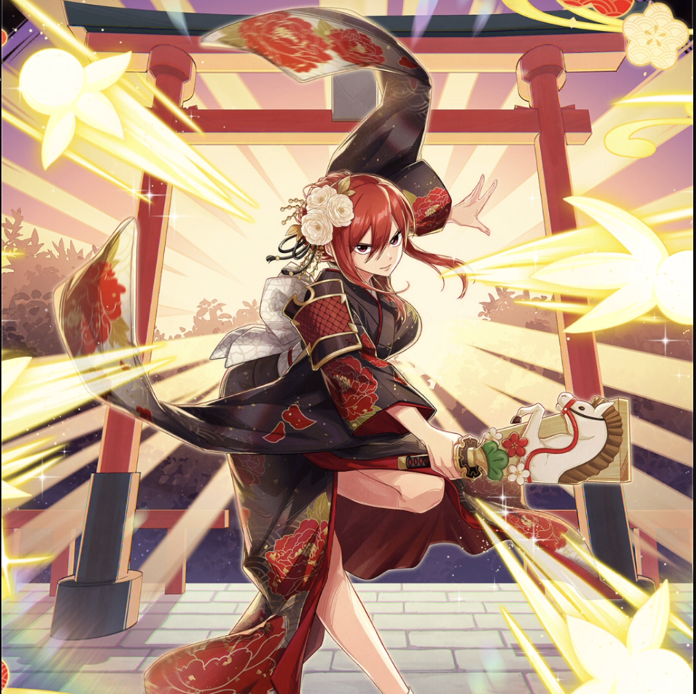

**Rarity:** UR

**Attribute:** 💛 Heart

**Class:** Melee

**Identity:** Erza Scarlet

**Normal attack range:** Ranged

**Signature lacrima:** [[lacrimas/first-dream-erza-lacrima-fc3732d0|✨ First Dream Erza Lacrima]]

## Game text

### 🗡️ Normal Skill (Ranged)

Deals damage equal to 150% of ATK to the target. After an attack hits, with a 20% chance, applies &#91;High&#93; Bleed to the target for 3 seconds.

### 🗡️ Special Skill – Armor of Good Fortune - Replacement

After a normal skill hits, there is a 30% chance to advance HEART allies stored Ultimate SKill Gauge by 0.7 seconds.

### 💥 Ultimate – Change Outfit: Hagoita Dance

Deals damage equal to 850% of ATK to enemies within the target area every 10 seconds. After an attack hits, applies &#91;Top&#93; Bleed to the target for 5 seconds.

## Effect applications

### High Bleed
| Property | Value |
| --- | --- |
| Family | Bleed |
| Target | Single Enemy |
| Activation | Normal SKill Hit |
| Chance | 20% |
| Duration | 3 sec |
| Value | 35 Percent of ATK per sec |
| Source skill | Normal Attack |

Deals damage equal to 150% of ATK to the target. After an attack hits, with a 20% chance, applies &#91;High&#93; Bleed to the target for 3 seconds.

### Advance Ultimate Skill Gauge
| Property | Value |
| --- | --- |
| Family | Ultimate Skill Gauge |
| Target | Heart Allies |
| Activation | Normal SKill Hit |
| Chance | 30% |
| Value | 0.7 Seconds |
| Source skill | Special Skill |

After a normal skill hits, there is a 30% chance to advance HEART allies stored Ultimate SKill Gauge by 0.7 seconds.

### Top Bleed
| Property | Value |
| --- | --- |
| Family | Bleed |
| Target | Each Target Hit |
| Activation | Every 10 sec, After Attack Hits |
| Duration | 5 sec |
| Value | 40 Percent of ATK per sec |

Unspecified values remain unknown. Text is transcribed from game records; localization and entry errors may remain.
