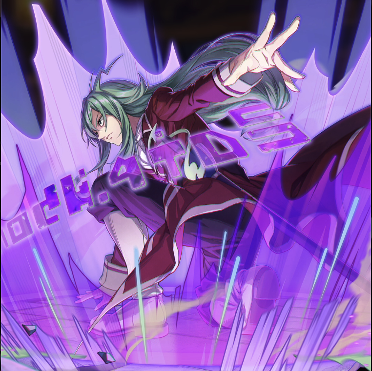

**Rarity:** UR

**Attribute:** 💚 Technique

**Class:** Disrupt

**Identity:** Freed Justine

**Normal attack range:** Ranged

**Signature lacrima:** [[lacrimas/freed-lacrima-6f1ba7d5|✨ Freed Lacrima]]

## Game text

### 🗡️ Normal Skill (Ranged)

Deals 120% ATK damage to the target.

### 🗡️ Special Skill - Spellcasting Magic (Attack Down)

After a normal skill hits, there is a 20% chance to inflict on the target for 5 sec &#91;High&#93; ATK Decrease.

### 💥 Ultimate - Script Magic (Skill Seal)

Every 9 sec, deal damage equal to 600% of ATK to enemies within the target area. After the attack hits, there is a 50% chance to inflict on each target for 5 sec Silence.

## Effect applications

### High ATK Decrease
| Property | Value |
| --- | --- |
| Family | ATK |
| Target | Single Enemy |
| Activation | Normal SKill Hit |
| Chance | 20% |
| Duration | 5 sec |
| Value | 25 Percent |
| Source skill | Special Skill |

After a normal skill hits, there is a 20% chance to inflict on the target for 5 sec &#91;High&#93; ATK Decrease

### Silence
| Property | Value |
| --- | --- |
| Family | Silence |
| Target | Each Target Hit |
| Activation | Every 9 sec, After Attack Hits |
| Chance | 50% |
| Duration | 5 sec |
| Source skill | Ultimate |

Every 9 sec, deal damage equal to 600% of ATK to enemies within the target area. After the attack hits, there is a 50% chance to inflict on each target for 5 sec Silence.

Unspecified values remain unknown. Text is transcribed from game records; localization and entry errors may remain.
