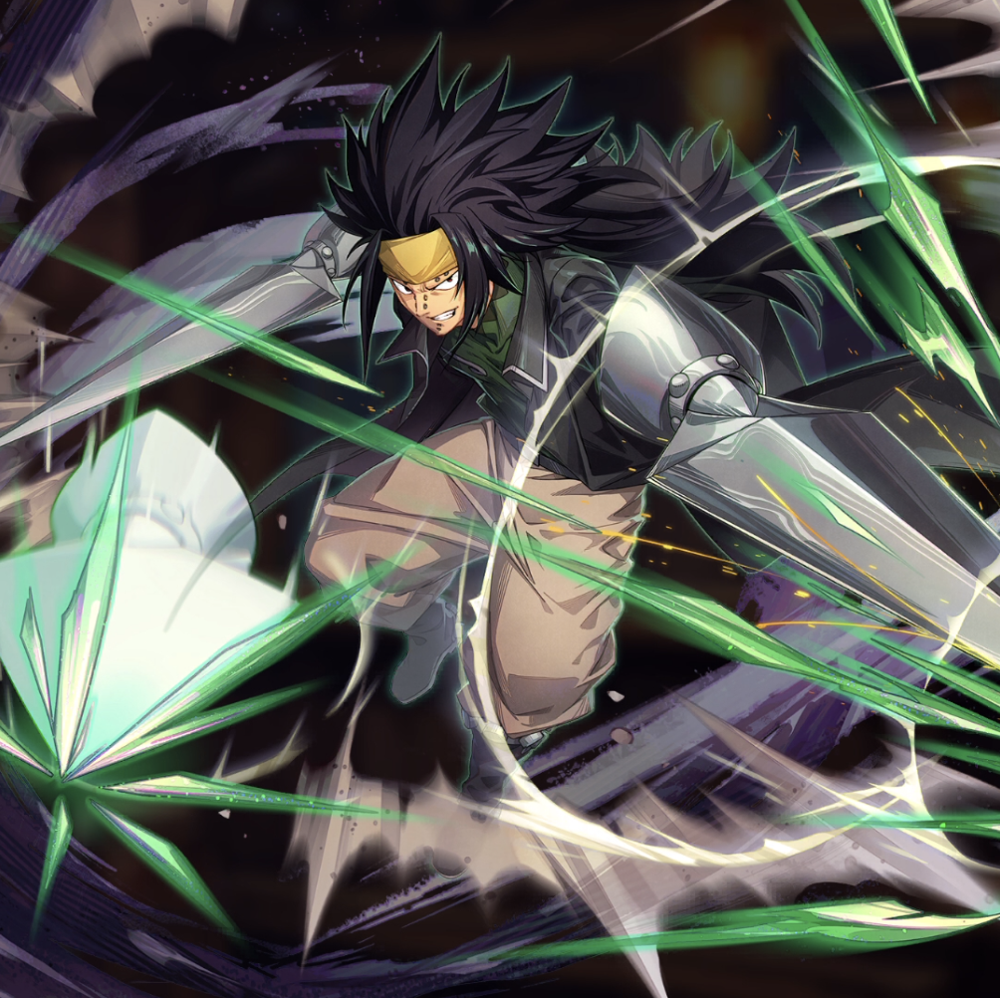

**Rarity:** UR

**Attribute:** 💛 Heart

**Class:** Defense

**Identity:** Gajeel Redfox

**Normal attack range:** Melee

**Signature lacrima:** [[lacrimas/gajeel-lacrima-797c9caf|✨ Gajeel Lacrima]]

## Game text

### Normal Attack (Melee)

Deals 130% ATK damage to the target. If the target is Bleeding after hitting, deals an additional 70% ATK damage.

### Special Skill – Devil&#x27;s Abyss

Every 5 sec, for 5 sec, grant yourself &#91;Top&#93; DEF Increase and &#91;Top&#93; Critical Defense Increase.

### Ultimate – Iron Dragon Spear: Onishin

Every 9 sec, deal damage equal to 1000% of ATK to the target. After the attack hits, there is a 50% chance to inflict on the target for 5 sec &#91;Top&#93; Bleed.

## Effect applications

### Top DEF Increase
| Property | Value |
| --- | --- |
| Family | DEF |
| Target | Self |
| Activation | Every 5 sec |
| Duration | 5 sec |
| Value | 30 Percent |
| Source skill | Special Skill |

Every 5 sec, for 5 sec, grant yourself &#91;Top&#93; DEF Increase and &#91;Top&#93; Critical Defense Increase.

### Top Critical Defense Increase
| Property | Value |
| --- | --- |
| Family | Critical Defense |
| Target | Self |
| Activation | Every 5 sec |
| Duration | 5 sec |
| Value | 50 Percent |
| Source skill | Special Skill |

Every 5 sec, for 5 sec, grant yourself &#91;Top&#93; Crittical Defense Increase

### Additional Damage
| Property | Value |
| --- | --- |
| Family | Damage |
| Target | Single Enemy |
| Activation | Normal SKill Hit |
| Value | 70 Percent of own ATK |
| Required effects | Bleed |
| Match rule | Any |
| Condition subject | Target Hit |
| Evaluation timing | After Attack Hits |
| Required state | Present |
| Source skill | Normal Attack |

If the target is Bleeding after the hit, deal an additional 70% ATK damage.

### Top Bleed
| Property | Value |
| --- | --- |
| Family | Bleed |
| Target | Single Enemy |
| Activation | Every 9 sec, After Attack Hits |
| Chance | 50% |
| Duration | 5 sec |
| Value | 40 Percent of ATK per sec |
| Source skill | Ultimate |

After the attack hits, there is a 50% chance to inflict Top Bleed on the target for 5 sec.

Unspecified values remain unknown. Text is transcribed from game records; localization and entry errors may remain.
