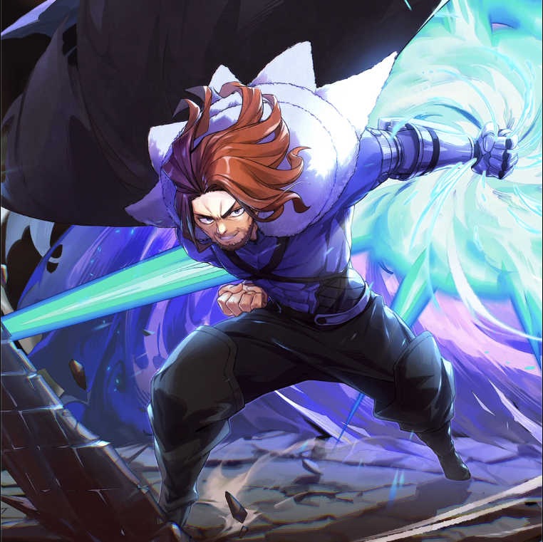

**Rarity:** UR

**Attribute:** 💚 Technique

**Class:** Melee

**Identity:** Gildarts Clive

**Normal attack range:** Melee

**Signature lacrima:** [[lacrimas/gildarts-lacrima-8650ed81|✨ Gildarts Lacrima]]

## Game text

### 🗡️ Normal Skill (Melee)

Deals 140% ATk damage to the target.

### 🗡️ Special Skill - All Crash

When a criticla hit occurs, deal damage equal to 250% of ATK to enemies within the target&#x27;s area. After the attack hits, for 5 sec, inflict &#91;High&#93; DEF Decrease and, &#91;High&#93; Critical Resistance Decrease on the target.

### 💥 Ultimate - Divine Justice: Zetten

Every 9 sec, deal damage equal to 1050% of ATK to the target. After the attack hits, grant yourself for 6 sec &#91;Top&#93; ATK Increase.

## Effect applications

### High DEF Decrease
| Property | Value |
| --- | --- |
| Family | DEF |
| Target | Single Enemy |
| Activation | Critical Hit, After Attack Hits |
| Duration | 5 sec |
| Value | 25 Percent |
| Source skill | Special Skill |

When a critical hit occurs....After the attack hits, for 5 sec, inflict &#91;High&#93; DEF Decrease on the target.

### High Critical Resistance Decrease
| Property | Value |
| --- | --- |
| Family | Critical Resistance |
| Target | Single Enemy |
| Activation | Critical Hit, After Attack Hits |
| Duration | 5 sec |
| Value | 15 Percent |
| Source skill | Special Skill |

When a critical hit occurs....After the attack hits, for 5 sec, inflict &#91;High Critical Resistance Decrease on the target.

### Top ATK Increase
| Property | Value |
| --- | --- |
| Family | ATK |
| Target | Self |
| Activation | Every 9 sec, After Attack Hits |
| Duration | 6 sec |
| Value | 30 Percent |
| Source skill | Ultimate |

Every 9 sec, deal damage equal to 1050% of ATK to the target. After the attack hits, grant yourself for 6 sec &#91;Top&#93; ATK Increase.

Unspecified values remain unknown. Text is transcribed from game records; localization and entry errors may remain.
