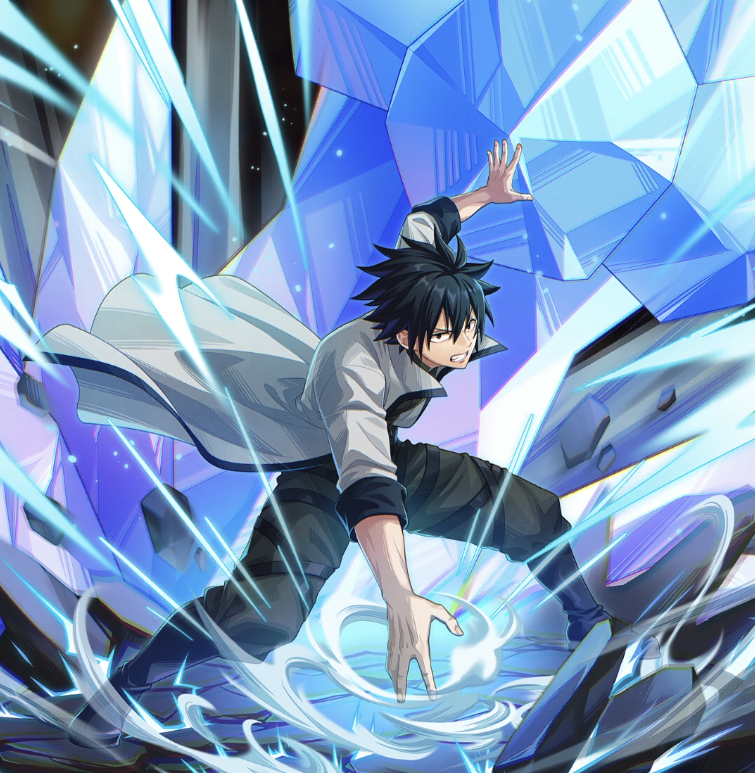

**Rarity:** UR

**Attribute:** ❤️ Brave

**Class:** Ranged

**Identity:** Gray Fullbuster

**Normal attack range:** Ranged

**Signature lacrima:** [[lacrimas/gray-lacrima-d66cc0fe|✨ Gray Lacrima]]

## Game text

### 🗡️ Normal Skill (Ranged)

Deals 140% ATK damage to the target.

### 🗡️ Special Skill - Ice Shaping Mage

When a critical hit occurs, inflict on the target for 5 sec &#91;Top&#93; DEF Decrease.

### 💥 Ultimate - Ice Make: War God Lance (Gungnir)

Every 11 sec, deal damage equal to 1050% of ATK to the target. After the attack hits, there is a 40% chance to inflict on the target for 5 sec, &#91;Top&#93; Freeze.

## Effect applications

### Top DEF Decrease
| Property | Value |
| --- | --- |
| Family | DEF |
| Target | Single Enemy |
| Activation | Critical Hit, After Attack Hits |
| Duration | 5 sec |
| Value | 30 Percent |
| Source skill | Special Skill |

When a critical hit occurs, inflict on the target for 5 sec &#91;Top&#93; DEF Decrease.

### Top Freeze
| Property | Value |
| --- | --- |
| Family | Freeze |
| Target | Single Enemy |
| Activation | Every 11 sec, After Attack Hits |
| Chance | 40% |
| Duration | 5 sec |
| Source skill | Ultimate |

Every 11 sec, deal damage equal to 1050% of ATK to the target. After the attack hits, there is a 40% chance to inflict on the target for 5 sec, &#91;Top&#93; Freeze.

Unspecified values remain unknown. Text is transcribed from game records; localization and entry errors may remain.
