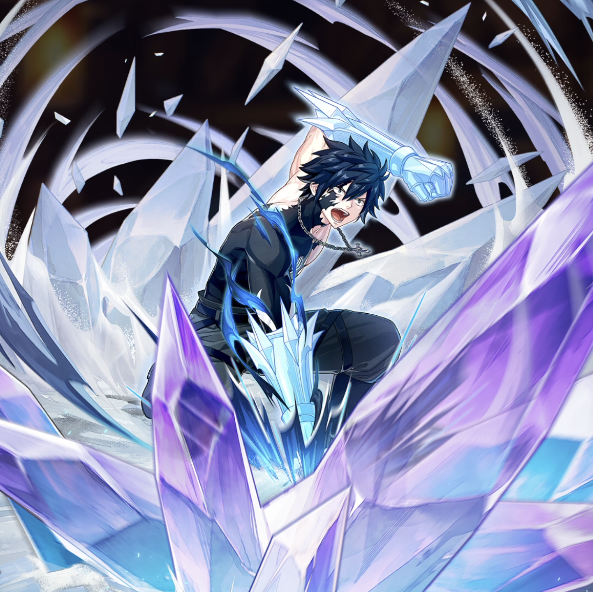

**Rarity:** UR

**Attribute:** 💛 Heart

**Class:** Melee

**Identity:** Gray Fullbuster

**Normal attack range:** Melee

**Signature lacrima:** [[lacrimas/gray-ice-devil-slayer-mage-lacrima-5d6f07f1|✨ Gray -Ice Devil Slayer Mage- Lacrima]]

## Game text

### 🗡️ Normal Skill (Melee)

Deals 150% ATK damage to the target. After hitting, 15% chance to inflict 2s of &#91;High&#93; Freeze.

### 🗡️ Special Skill – Ice Demon Zero Sword

After a normal skill hits, there is a 20% chance to deal 300% damage to the target. If the attack hits when the target is in Freeze state, deal an additional 300% of ATK as damage.

### 💥 Ultimate – Ice Demon: Zero Break Fist

Every 11 sec, deal damage equal to 1100% of ATK to the target. After the attack hits, there is a 50% chance to inflict on the target for 5 sec, &#91;Top&#93; Freeze.

## Effect applications

### High Freeze
| Property | Value |
| --- | --- |
| Family | Freeze |
| Target | Single Enemy |
| Activation | Normal SKill Hit |
| Chance | 15% |
| Duration | 2 sec |
| Source skill | Normal Attack |

Deals 150% ATK damage to the target. After hitting, 15% chance to inflict 2s of &#91;High&#93; Freeze.

### Additional Damage
| Property | Value |
| --- | --- |
| Family | Damage |
| Target | Single Enemy |
| Activation | Normal SKill Hit |
| Value | 300 Percent of own ATK |
| Required effects | Freeze |
| Match rule | Any |
| Condition subject | Target |
| Evaluation timing | At Attack Hit |
| Required state | Present |
### Top Freeze
| Property | Value |
| --- | --- |
| Family | Freeze |
| Target | Single Enemy |
| Activation | Every 11 sec, After Attack Hits |
| Chance | 50% |
| Duration | 5 sec |
| Source skill | Ultimate |

Every 11 sec, deal damage equal to 1100% of ATK to the target. After the attack hits, there is a 50% chance to inflict on the target for 5 sec, &#91;Top&#93; Freeze.

Unspecified values remain unknown. Text is transcribed from game records; localization and entry errors may remain.
