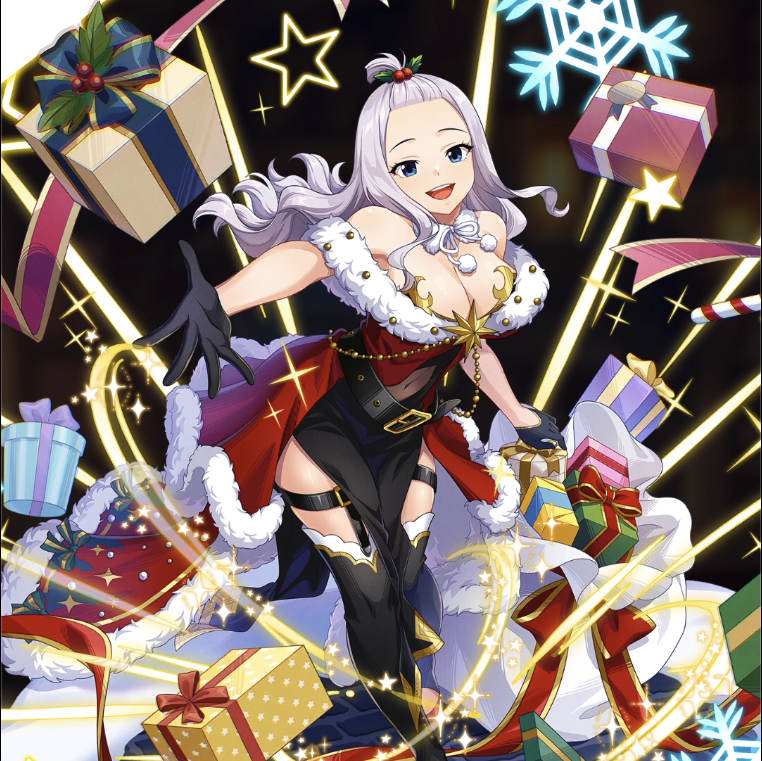

**Rarity:** UR

**Attribute:** 💚 Technique

**Class:** Ranged

**Identity:** Mirajane Strauss

**Normal attack range:** Ranged

**Signature lacrima:** [[lacrimas/holy-night-mirajane-lacrima-87b21b45|✨ Holy Night Mirajane Lacrima]]

## Game text

### 🗡️ Normal Skill (Ranged)

Deals 150% ATK damage to the target. After hitting, 20% chance to inflict 3s of &#91;High&#93; Burn.

### 🗡️ Special Skill - Holy Prayer

When a normal skill hits and the target is in Burn state, advance your current Ultimate Skill gauge by 0.7 sec.

### 💥 Ultimate - Take Over: Santa Soul

Every 9 sec, deal damage equal to 1100% of ATK to the target. After the attack hits, there is a 50% chance to inflict on the target for 5 sec, &#91;Top&#93; Burn.

## Effect applications

### High Burn
| Property | Value |
| --- | --- |
| Family | Burn |
| Target | Single Enemy |
| Activation | Normal SKill Hit, After Attack Hits |
| Chance | 20% |
| Duration | 3 sec |
| Value | 25 Percentage of Source ATK per second |
| Source skill | Normal Attack |

Deals 150% ATK damage to the target. After hitting, 20% chance to inflict 3s of &#91;High&#93; Burn.

### Advance Ultimate Skill Gauge
| Property | Value |
| --- | --- |
| Family | Ultimate Skill Gauge |
| Target | Self |
| Activation | Normal SKill Hit |
| Value | 0.7 Seconds |
| Required effects | Burn |
| Match rule | Any |
| Condition subject | Target |
| Evaluation timing | At Attack Hit |
| Required state | Present |

When a normal skill hits, and the target is in Burn State, advance your current Ultimate Skill gauge by 0.7 sec.

### Top Burn
| Property | Value |
| --- | --- |
| Family | Burn |
| Target | Single Enemy |
| Activation | Every 9 sec, After Attack Hits |
| Chance | 50% |
| Duration | 5 sec |
| Value | 30 Percent of ATK per sec |
| Source skill | Ultimate |

Every 9 sec, deal damage equal to 1100% of ATK to the target. After the attack hits, there is a 50% chance to inflict on the target for 5 sec, &#91;Top&#93; Burn.

Unspecified values remain unknown. Text is transcribed from game records; localization and entry errors may remain.
