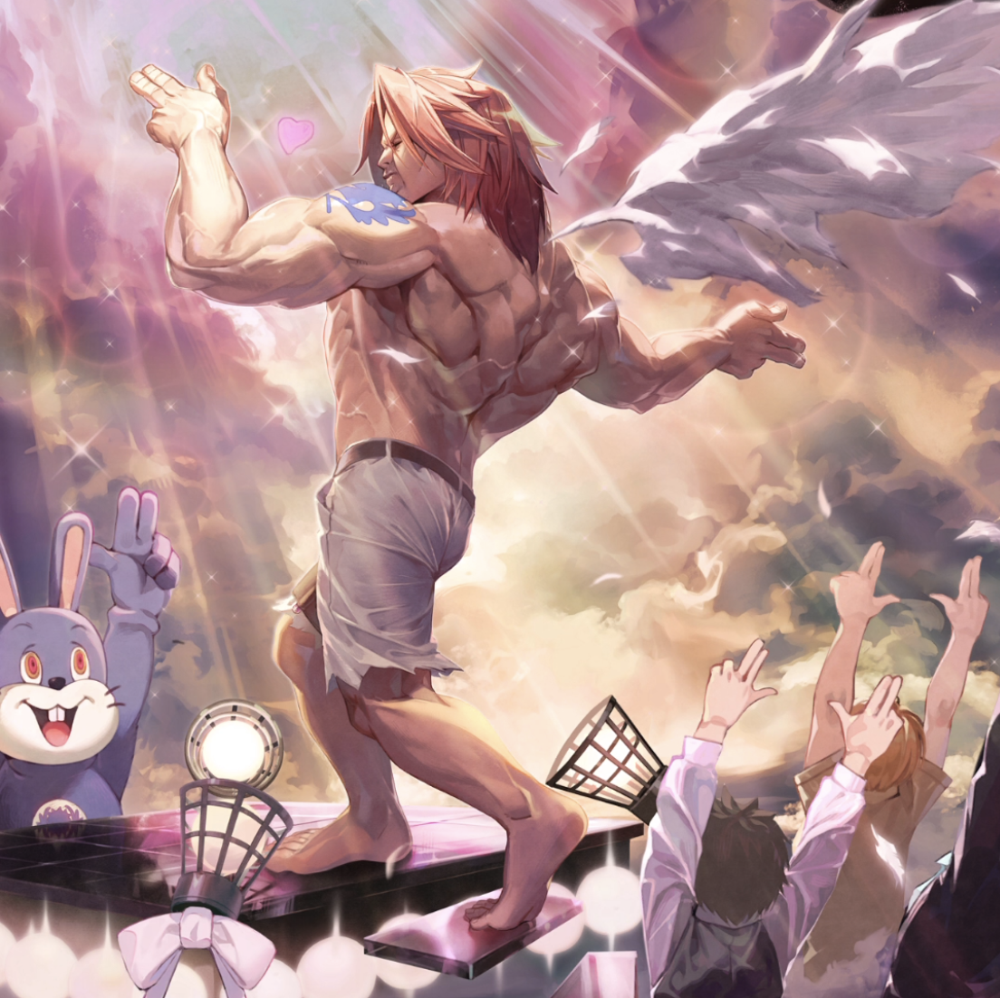

**Rarity:** UR

**Attribute:** ❤️ Brave

**Class:** Melee

**Identity:** Ichiya

**Normal attack range:** Ranged

**Signature lacrima:** [[lacrimas/ichiya-power-perfume-lacrima-d5162fb7|✨ Ichiya -Power Perfume- Lacrima]]

## Game text

### 🗡️ Normal Skill (Ranged)

Deals 170% ATK damage to the target. If a critical hit occurs, grants all allies for 3 seconds: &#91;High&#93; ATK Increase.

### 🗡️ Special Skill – Power Perfume: Max Men

After a normal skill hits, has a 30% chance to grant all allies with the Brave attribute for 6 seconds: &#91;Top&#93; Accuracy Increase and &#91;Top&#93; Critical Damage Increase.

### 💥 Ultimate – Smiling Smash

Deals 950% ATK damage to all enemies every 10 seconds. After a hit, grants self for 7 seconds: &#91;Top&#93; ATK Increase and &#91;Top&#93; Critical Rate Increase, &#91;Top&#93; Shield.

## Effect applications

### High ATK Increase
| Property | Value |
| --- | --- |
| Family | ATK |
| Target | All Allies |
| Activation | Critical Hit |
| Duration | 3 sec |
| Value | 25 Percent |
| Source skill | Normal Attack |

Deals 170% ATK damage to the target. If a critical hit occurs, grants all allies for 3 seconds: &#91;High&#93; ATK Increase.

### Top Accuracy Increase
| Property | Value |
| --- | --- |
| Family | Accuracy |
| Target | Brave Allies |
| Activation | Normal SKill Hit |
| Chance | 30% |
| Duration | 6 sec |
| Value | 20 Percent |
| Source skill | Special Skill |

After a normal skill hits, has a 30% chance to grant all allies with the Brave attribute for 6 seconds: &#91;Top&#93; Accuracy Increase and &#91;Top&#93; Critical Damage Increase.

### Top Critical Damage Increase
| Property | Value |
| --- | --- |
| Family | Critical Damage |
| Target | Brave Allies |
| Activation | Normal SKill Hit |
| Chance | 30% |
| Duration | 6 sec |
| Value | 50 Percent |
| Source skill | Special Skill |

After a normal skill hits, has a 30% chance to grant all allies with the Brave attribute for 6 seconds: &#91;Top&#93; Accuracy Increase and &#91;Top&#93; Critical Damage Increase.

### Top ATK Increase
| Property | Value |
| --- | --- |
| Family | ATK |
| Target | Self |
| Activation | Every 10 sec, After Attack Hits |
| Duration | 7 sec |
| Value | 30 Percent |
| Source skill | Ultimate |

Deals 950% ATK damage to all enemies every 10 seconds. After a hit, grants self for 7 seconds: &#91;Top&#93; ATK Increase and &#91;Top&#93; Critical Rate Increase, &#91;Top&#93; Shield.

### Top Critical Rate Increase
| Property | Value |
| --- | --- |
| Family | Critical Rate |
| Target | Self |
| Activation | Every 10 sec, After Attack Hits |
| Duration | 7 sec |
| Value | 20 Percent |
| Source skill | Ultimate |

Deals 950% ATK damage to all enemies every 10 seconds. After a hit, grants self for 7 seconds: &#91;Top&#93; ATK Increase and &#91;Top&#93; Critical Rate Increase, &#91;Top&#93; Shield.

### Top Shield
| Property | Value |
| --- | --- |
| Family | Shield |
| Target | Self |
| Activation | Every 10 sec, After Attack Hits |
| Duration | 7 sec |
| Value | 25 Percent of Max HP |
| Source skill | Ultimate |

Deals 950% ATK damage to all enemies every 10 seconds. After a hit, grants self for 7 seconds: &#91;Top&#93; ATK Increase and &#91;Top&#93; Critical Rate Increase, &#91;Top&#93; Shield.

Unspecified values remain unknown. Text is transcribed from game records; localization and entry errors may remain.
