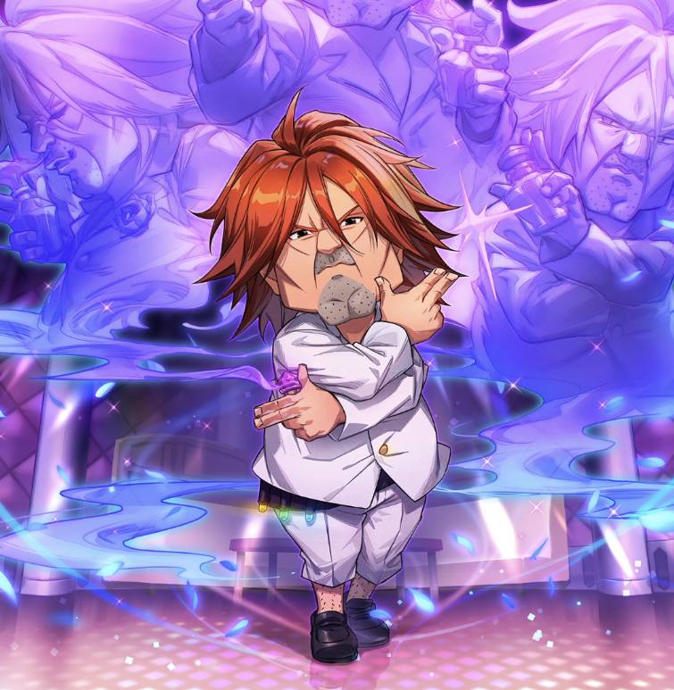

**Rarity:** UR

**Attribute:** ❤️ Brave

**Class:** Disrupt

**Identity:** Ichiya

**Normal attack range:** Ranged

**Signature lacrima:** [[lacrimas/ichiya-lacrima-2c10ade6|✨ Ichiya Lacrima]]

## Game text

### 🗡️ Normal Skill (Ranged)

Deals 120% ATK damage to the target.

### 🗡️ Special Skill - The Scent of Attack

When a critical hit occurs, for 4 sec, grant all Brv-type allies &#91;High&#93; ATK Increase and &#91;High&#93; Accuracy Increase.

### 💥 Ultimate - Ichiya Virus

Every 10 sec, deal damage equal to 650% of ATK to enemies within the target area. After the attack hits, there is a 50% chance to inflict on each target for 5 sec, Heal Block and &#91;High&#93; Paralysis.

## Effect applications

### High ATK Increase
| Property | Value |
| --- | --- |
| Family | ATK |
| Target | Brave Allies |
| Activation | Critical Hit |
| Duration | 4 sec |
| Value | 25 Percent |
| Source skill | Special Skill |

When a critical hit occurs, for 4 sec, grant all Brv-type allies &#91;High&#93; ATK Increase and &#91;High&#93; Accuracy Increase.

### High Accuracy Increase
| Property | Value |
| --- | --- |
| Family | Accuracy |
| Target | Brave Allies |
| Activation | Critical Hit |
| Duration | 4 sec |
| Value | 15 Percent |
| Source skill | Special Skill |

When a critical hit occurs, for 4 sec, grant all Brv-type allies &#91;High&#93; ATK Increase and &#91;High&#93; Accuracy Increase.

### Heal Block
| Property | Value |
| --- | --- |
| Family | Heal Block |
| Target | Each Target Hit |
| Activation | Every 10 sec, After Attack Hits |
| Chance | 50% |
| Duration | 5 sec |
| Source skill | Ultimate |

Every 10 sec, deal damage equal to 650% of ATK to enemies within the target area. After the attack hits, there is a 50% chance to inflict on each target for 5 sec, Heal Block and &#91;High&#93; Paralysis.

### High Paralysis
| Property | Value |
| --- | --- |
| Family | Paralysis |
| Target | Each Target Hit |
| Activation | Every 10 sec, After Attack Hits |
| Chance | 50% |
| Duration | 5 sec |
| Value | 25 Percent of ATK per sec |
| Source skill | Ultimate |

Every 10 sec, deal damage equal to 650% of ATK to enemies within the target area. After the attack hits, there is a 50% chance to inflict on each target for 5 sec, Heal Block and &#91;High&#93; Paralysis.

Unspecified values remain unknown. Text is transcribed from game records; localization and entry errors may remain.
