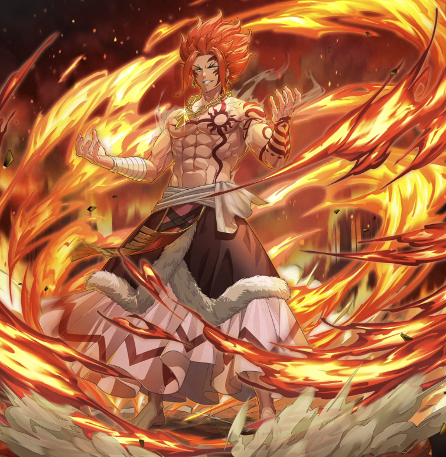

**Rarity:** UR

**Attribute:** ❤️ Brave

**Class:** Melee

**Identity:** Ignia

**Normal attack range:** Ranged

**Signature lacrima:** [[lacrimas/ignia-lacrima-aae7601a|✨ Ignia Lacrima]]

## Game text

### 🗡️ Normal Skill - Normal Attack (Ranged)

Deals damage equal to 190% of ATK to the target. After hitting, has a 30% chance to inflict &#91;Top&#93; Burn on the target for 3 sec.

### 🗡️ Special Skill - Flame Dragon God&#x27;s Intimidation

If enemies within the target&#x27;s range are afflicted with Burn after a normal skill hits, inflicts &#91;Top&#93; ATK Decrease, &#91;Top&#93; Critical Damage Decrease, and &#91;Top&#93; Critical Rate Decrease on each enemy for 5 sec.

### 💥 Ultimate - Raging Inferno

Deals damage equal to 1000% of ATK to all enemies every 9 sec. After hitting, inflicts &#91;Top&#93; Burn and  &#91;Top&#93; Critical Resistance Decrease on each target for 6 sec.

## Effect applications

### Top Burn
| Property | Value |
| --- | --- |
| Family | Burn |
| Target | Single Enemy |
| Activation | Normal SKill Hit |
| Chance | 30% |
| Duration | 3 sec |
| Value | 30 Percent of ATK per sec |
| Source skill | Normal Attack |

Deals damage equal to 190% of ATK to the target. After hitting, has a 30% chance to inflict &#91;Top&#93; Burn on the target for 3 sec.

### Top ATK Decrease
| Property | Value |
| --- | --- |
| Family | ATK |
| Target | Enemies in Target Area |
| Activation | Normal SKill Hit |
| Duration | 5 sec |
| Value | 30 Percent |
| Required effects | Burn |
| Match rule | Any |
| Condition subject | Target |
| Evaluation timing | After Attack Hits |
| Required state | Present |
### Top Critical Rate Decrease
| Property | Value |
| --- | --- |
| Family | Critical Rate |
| Target | Enemies in Target Area |
| Activation | Normal SKill Hit |
| Duration | 5 sec |
| Value | 20 Percent |
| Required effects | Burn |
| Match rule | Any |
| Condition subject | Target |
| Evaluation timing | After Attack Hits |
| Required state | Present |
### Top Critical Damage Decrease
| Property | Value |
| --- | --- |
| Family | Critical Damage |
| Target | Enemies in Target Area |
| Activation | Normal SKill Hit |
| Duration | 5 sec |
| Value | 50 Percent |
| Required effects | Burn |
| Match rule | Any |
| Condition subject | Target |
| Evaluation timing | After Attack Hits |
| Required state | Present |
### Top Burn
| Property | Value |
| --- | --- |
| Family | Burn |
| Target | Each Target Hit |
| Activation | Every 9 sec, After Attack Hits |
| Duration | 6 sec |
| Value | 30 Percent of ATK per sec |
| Source skill | Ultimate |

Deals damage equal to 1000% of ATK to all enemies every 9 sec. After hitting, inflicts &#91;Top&#93; Burn and  &#91;Top&#93; Critical Resistance Decrease on each target for 6 sec.

### Top Critical Resistance Decrease
| Property | Value |
| --- | --- |
| Family | Critical Resistance |
| Target | Each Target Hit |
| Activation | Every 9 sec, After Attack Hits |
| Duration | 6 sec |
| Value | 20 Percent |
| Source skill | Ultimate |

Deals damage equal to 1000% of ATK to all enemies every 9 sec. After hitting, inflicts &#91;Top&#93; Burn and  &#91;Top&#93; Critical Resistance Decrease on each target for 6 sec.

Unspecified values remain unknown. Text is transcribed from game records; localization and entry errors may remain.
