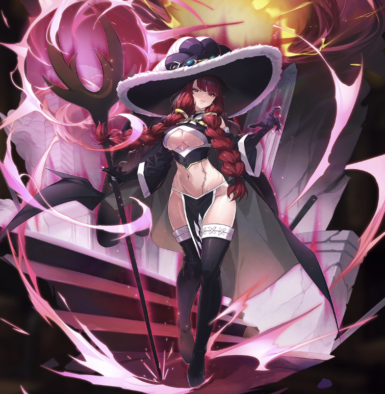

**Rarity:** UR

**Attribute:** ❤️ Brave

**Class:** Ranged

**Identity:** Irene Belserion

**Normal attack range:** Ranged

**Signature lacrima:** [[lacrimas/irene-lacrima-7e4101e8|✨ Irene Lacrima]]

## Game text

### 🗡️ Normal Skill (Ranged)

Deals 140% ATK damage to the target.

### 🗡️ Special Skill - High Level Assistance Specialist

When a critical hit occurs, for 7 sec, grant all Brv-type allies &#91;Top&#93; ATK Increase and &#91;Top&#93; Critical Rate Increase

### 💥 Ultimate - Meteor Drop

Every 9 sec, deal damage equal to 700% of ATK to all enemies. After the attack hits,  inflicts on the target for 5 sec &#91;Top&#93; Critical Defense Decrease. There is a 30% chance to inflict on each target for 5 sec &#91;High&#93; Burn.

## Effect applications

### Top ATK Increase
| Property | Value |
| --- | --- |
| Family | ATK |
| Target | Brave Allies |
| Activation | Critical Hit |
| Duration | 7 sec |
| Value | 30 Percent |
| Source skill | Special Skill |

When a critical hit occurs, for 7 sec, grant all Brv-type allies &#91;Top&#93; ATK Increase and &#91;Top&#93; Critical Rate Increase

### Top Critical Rate Increase
| Property | Value |
| --- | --- |
| Family | Critical Rate |
| Target | Brave Allies |
| Activation | Critical Hit |
| Duration | 7 sec |
| Value | 20 Percent |
| Source skill | Special Skill |

When a critical hit occurs, for 7 sec, grant all Brv-type allies &#91;Top&#93; ATK Increase and &#91;Top&#93; Critical Rate Increase

### Top Critical Defense Decrease
| Property | Value |
| --- | --- |
| Family | Critical Defense |
| Target | Each Target Hit |
| Activation | Every 9 sec, After Attack Hits |
| Duration | 5 sec |
| Value | 50 Percent |
| Source skill | Ultimate |

Every 9 sec, deal damage equal to 700% of ATK to all enemies. After the attack hits,  inflicts on the target for 5 sec &#91;Top&#93; Critical Defense Decrease. There is a 30% chance to inflict on each target for 5 sec &#91;High&#93; Burn.

### High Burn
| Property | Value |
| --- | --- |
| Family | Burn |
| Target | Each Target Hit |
| Activation | Every 9 sec, After Attack Hits |
| Chance | 30% |
| Duration | 5 sec |
| Value | 25 Percentage of Source ATK per second |
| Source skill | Ultimate |

Every 9 sec, deal damage equal to 700% of ATK to all enemies. After the attack hits,  inflicts on the target for 5 sec &#91;Top&#93; Critical Defense Decrease. There is a 30% chance to inflict on each target for 5 sec &#91;High&#93; Burn.

Unspecified values remain unknown. Text is transcribed from game records; localization and entry errors may remain.
