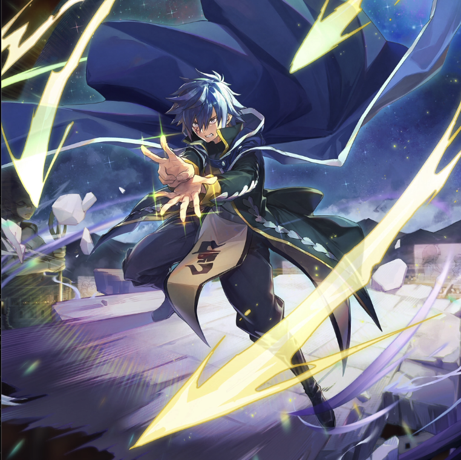

**Rarity:** UR

**Attribute:** 💙 Mind

**Class:** Ranged

**Identity:** Jellal Fernandes

**Normal attack range:** Ranged

**Signature lacrima:** [[lacrimas/jellal-lacrima-282676bc|✨ Jellal Lacrima]]

## Game text

### 🗡️ Normal Skill (Ranged)

Deals damage equal to 150% of ATK to the target. When a critical hit occurs, grants INT-type allies for 3 seconds &#91;High&#93; ATK Increase and &#91;Top&#93; Critical Damage Increase.

### 🗡️ Special Skill – Nine Thunder Stars

After a normal skill hits, there is a 20% chance to deal 400% damage to the target. After the attack hits, inflicts &#91;Top&#93; Paralysis on the target for 5 seconds.

### 💥 Ultimate – Seven-Star Sword

Deals damage equal to 750% of ATK to all enemies every 10 seconds. After an attack hits, if the target is afflicted with Paralysis, for 5 seconds, grants the target &#91;Top&#93; Evasion Decrease and &#91;Top&#93; Crititcal Defense Increase, Heal Block.

## Effect applications

### High ATK Increase
| Property | Value |
| --- | --- |
| Family | ATK |
| Target | Mind Allies |
| Activation | Critical Hit |
| Duration | 3 sec |
| Value | 25 Percent |
| Source skill | Normal Attack |

Deals damage equal to 150% of ATK to the target. When a critical hit occurs, grants INT-type allies for 3 seconds &#91;High&#93; ATK Increase and &#91;Top&#93; Critical Damage Increase.

### Top Critical Damage Decrease
| Property | Value |
| --- | --- |
| Family | Critical Damage |
| Target | Mind Allies |
| Activation | Critical Hit |
| Duration | 3 sec |
| Value | 50 Percent |
### Top Evasion Increase
| Property | Value |
| --- | --- |
| Family | Evasion |
| Target | Self |
| Activation | Every 10 sec, After Attack Hits |
| Duration | 5 sec |
| Value | 20 Percent |
| Required effects | Paralysis |
| Match rule | Any |
| Condition subject | Target Hit |
| Evaluation timing | After Attack Hits |
| Required state | Present |
| Source skill | Ultimate |

Deals damage equal to 750% of ATK to all enemies every 10 seconds. After an attack hits, if the target is afflicted with Paralysis, for 5 seconds, grants the target &#91;Top&#93; Evasion Decrease and &#91;Top&#93; Crititcal Defense Increase, Heal Block.

### Top Critical Defense Increase
| Property | Value |
| --- | --- |
| Family | Critical Defense |
| Target | Self |
| Activation | Every 10 sec, After Attack Hits |
| Duration | 5 sec |
| Value | 50 Percent |
| Required effects | Paralysis |
| Match rule | Any |
| Condition subject | Target Hit |
| Evaluation timing | After Attack Hits |
| Required state | Present |
| Source skill | Ultimate |

Deals damage equal to 750% of ATK to all enemies every 10 seconds. After an attack hits, if the target is afflicted with Paralysis, for 5 seconds, grants the target &#91;Top&#93; Evasion Decrease and &#91;Top&#93; Crititcal Defense Increase, Heal Block.

### Heal Block
| Property | Value |
| --- | --- |
| Family | Heal Block |
| Target | Each Target Hit |
| Activation | Every 10 sec, After Attack Hits |
| Duration | 5 sec |
| Required effects | Paralysis |
| Match rule | Any |
| Condition subject | Target Hit |
| Evaluation timing | After Attack Hits |
| Required state | Present |
### Top Paralysis
| Property | Value |
| --- | --- |
| Family | Paralysis |
| Target | Single Enemy |
| Activation | Normal SKill Hit, After Attack Hits |
| Parent skill chance | 20% |
| Duration | 5 sec |
| Value | 30 Percent of ATK per sec |
| Source skill | Special Skill |

After a normal skill hits, there is a 20% chance to deal 400% damage to the target. After the attack hits, inflicts &#91;Top&#93; Paralysis on the target for 5 seconds.

Unspecified values remain unknown. Text is transcribed from game records; localization and entry errors may remain.
