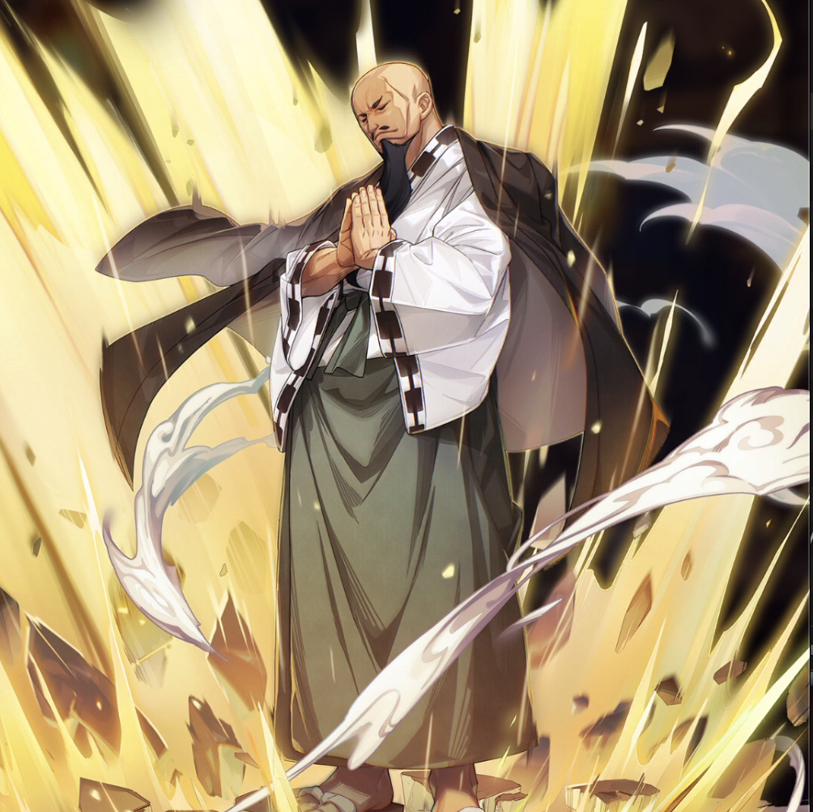

**Rarity:** UR

**Attribute:** 💙 Mind

**Class:** Defense

**Identity:** Jura Neekis

**Normal attack range:** Melee

**Signature lacrima:** [[lacrimas/jura-lacrima-270117c2|✨ Jura Lacrima]]

## Game text

### 🗡️ Normal Skill (Melee)

Deals 130% ATK damage to the target.

### 🗡️ Special Skill - Impenetrable

Every 5 sec, for 5 sec, grant yourself &#91;Top&#93; DEF Increase and &#91;High&#93; Critical Defense Increase.

### 💥 Ultimate – Earth Magic: Rumbling Fuji

Every 9 sec, deal damage equal to 700% of ATK to enemies within the target area.

## Effect applications

### Top DEF Increase
| Property | Value |
| --- | --- |
| Family | DEF |
| Target | Self |
| Activation | Every 5 sec |
| Duration | 5 sec |
| Value | 30 Percent |
### High Critical Defense Increase
| Property | Value |
| --- | --- |
| Family | Critical Defense |
| Target | Self |
| Activation | Every 5 sec |
| Duration | 5 sec |
| Value | 40 Percent |

Unspecified values remain unknown. Text is transcribed from game records; localization and entry errors may remain.
