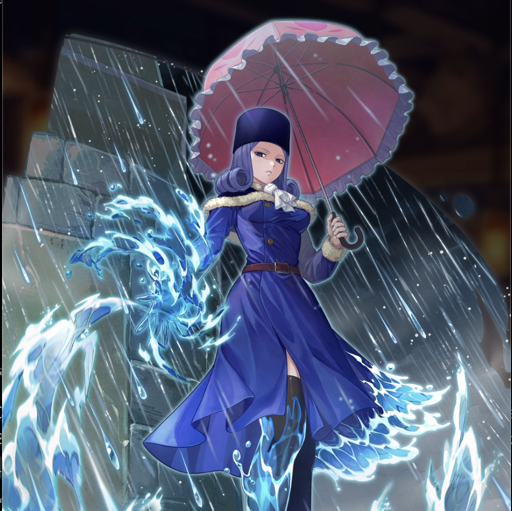

**Rarity:** UR

**Attribute:** ❤️ Brave

**Class:** Disrupt

**Identity:** Juvia Lockser

**Normal attack range:** Ranged

**Signature lacrima:** [[lacrimas/juvia-element-4-lacrima-7d7efbc3|✨ Juvia -Element 4- Lacrima]]

## Game text

### 🗡️ Normal Skill (Ranged)

Deals damage equal to 160% 0f ATK to the target. After the attack hits, has a 30% chance to inflict &#91;Top&#93; ATK Decrease and &#91;Top&#93; Critical Rate Decrease on the target for 3 sec.

### 🗡️ Special Skill – Juvia is a Rain Woman

After a normal skill hits, has a 30% chance to deal damage equal to 450% of ATK to the target. After the attack hits, inflicts &#91;Top&#93; Burn and Silence on the target for 5 sec.

### 💥 Ultimate – Water Lock

Deals damage equal to 900% of ATK to enemies within the target area every 10 sec. Damage increases by 50% for each Brave ally (up to 350%). If the target is afflicted with Silence or Burn after the attack hits, inflicts the following effects on each target for 7 sec: &#91;Top&#93; DEF Decrease,  &#91;Top&#93; Critical Resistance Decrease, &#91;Top&#93; Critical Defense Decrease, and Heal Block.

## Effect applications

### Top ATK Decrease
| Property | Value |
| --- | --- |
| Family | ATK |
| Target | Single Enemy |
| Activation | Normal SKill Hit |
| Chance | 30% |
| Duration | 3 sec |
| Value | 30 Percent |
| Source skill | Normal Attack |

Deals damage equal to 160% 0f ATK to the target. After the attack hits, has a 30% chance to inflict &#91;Top&#93; ATK Decrease and &#91;Top&#93; Critical Rate Decrease on the target for 3 sec.

### Top Critical Rate Decrease
| Property | Value |
| --- | --- |
| Family | Critical Rate |
| Target | Single Enemy |
| Activation | Normal SKill Hit |
| Chance | 30% |
| Duration | 3 sec |
| Value | 20 Percent |
| Source skill | Normal Attack |

Deals damage equal to 160% 0f ATK to the target. After the attack hits, has a 30% chance to inflict &#91;Top&#93; ATK Decrease and &#91;Top&#93; Critical Rate Decrease on the target for 3 sec.

### Top Burn
| Property | Value |
| --- | --- |
| Family | Burn |
| Target | Single Enemy |
| Activation | Special Skill Hit |
| Parent skill chance | 30% |
| Duration | 5 sec |
| Value | 30 Percent of ATK per sec |
| Source skill | Special Skill |

After a normal skill hits, has a 30% chance to deal damage equal to 450% of ATK to the target. After the attack hits, inflicts &#91;Top&#93; Burn and Silence on the target for 5 sec.

### Silence
| Property | Value |
| --- | --- |
| Family | Silence |
| Target | Single Enemy |
| Activation | Special Skill Hit |
| Parent skill chance | 30% |
| Duration | 5 sec |
| Source skill | Special Skill |

After a normal skill hits, has a 30% chance to deal damage equal to 450% of ATK to the target. After the attack hits, inflicts &#91;Top&#93; Burn and Silence on the target for 5 sec.

### Top DEF Decrease
| Property | Value |
| --- | --- |
| Family | DEF |
| Target | Each Target Hit |
| Activation | Every 10 sec |
| Duration | 7 sec |
| Value | 30 Percent |
| Required effects | Silence, Burn |
| Match rule | Any |
| Condition subject | Target Hit |
| Evaluation timing | After Attack Hits |
| Required state | Present |
| Source skill | Ultimate |

Deals damage equal to 900% of ATK to enemies within the target area every 10 sec. Damage increases by 50% for each Brave ally (up to 350%). If the target is afflicted with Silence or Burn after the attack hits, inflicts the following effects on each target for 7 sec: &#91;Top&#93; DEF Decrease,  &#91;Top&#93; Critical Resistance Decrease, &#91;Top&#93; Critical Defense Decrease, and Heal Block.

### Top Critical Resistance Decrease
| Property | Value |
| --- | --- |
| Family | Critical Resistance |
| Target | Each Target Hit |
| Activation | Every 10 sec |
| Duration | 7 sec |
| Value | 20 Percent |
| Required effects | Silence, Burn |
| Match rule | Any |
| Condition subject | Target Hit |
| Evaluation timing | After Attack Hits |
| Required state | Present |
| Source skill | Ultimate |

Deals damage equal to 900% of ATK to enemies within the target area every 10 sec. Damage increases by 50% for each Brave ally (up to 350%). If the target is afflicted with Silence or Burn after the attack hits, inflicts the following effects on each target for 7 sec: &#91;Top&#93; DEF Decrease,  &#91;Top&#93; Critical Resistance Decrease, &#91;Top&#93; Critical Defense Decrease, and Heal Block.

### Top Critical Defense Decrease
| Property | Value |
| --- | --- |
| Family | Critical Defense |
| Target | Each Target Hit |
| Activation | Every 10 sec |
| Duration | 7 sec |
| Value | 50 Percent |
| Required effects | Silence, Burn |
| Match rule | Any |
| Condition subject | Target Hit |
| Evaluation timing | After Attack Hits |
| Required state | Present |
| Source skill | Ultimate |

Deals damage equal to 900% of ATK to enemies within the target area every 10 sec. Damage increases by 50% for each Brave ally (up to 350%). If the target is afflicted with Silence or Burn after the attack hits, inflicts the following effects on each target for 7 sec: &#91;Top&#93; DEF Decrease,  &#91;Top&#93; Critical Resistance Decrease, &#91;Top&#93; Critical Defense Decrease, and Heal Block.

### Heal Block
| Property | Value |
| --- | --- |
| Family | Heal Block |
| Target | Each Target Hit |
| Activation | Every 10 sec |
| Duration | 7 sec |
| Required effects | Silence, Burn |
| Match rule | Any |
| Condition subject | Target Hit |
| Evaluation timing | After Attack Hits |
| Required state | Present |
| Source skill | Ultimate |

Deals damage equal to 900% of ATK to enemies within the target area every 10 sec. Damage increases by 50% for each Brave ally (up to 350%). If the target is afflicted with Silence or Burn after the attack hits, inflicts the following effects on each target for 7 sec: &#91;Top&#93; DEF Decrease,  &#91;Top&#93; Critical Resistance Decrease, &#91;Top&#93; Critical Defense Decrease, and Heal Block.

Unspecified values remain unknown. Text is transcribed from game records; localization and entry errors may remain.
