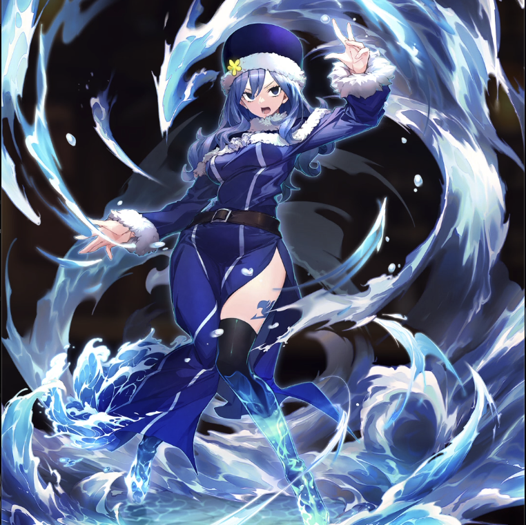

**Rarity:** UR

**Attribute:** 💛 Heart

**Class:** Ranged

**Identity:** Juvia Lockser

**Normal attack range:** Ranged

**Signature lacrima:** [[lacrimas/juvia-lacrima-d0906978|✨ Juvia Lacrima]]

## Game text

### 🗡️ Normal Skill (Ranged)

Delas 140% ATK damage to the target. After hitting, 20% chance to grant yourself for 3s: &#91;Mid&#93; Critical Rate Increase.

### 🗡️ Special Skill - Water Stream Rising Haze

When a critical hit occurs, deal damage equal to 250% of ATK to the target. After the attack hits, for 7 sec, grant yourself &#91;Top&#93; Evasion Increase.

### 💥 Ultimate - Water Stream Typhoon

Every 9 sec, deal damage equal to 1100% of ATK to the target. After the attack hits, push back the target&#x27;s filled Ultimate Skill gauge by 3 sec.

## Effect applications

### Mid Critical Rate Increase
| Property | Value |
| --- | --- |
| Family | Critical Rate |
| Target | Self |
| Activation | After Attack Hits |
| Chance | 20% |
| Duration | 3 sec |
| Value | 10 Percent |
### Top Evasion Increase
| Property | Value |
| --- | --- |
| Family | Evasion |
| Target | Self |
| Activation | Critical Hit |
| Duration | 7 sec |
| Value | 20 Percent |
### Push Back Ultimate Skill Gauge
| Property | Value |
| --- | --- |
| Family | Ultimate Skill Gauge |
| Target | Single Enemy |
| Activation | Every 9 sec, After Attack Hits |
| Value | 3 Seconds |

Unspecified values remain unknown. Text is transcribed from game records; localization and entry errors may remain.
