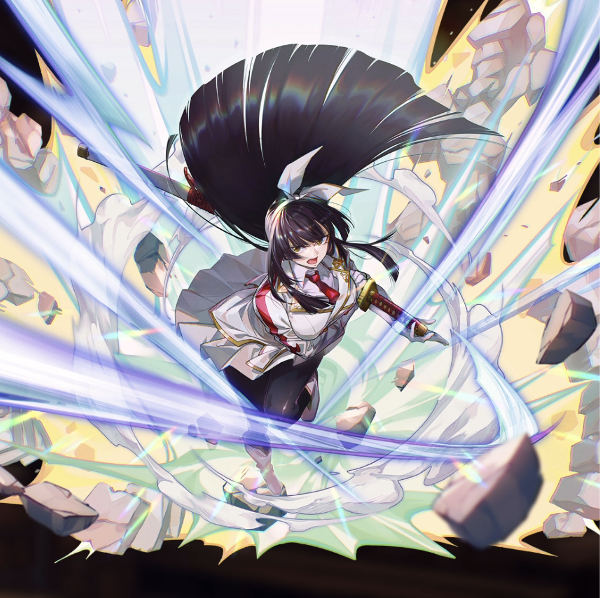

**Rarity:** UR

**Attribute:** 💛 Heart

**Class:** Melee

**Identity:** Kagura Mikazuchi

**Signature lacrima:** [[lacrimas/kagura-lacrima-acab44a5|✨ Kagura Lacrima]]

## Game text

### 🗡️ Normal Skill

Deals 140% ATK damage to the target.

### 🗡️ Special Skill - &quot;Strong&quot; Type

When a critical hit occurs, deal damage equal to 300% of ATK to the target. After the attack hits, advance your current Ultimate Skill Gauge by 0.7 sec.

### 💥 Ultimate - Stance of Slash

Every 8 sec, deal damage equal to 1100% of ATK to the target. After the attack hits, there is a 50% chance to inflict on the target for 5 sec &#91;Top&#93; Bleed, and grant yourself for 7 sec &#91;Top&#93; ATK Increase and &#91;High&#93; Critical Rate Increase.

## Effect applications

### Advance Ultimate Skill Gauge
| Property | Value |
| --- | --- |
| Family | Ultimate Skill Gauge |
| Target | Self |
| Activation | Critical Hit, After Attack Hits |
| Value | 0.7 Seconds |
| Source skill | Special Skill |

When a critical hit occurs, deal damage equal to 300% of ATK to the target. After the attack hits, advance your current Ultimate Skill Gauge by 0.7 sec.

### Top Bleed
| Property | Value |
| --- | --- |
| Family | Bleed |
| Target | Single Enemy |
| Activation | Every 8 sec, After Attack Hits |
| Chance | 50% |
| Duration | 5 sec |
| Value | 40 Percent of ATK per sec |
| Source skill | Ultimate |

Every 8 sec... After the attack hits, there is a 50% chance to inflict on the target for 5 sec &#91;Top&#93; Bleed.

### Top ATK Increase
| Property | Value |
| --- | --- |
| Family | ATK |
| Target | Self |
| Activation | Every 8 sec, After Attack Hits |
| Duration | 7 sec |
| Value | 30 Percent |
| Source skill | Ultimate |

Every 8 sec, deal damage equal to 1100% of ATK to the target. After the attack hits, there is a 50% chance to inflict on the target for 5 sec &#91;Top&#93; Bleed, and grant yourself for 7 sec &#91;Top&#93; ATK Increase and &#91;High&#93; Critical Rate Increase.

### High Critical Rate Increase
| Property | Value |
| --- | --- |
| Family | Critical Rate |
| Target | Self |
| Activation | Every 8 sec, After Attack Hits |
| Duration | 7 sec |
| Value | 15 Percent |
| Source skill | Ultimate |

Every 8 sec, deal damage equal to 1100% of ATK to the target. After the attack hits, there is a 50% chance to inflict on the target for 5 sec &#91;Top&#93; Bleed, and grant yourself for 7 sec &#91;Top&#93; ATK Increase and &#91;High&#93; Critical Rate Increase.

Unspecified values remain unknown. Text is transcribed from game records; localization and entry errors may remain.
