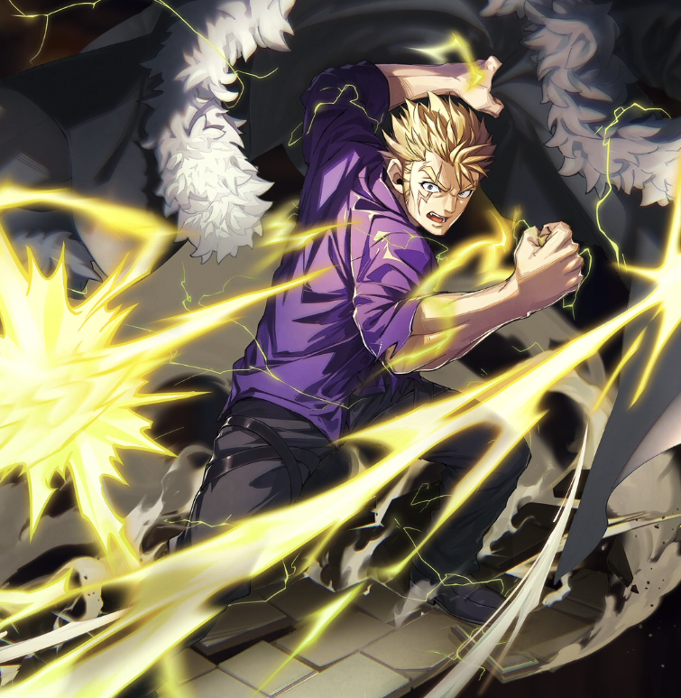

**Rarity:** UR

**Attribute:** ❤️ Brave

**Class:** Melee

**Identity:** Laxus Dreyar

**Normal attack range:** Melee

**Signature lacrima:** [[lacrimas/laxus-lacrima-cd58792b|✨ Laxus Lacrima]]

## Game text

### **🗡️ Normal Skill — Normal Attack (Melee)**

Deals 140% ATK damage tot he target.

### **🗡️ Special Skill — Thunder Dragon’s Jaw**

When a critical hit occurs, deal damage equal to 250% of ATK to the target. If the attack hits and the target is in a Paralysis state, deal additional damage equal to 250% of ATK.

### **💥 Ultimate — Raging Bolt**

Every 10 sec, deal damage equal to 700% of ATK to all enemies. After the attack hits, there is a 30% chance to inflict on each target for 7 sec &#91;Top&#93; Paralysis.

## Effect applications

### Additional Damage
| Property | Value |
| --- | --- |
| Family | Damage |
| Target | Single Enemy |
| Activation | Critical Hit, After Attack Hits |
| Value | 250 Percent of own ATK |
| Required effects | Paralysis |
| Match rule | Any |
| Condition subject | Target |
| Evaluation timing | At Attack Hit |
| Required state | Present |

IWhen a critical hit occurs....If the attack hits and the target is in a Paralysis state, deal additional damage equal to 250% of ATK

### Top Paralysis
| Property | Value |
| --- | --- |
| Family | Paralysis |
| Target | Each Target Hit |
| Activation | Every 10 sec, After Attack Hits |
| Chance | 30% |
| Duration | 7 sec |
| Value | 30 Percent of ATK per sec |
| Source skill | Ultimate |

Every 10 sec, deal damage equal to 700% of ATK to all enemies. After the attack hits, there is a 30% chance to inflict on each target for 7 sec &#91;Top&#93; Paralysis.

Unspecified values remain unknown. Text is transcribed from game records; localization and entry errors may remain.
