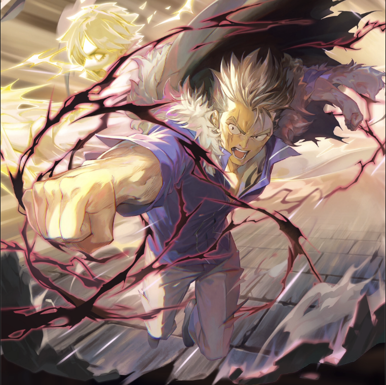

**Rarity:** UR

**Attribute:** 💚 Technique

**Class:** Melee

**Identity:** Laxus Dreyar

**Normal attack range:** Ranged

**Signature lacrima:** [[lacrimas/laxus-red-lightning-dragon-mode-lacrima-0d735ffa|✨ Laxus - Red Lightning Dragon Mode- Lacrima]]

## Game text

### 🗡️ Normal Skill (Ranged)

Deals 160% of ATK as damage to the target. If a critical hit occurs, grants allies of the Skill attribute &#91;Top&#93; Critical Damage Increase for 3 seconds.

### 🗡️ Special Skill - Thunder Dragon Fangtian Halberd

After a normal skill hits, has a 20% chance to deal 350% damage to the target. If the attack hits a target afflicted with &quot;Bleed&quot;, deals an additional 350% of ATK as damage.

### 💥 Ultimate - Megaton: Red Lightning

Deals 900% of ATK as damage to enemies within range every 10 seconds. After a successful hit, has a 50% chance to inflict &#91;Top&#93; Bleed, &#91;Top&#93; Critical Resistance Decrease, and &#91;Top&#93; Evasion Decrease on each target for 5 seconds.

## Effect applications

### Top Critical Damage Increase
| Property | Value |
| --- | --- |
| Family | Critical Damage |
| Target | Technique Allies |
| Activation | Critical Hit |
| Duration | 3 sec |
| Value | 50 Percent |
| Source skill | Normal Attack |

Deals 160% of ATK as damage to the target. If a critical hit occurs, grants allies of the Skill attribute &#91;Top&#93; Critical Damage Increase for 3 seconds.

### Additional Damage
| Property | Value |
| --- | --- |
| Family | Damage |
| Target | Single Enemy |
| Activation | Normal SKill Hit, After Attack Hits |
| Chance | 20% |
| Value | 350 Percent of own ATK |
| Required effects | Bleed |
| Match rule | Any |
| Condition subject | Target |
| Evaluation timing | At Attack Hit |
| Required state | Present |

If the attack hits a target afflicted with &quot;Bleed&quot;, deals an additional 350% of ATK as damage.

### Top Bleed
| Property | Value |
| --- | --- |
| Family | Bleed |
| Target | Each Target Hit |
| Activation | Every 10 sec, After Attack Hits |
| Chance | 50% |
| Duration | 5 sec |
| Value | 40 Percent of ATK per sec |
| Source skill | Ultimate |

After a successful hit, has a 50% chance to inflict for 5 sec &#91;Top&#93; Bleed on each target for 5 seconds

### Top Critical Resistance Decrease
| Property | Value |
| --- | --- |
| Family | Critical Resistance |
| Target | Each Target Hit |
| Activation | Every 10 sec, After Attack Hits |
| Chance | 50% |
| Duration | 5 sec |
| Value | 20 Percent |
| Source skill | Ultimate |

Deals 900% of ATK as damage to enemies within range every 10 seconds. After a successful hit, has a 50% chance to inflict &#91;Top&#93; Bleed, &#91;Top&#93; Critical Resistance Decrease, and &#91;Top&#93; Evasion Decrease on each target for 5 seconds.

### Top Evasion Decrease
| Property | Value |
| --- | --- |
| Family | Evasion |
| Target | Each Target Hit |
| Activation | Every 10 sec, After Attack Hits |
| Chance | 50% |
| Duration | 5 sec |
| Value | 20 Percent |

Unspecified values remain unknown. Text is transcribed from game records; localization and entry errors may remain.
