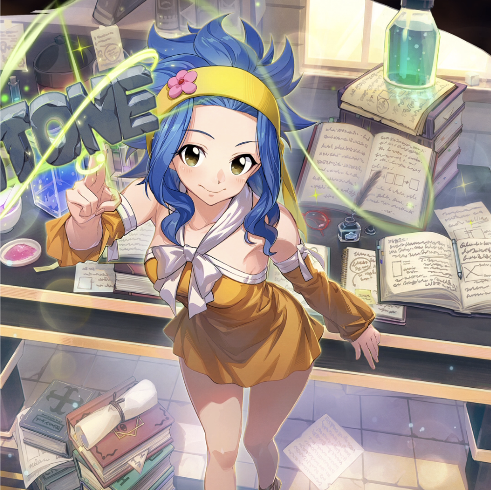

**Rarity:** UR

**Attribute:** 💙 Mind

**Class:** Disrupt

**Identity:** Levy McGarden

**Normal attack range:** Ranged

**Signature lacrima:** [[lacrimas/levy-lacrima-53324867|✨ Levy Lacrima]]

## Game text

### Normal Skill (Ranged)

Deals 120% ATK damage to the target.

### Special Skill – IRON

When a critical hit occurs, for 5 sec, grant Int-type allies &#91;High&#93; DEF Increase and &#91;High&#93; Critical Resistance Increase.

### Ultimate – 3D Text (STONE)

Every 11 sec, deal damage equal to 850% of ATK to the target. After the attack hits, there is a 50% chance to inflict on the target for 5 sec, Bind.

## Effect applications

### High DEF Increase
| Property | Value |
| --- | --- |
| Family | DEF |
| Target | Mind Allies |
| Activation | Critical Hit |
| Duration | 3 sec |
| Value | 25 Percent |
### High Critical Resistance Increase
| Property | Value |
| --- | --- |
| Family | Critical Resistance |
| Target | Mind Allies |
| Activation | Critical Hit |
| Duration | 5 sec |
| Value | 15 Percent |
### Bind
| Property | Value |
| --- | --- |
| Family | Bind |
| Target | Single Enemy |
| Activation | Every 11 sec, After Attack Hits |
| Chance | 50% |
| Duration | 5 sec |
| Source skill | Ultimate |

Every 11 sec, deal damage equal to 850% of ATK to the target. After the attack hits, there is a 50% chance to inflict on the target for 5 sec, Bind.

Unspecified values remain unknown. Text is transcribed from game records; localization and entry errors may remain.
