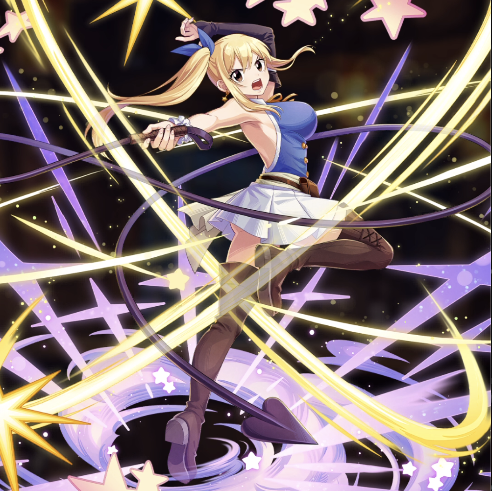

**Rarity:** UR

**Attribute:** 💙 Mind

**Class:** Disrupt

**Identity:** Lucy Heartfilia

**Normal attack range:** Ranged

**Signature lacrima:** [[lacrimas/lucy-lacrima-5096181a|✨ Lucy Lacrima]]

## Game text

### Normal Attack (Ranged)

Deals 120% ATK damage to the target.

### Special Skill – Guide of the Star Spirits

After a normal skill hits, there is a 20% chance to grant yourself for 5 sec &#91;Top&#93; Evasion Increase.

### Ultimate – Star Whip

Every 10 sec, deal damage equal to 600% of ATK to enemies within the target area. After the attack hits, there is a 50% chance to inflict on each target for 7 sec, &#91;Top&#93; ATK Decrease.

## Effect applications

### Top Evasion Increase
| Property | Value |
| --- | --- |
| Family | Evasion |
| Target | Self |
| Activation | Normal SKill Hit |
| Chance | 20% |
| Duration | 5 sec |
| Value | 20 Percent |
| Source skill | Special Skill |

After a normal skill hits, there is a 20% chance to grant yourself for 5 sec &#91;Top&#93; Evasion Increase.

### Top ATK Decrease
| Property | Value |
| --- | --- |
| Family | ATK |
| Target | Each Target Hit |
| Activation | Every 10 sec, After Attack Hits |
| Chance | 50% |
| Duration | 7 sec |
| Value | 30 Percent |

Unspecified values remain unknown. Text is transcribed from game records; localization and entry errors may remain.
