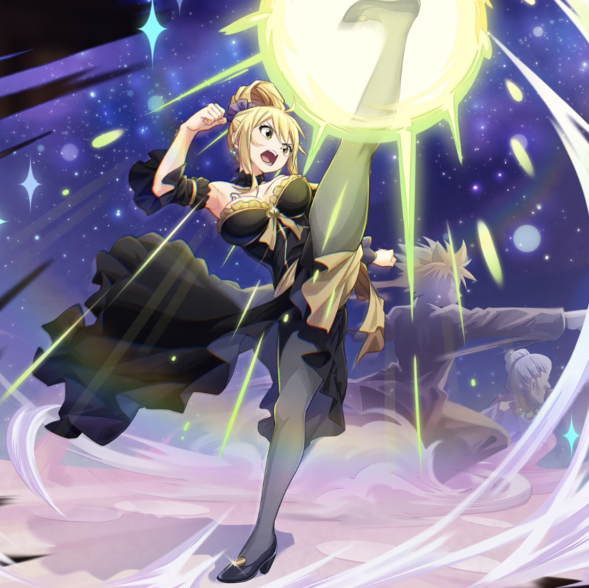

**Rarity:** UR

**Attribute:** 💙 Mind

**Class:** Melee

**Identity:** Lucy Heartfilia

**Normal attack range:** Melee

**Signature lacrima:** [[lacrimas/lucy-leo-form-lacrima-245e1721|✨ Lucy -Leo Form- Lacrima]]

## Game text

### 🗡️ Normal Skill (Melee)

Deals 160% ATK damage to the target.

### 🗡️ Special Skill – The Protection of the Leo Constellation

While you are on the field, grant all allies &#91;Top&#93; ATK Increase and &#91;Top&#93; Criticla Rate Increase.

### 💥 Ultimate – Lucy Regulus Slash

Every 11 sec, deal damage equal to 850% of ATK to enemies within the target area. After the attack hits, there is a 50% chance to inflict on each target for 5 sec, Blind.

## Effect applications

### Top ATK Increase
| Property | Value |
| --- | --- |
| Family | ATK |
| Target | All Allies |
| Activation | While Unit is on the Field |
| Value | 30 Percent |
| Source skill | Special Skill |

While you are on the field, grant all allies &#91;Top&#93; ATK Increase and &#91;Top&#93; Criticla Rate Increase.

### Top Critical Rate Increase
| Property | Value |
| --- | --- |
| Family | Critical Rate |
| Target | All Allies |
| Activation | While Unit is on the Field |
| Value | 20 Percent |
| Source skill | Special Skill |

While you are on the field, grant all allies &#91;Top&#93; ATK Increase and &#91;Top&#93; Criticla Rate Increase.

### Blind
| Property | Value |
| --- | --- |
| Family | Blind |
| Target | Each Target Hit |
| Activation | Every 11 sec, After Attack Hits |
| Chance | 50% |
| Duration | 5 sec |
| Source skill | Ultimate |

Every 11 sec, deal damage equal to 850% of ATK to enemies within the target area. After the attack hits, there is a 50% chance to inflict on each target for 5 sec, Blind.

Unspecified values remain unknown. Text is transcribed from game records; localization and entry errors may remain.
