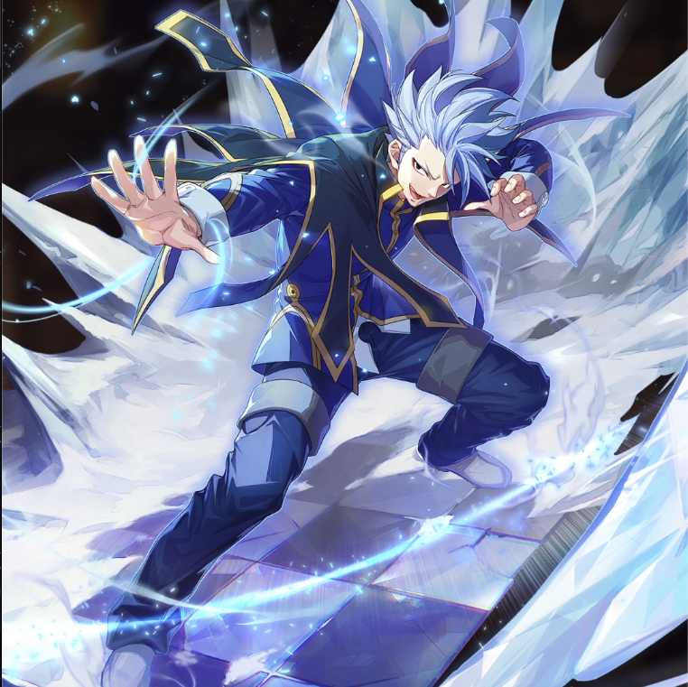

**Rarity:** UR

**Attribute:** 💚 Technique

**Class:** Ranged

**Identity:** Lyon Vastia

**Normal attack range:** Ranged

**Signature lacrima:** [[lacrimas/lyon-lacrima-025b56e7|✨ Lyon Lacrima]]

## Game text

### 🗡️ Normal Skill (Ranged)

Deals 140% ATK damage to the target.

### 🗡️ Special Skill - The Power of &quot;Zero Emperor&quot;

After a normal skill hits, if the target is in a Freeze state, push back the target&#x27;s accumulated Ultimate Skill Gauge by 0.7 sec.

### 💥 Ultimate - Ice Blade: Swan Wing

Every 11 sec, deal damage equal to 700% of ATK to enemies within the target area. After the attack hits, there is a 20% chance to inflict on each target for 4 sec &#91;High&#93; Freeze.

## Effect applications

### Push Back Ultimate Skill Gauge
| Property | Value |
| --- | --- |
| Family | Ultimate Skill Gauge |
| Target | Single Enemy |
| Activation | Normal SKill Hit |
| Value | 0.7 Seconds |
| Required effects | Freeze |
| Match rule | Any |
| Condition subject | Target |
| Evaluation timing | At Attack Hit |
| Required state | Present |
| Source skill | Special Skill |

After a normal skill hits,  if the target is in a Freeze state, push back the target&#x27;s accumulated Ultimate Skill gauge by 0.7 sec.

### High Freeze
| Property | Value |
| --- | --- |
| Family | Freeze |
| Target | Each Target Hit |
| Activation | Every 11 sec, After Attack Hits |
| Chance | 20% |
| Duration | 4 sec |
| Source skill | Ultimate |

Every 11 sec, deal damage equal to 700% of ATK to enemies within the target area. After the attack hits, there is a 20% chance to inflict on each target for 4 sec &#91;High&#93; Freeze.

Unspecified values remain unknown. Text is transcribed from game records; localization and entry errors may remain.
