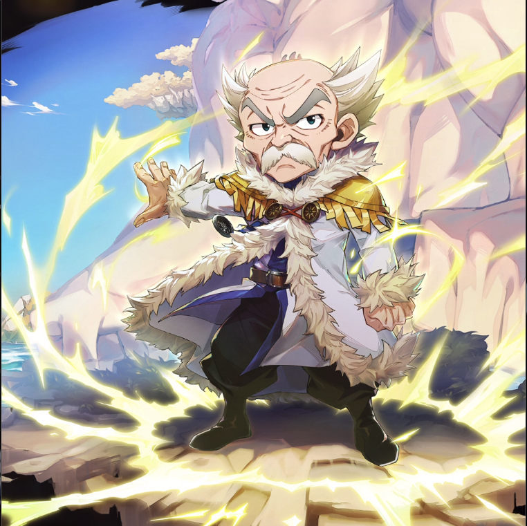

**Rarity:** UR

**Attribute:** 💚 Technique

**Class:** Defense

**Identity:** Makarov Dreyar

**Normal attack range:** Melee

**Signature lacrima:** [[lacrimas/makarov-lacrima-ce5c69c2|✨ Makarov Lacrima]]

## Game text

### 🗡️ Normal Skill (Melee)

Deals 130% ATK damage to the target.

### 🗡️ Special Skill - Unyielding Spirit

Every 7 sec, for 5 sec, grant Technique attribute allies &#91;Top&#93; DEF Increase and &#91;Top&#93; Critical Resistance Increase.

### 💥 Ultimate - Giant

Every 15 sec, transform into a giant for 7 sec. While transformed, you are in an Invincible state. When activated, inflict on all enemies for 7 sec Taunt.

## Effect applications

### Top DEF Increase
| Property | Value |
| --- | --- |
| Family | DEF |
| Target | Technique Allies |
| Activation | Every 7 sec |
| Duration | 5 sec |
| Value | 30 Percent |
| Source skill | Special Skill |

Every 7 sec, for 3 sec, grant Technique allies &#91;Top&#93; DEF Increase

### Top Critical Resistance Increase
| Property | Value |
| --- | --- |
| Family | Critical Resistance |
| Target | Technique Allies |
| Activation | Every 7 sec |
| Duration | 5 sec |
| Value | 20 Percent |
| Source skill | Special Skill |

Every 7 sec, for 5 sec, grant Technique allies &#91;Top&#93; Critical Resistance Increase.

### Invincible
| Property | Value |
| --- | --- |
| Family | Invincible |
| Target | Self |
| Activation | On Transformation |
| Duration | 7 sec |
| Condition | Invincible: While &#91;&#91;Giant&#93;&#93; |
### Taunt
| Property | Value |
| --- | --- |
| Family | Taunt |
| Target | All Enemies |
| Activation | On Transformation |
| Duration | 7 sec |
| Condition | On &#91;&#91;Giant&#93;&#93; activation |
| Source skill | Ultimate |

Every 15 sec, transform into a giant for 7 sec. While transformed, you are in an Invincible state. When activated, inflict on all enemies for 7 sec Taunt.

### Giant
| Property | Value |
| --- | --- |
| Family | Transformation |
| Target | Self |
| Activation | Every 15 sec |
| Duration | 7 sec |
| Source skill | Ultimate |

Every 15 sec, transform into a giant for 7 sec. While transformed, you are in an Invincible state. When activated, inflict on all enemies for 7 sec Taunt.

Unspecified values remain unknown. Text is transcribed from game records; localization and entry errors may remain.
