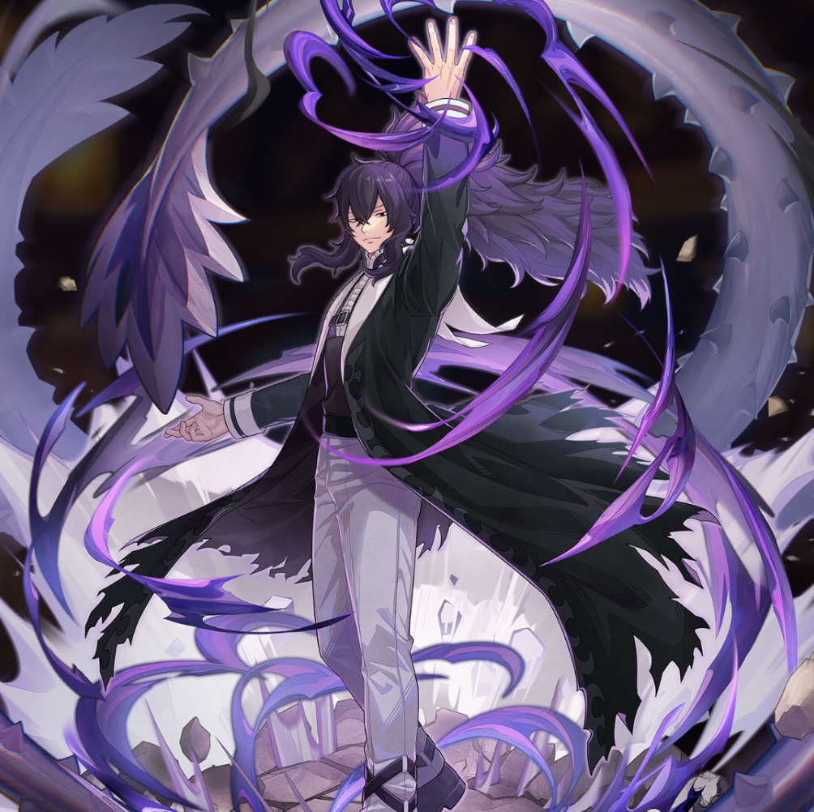

**Rarity:** UR

**Attribute:** 💙 Mind

**Class:** Ranged

**Identity:** Mard Geer

**Normal attack range:** Ranged

**Signature lacrima:** [[lacrimas/mard-lacrima-4dd48117|✨ Mard Lacrima]]

## Game text

### Normal Attack (Ranged)

Deals 140% ATK damage to the target.

### Special Skill – The Power of the Absolute Devil

After a normal skill hits, if the target is in Bleed state, push back the target&#x27;s current Ultimate Skill gauge by 0.7 sec

### Ultimate Skill – Thorn

Every 10 sec, deal damage equal to 1100% of ATK to the target. After the attack hits, there is a 50% chance to inflict on the target for 5 sec, &#91;Top&#93; Bleed.

## Effect applications

### Top Bleed
| Property | Value |
| --- | --- |
| Family | Bleed |
| Target | Single Enemy |
| Activation | Every 10 sec, After Attack Hits |
| Chance | 50% |
| Duration | 5 sec |
| Value | 40 Percent of ATK per sec |
| Source skill | Ultimate |

After the attack hits, there is a 50% chance to inflict Top Bleed on the target for 5 sec.

### Push Back Ultimate Skill Gauge
| Property | Value |
| --- | --- |
| Family | Ultimate Skill Gauge |
| Target | Single Enemy |
| Activation | Normal SKill Hit |
| Value | 0.7 Seconds |
| Required effects | Bleed |
| Match rule | Any |
| Condition subject | Target |
| Evaluation timing | After Attack Hits |
| Required state | Present |

After Normal Skill hits, if the target is Bleeding, push back the target&#x27;s current Ultimate Skill Gauge by 0.7 sec.

Unspecified values remain unknown. Text is transcribed from game records; localization and entry errors may remain.
