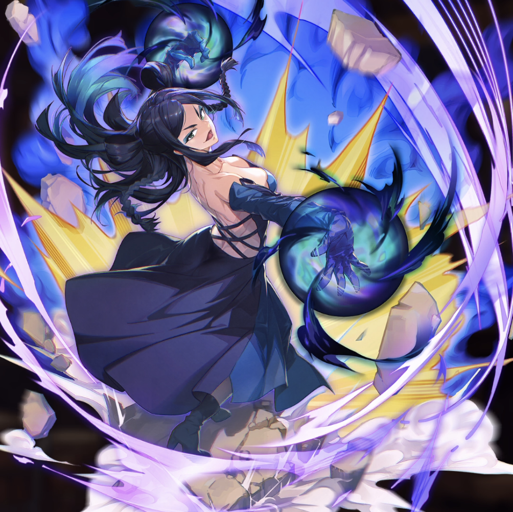

**Rarity:** UR

**Attribute:** 💙 Mind

**Class:** Ranged

**Identity:** Minerva Orland

**Normal attack range:** Ranged

**Signature lacrima:** [[lacrimas/minerva-lacrima-c575db77|✨ Minerva Lacrima]]

## Game text

### Normal Attack (Ranged)

Deals 140% ATK damage to the target.

### Special Skill – Spatial Magic — Explosion

When a criticla hit occurs, deal damage equal to 250% of ATK to the target. After the attack hits, for 5 sec, inflict on the target &#91;High&#93; Burn.

### Ultimate – Jagd Rigora

Every 9 sec, deal damage equal to 700% of ATK to enemies within the target area. If the target is in a Burn state after the attack hits, deal additional damage equal to 400% of ATK.

## Effect applications

### High Burn
| Property | Value |
| --- | --- |
| Family | Burn |
| Target | Single Enemy |
| Activation | Critical Hit |
| Duration | 5 sec |
| Value | 25 Percentage of Source ATK per second |
| Source skill | Special Skill |

When a criticla hit occurs, deal damage equal to 250% of ATK to the target. After the attack hits, for 5 sec, inflict on the target &#91;High&#93; Burn.

### Additional Damage
| Property | Value |
| --- | --- |
| Family | Damage |
| Target | Each Target Hit |
| Activation | Every 9 sec, After Attack Hits |
| Value | 400 Percent of own ATK |
| Required effects | Burn |
| Match rule | Any |
| Condition subject | Target Hit |
| Evaluation timing | After Attack Hits |
| Required state | Present |

Unspecified values remain unknown. Text is transcribed from game records; localization and entry errors may remain.
