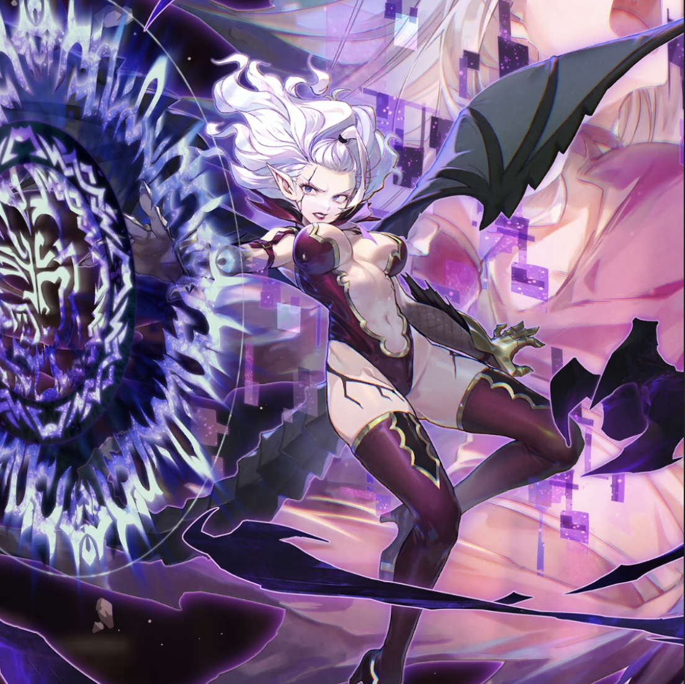

**Rarity:** UR

**Attribute:** 💛 Heart

**Class:** Ranged

**Identity:** Mirajane Strauss

**Normal attack range:** Ranged

**Signature lacrima:** [[lacrimas/mirajane-satan-soul-lacrima-2df0a514|✨ Mirajane -Satan Soul- Lacrima]]

## Game text

### 🗡️ Normal Skill (Ranged)

Deals damage equal to 150% of ATK to the target. When a critical hit occurs, for 3 seconds, grants allies of the Heart attribute &#91;High&#93; Critical Damage Increase and &#91;High&#93; Evasion Increase.

### 🗡️ Special Skill – Demon Blast

Ater a normal skill hits, there is a 20% chance to deal damage equal to 250% to enemies within the target area. After an attack hits, there is a 50% chance to apply Silence to each target for 5 seconds.

### 💥 Ultimate – Darkness Stream

Every 10 seconds, deals damage equal to 900% of ATK to enemies within range. If the target is in the Silence state after the attack hits, for each target, for 5 seconds, applies &#91;Top&#93; ATK Decrease, &#91;Top&#93; Critical Damage Decrease, and &#91;Top&#93; Bleed.

## Effect applications

### High Critical Damage Increase
| Property | Value |
| --- | --- |
| Family | Critical Damage |
| Target | Heart Allies |
| Activation | Critical Hit |
| Duration | 3 sec |
| Value | 40 Percent |
| Source skill | Normal Attack |

Deals damage equal to 150% of ATK to the target. When a critical hit occurs, for 3 seconds, grants allies of the Heart attribute &#91;High&#93; Critical Damage Increase and &#91;High&#93; Evasion Increase.

### High Evasion Increase
| Property | Value |
| --- | --- |
| Family | Evasion |
| Target | Heart Allies |
| Activation | Critical Hit |
| Duration | 3 sec |
| Value | 15 Percent |
| Source skill | Normal Attack |

Deals damage equal to 150% of ATK to the target. When a critical hit occurs, for 3 seconds, grants allies of the Heart attribute &#91;High&#93; Critical Damage Increase and &#91;High&#93; Evasion Increase.

### Silence
| Property | Value |
| --- | --- |
| Family | Silence |
| Target | Each Target Hit |
| Activation | Normal SKill Hit |
| Chance | 50% |
| Parent skill chance | 20% |
| Duration | 5 sec |
| Source skill | Special Skill |

Ater a normal skill hits, there is a 20% chance to deal damage equal to 250% to enemies within the target area. After an attack hits, there is a 50% chance to apply Silence to each target for 5 seconds.

### Top ATK Decrease
| Property | Value |
| --- | --- |
| Family | ATK |
| Target | Each Target Hit |
| Activation | Every 10 sec, After Attack Hits |
| Duration | 5 sec |
| Value | 30 Percent |
| Required effects | Silence |
| Match rule | Any |
| Condition subject | Target Hit |
| Evaluation timing | After Attack Hits |
| Required state | Present |
### Top Critical Damage Decrease
| Property | Value |
| --- | --- |
| Family | Critical Damage |
| Target | Each Target Hit |
| Activation | Every 10 sec, After Attack Hits |
| Duration | 5 sec |
| Value | 50 Percent |
| Required effects | Silence |
| Match rule | Any |
| Condition subject | Target Hit |
| Evaluation timing | After Attack Hits |
| Required state | Present |
### Top Bleed
| Property | Value |
| --- | --- |
| Family | Bleed |
| Target | Each Target Hit |
| Activation | Every 10 sec, After Attack Hits |
| Duration | 5 sec |
| Value | 40 Percent of ATK per sec |
| Required effects | Silence |
| Match rule | Any |
| Condition subject | Target Hit |
| Evaluation timing | After Attack Hits |
| Required state | Present |

Unspecified values remain unknown. Text is transcribed from game records; localization and entry errors may remain.
