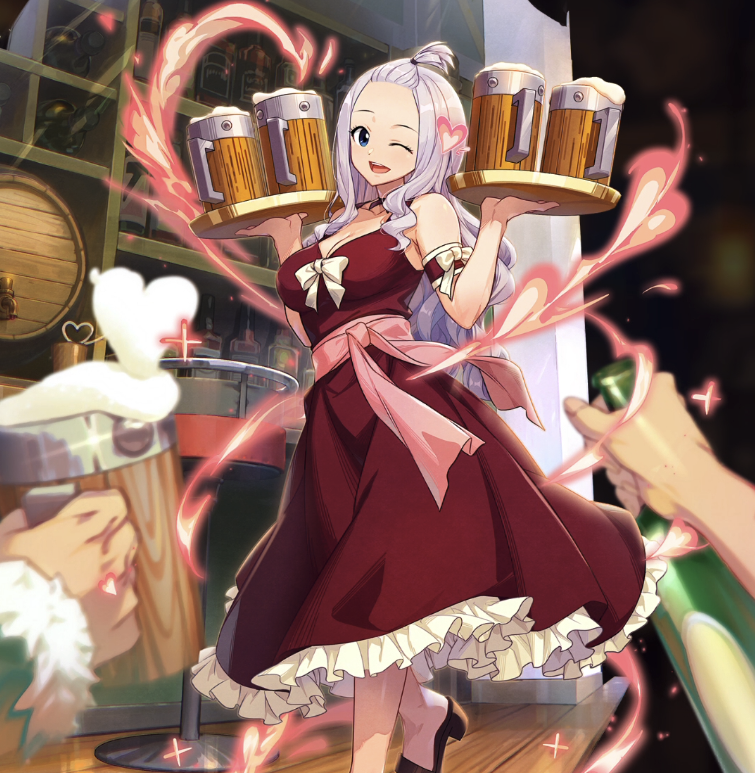

**Rarity:** UR

**Attribute:** ❤️ Brave

**Class:** Heal

**Identity:** Mirajane Strauss

**Normal attack range:** Ranged

**Signature lacrima:** [[lacrimas/mirajane-lacrima-daa64bdc|✨ Mirajane Lacrima]]

## Game text

### 🗡️ Normal Skill (Ranged)

Deals 120% ATK damage to the target. After hitting, heals the ally with the lowest HP for 140% of your ATK.

### 🗡️ Special Skill - Top Model of Weekly Sorcerer

After a normal skill hits, there is a 20% chance to inflict on the target for 4 sec, Silence.

### 💥 Ultimate - Fairy Tail&#x27;s Poster Girl

Every 10 sec, restore HP to the ally with the lowest HP equal to 850% of your ATK, and grant that ally for 5 sec &#91;Top&#93; Continuous Heal. Then remove all debuffs applied to all allies.

## Effect applications

### Heal
| Property | Value |
| --- | --- |
| Family | Heal |
| Target | Lowest HP Ally |
| Activation | Normal SKill Hit |
| Value | 140 Percent of own ATK |
| Source skill | Normal Attack |

After hitting, heals the ally with the lowest HP for 140% of your ATK

### Silence
| Property | Value |
| --- | --- |
| Family | Silence |
| Target | Single Enemy |
| Activation | Normal SKill Hit |
| Chance | 20% |
| Duration | 4 sec |
| Source skill | Special Skill |

After a normal skill hits, there is a 20% chance to inflict on the target for 4 sec, Silence.

### Heal
| Property | Value |
| --- | --- |
| Family | Heal |
| Target | Lowest HP Ally |
| Activation | Every 10 sec |
| Value | 850 Percent of own ATK |
| Source skill | Ultimate |

Every 10 sec, restore HP to the ally with the lowest HP equal to 850% of your ATK, and grant that ally for 5 sec &#91;Top&#93; Continuous Heal. Then remove all debuffs applied to all allies.

### Top Continuous Heal
| Property | Value |
| --- | --- |
| Family | Heal |
| Target | Lowest HP Ally |
| Activation | After Heal |
| Duration | 5 sec |
| Value | 120 Percent of ATK per sec |
### Remove All Debuffs
| Property | Value |
| --- | --- |
| Family | Cleanse |
| Target | All Allies |
| Activation | Every 10 sec, After Heal |
| Source skill | Ultimate |

Every 10 sec, restore HP to the ally with the lowest HP equal to 850% of your ATK, and grant that ally for 5 sec &#91;Top&#93; Continuous Heal. Then remove all debuffs applied to all allies.

Unspecified values remain unknown. Text is transcribed from game records; localization and entry errors may remain.
