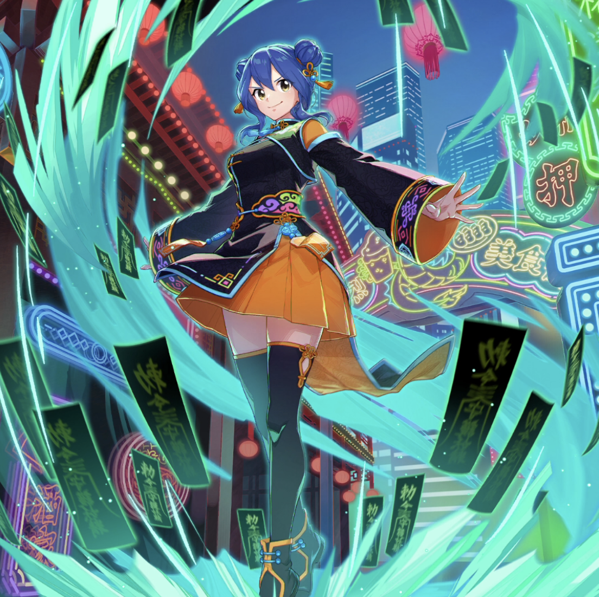

**Rarity:** UR

**Attribute:** ❤️ Brave

**Class:** Heal

**Identity:** Levy McGarden

**Normal attack range:** Ranged

**Signature lacrima:** [[lacrimas/moonlit-reverie-levy-lacrima-b10a0263|✨ Moonlit Reverie Levy Lacrima]]

## Game text

### 🗡️ Normal Skill (Ranged)

Deals damage equal to 120% of ATK to the target. After the attack hits, restores HP of the ally with the lowest HP by 160% of the caster&#x27;s ATK.

### 🗡️ Special Skill – Protective Charm

After a normal skill hits, has a 30% chance to apply the following to all allies for 5 seconds: &#91;Top&#93; Critical Resistance Increase, &#91;Top&#93; Continuous Heal, Action Block Barrier.

### 💥 Ultimate - Healing Talisman

Every 11 seconds, restores all allies HP by 950% of own ATK. Additionally, grants the target for 5 seconds: &#91;Top&#93; Shield and &#91;Top&#93; Critical Rate Increase, and removes all debuffs from all allies. Furthermore, grants all Brave-attribute allies for 5 seconds: &#91;High&#93; ATK Increase and &#91;High&#93; Accuracy Increase.

## Effect applications

### Heal
| Property | Value |
| --- | --- |
| Family | Heal |
| Target | Lowest HP Ally |
| Activation | Normal SKill Hit |
| Value | 160 Percent of own ATK |
| Source skill | Normal Attack |

Deals damage equal to 120% of ATK to the target. After the attack hits, restores HP of the ally with the lowest HP by 160% of the caster&#x27;s ATK.

### Top Critical Resistance Increase
| Property | Value |
| --- | --- |
| Family | Critical Resistance |
| Target | All Allies |
| Activation | Normal SKill Hit |
| Chance | 30% |
| Duration | 5 sec |
| Value | 20 Percent |
| Source skill | Special Skill |

After a normal skill hits, has a 30% chance to apply the following to all allies for 5 seconds: &#91;Top&#93; Critical Resistance Increase, &#91;Top&#93; Continuous Heal, Action Block Barrier.

### Top Continuous Heal
| Property | Value |
| --- | --- |
| Family | Heal |
| Target | All Allies |
| Activation | Normal SKill Hit |
| Chance | 30% |
| Duration | 5 sec |
| Value | 120 Percent of ATK per sec |
| Source skill | Special Skill |

After a normal skill hits, has a 30% chance to apply the following to all allies for 5 seconds: &#91;Top&#93; Critical Resistance Increase, &#91;Top&#93; Continuous Heal, Action Block Barrier.

### Action Block Barrier
| Property | Value |
| --- | --- |
| Family | Action Block Barrier |
| Target | All Allies |
| Activation | Normal SKill Hit |
| Chance | 30% |
| Duration | 5 sec |
| Source skill | Special Skill |

After a normal skill hits, has a 30% chance to apply the following to all allies for 5 seconds: &#91;Top&#93; Critical Resistance Increase, &#91;Top&#93; Continuous Heal, Action Block Barrier.

### Heal
| Property | Value |
| --- | --- |
| Family | Heal |
| Target | All Allies |
| Activation | Every 11 sec |
| Value | 950 Percent of own ATK |
| Source skill | Ultimate |

Every 11 seconds, restores all allies HP by 950% of own ATK. Additionally, grants the target for 5 seconds: &#91;Top&#93; Shield and &#91;Top&#93; Critical Rate Increase, and removes all debuffs from all allies. Furthermore, grants all Brave-attribute allies for 5 seconds: &#91;High&#93; ATK Increase and &#91;High&#93; Accuracy Increase.

### Top Shield
| Property | Value |
| --- | --- |
| Family | Shield |
| Target | All Allies |
| Activation | Every 11 sec |
| Duration | 5 sec |
| Value | 25 Percent of Max HP |
| Source skill | Ultimate |

Every 11 seconds, restores all allies HP by 950% of own ATK. Additionally, grants the target for 5 seconds: &#91;Top&#93; Shield and &#91;Top&#93; Critical Rate Increase, and removes all debuffs from all allies. Furthermore, grants all Brave-attribute allies for 5 seconds: &#91;High&#93; ATK Increase and &#91;High&#93; Accuracy Increase.

### Top Critical Rate Increase
| Property | Value |
| --- | --- |
| Family | Critical Rate |
| Target | All Allies |
| Activation | Every 11 sec |
| Duration | 5 sec |
| Value | 20 Percent |
| Source skill | Ultimate |

Every 11 seconds, restores all allies HP by 950% of own ATK. Additionally, grants the target for 5 seconds: &#91;Top&#93; Shield and &#91;Top&#93; Critical Rate Increase, and removes all debuffs from all allies. Furthermore, grants all Brave-attribute allies for 5 seconds: &#91;High&#93; ATK Increase and &#91;High&#93; Accuracy Increase.

### Remove All Debuffs
| Property | Value |
| --- | --- |
| Family | Cleanse |
| Target | All Allies |
| Activation | Every 11 sec |
### High ATK Increase
| Property | Value |
| --- | --- |
| Family | ATK |
| Target | Brave Allies |
| Activation | Every 11 sec |
| Duration | 5 sec |
| Value | 25 Percent |
| Source skill | Ultimate |

Every 11 seconds, restores all allies HP by 950% of own ATK. Additionally, grants the target for 5 seconds: &#91;Top&#93; Shield and &#91;Top&#93; Critical Rate Increase, and removes all debuffs from all allies. Furthermore, grants all Brave-attribute allies for 5 seconds: &#91;High&#93; ATK Increase and &#91;High&#93; Accuracy Increase.

### High Accuracy Increase
| Property | Value |
| --- | --- |
| Family | Accuracy |
| Target | Brave Allies |
| Activation | Every 11 sec |
| Duration | 5 sec |
| Value | 15 Percent |
| Source skill | Ultimate |

Every 11 seconds, restores all allies HP by 950% of own ATK. Additionally, grants the target for 5 seconds: &#91;Top&#93; Shield and &#91;Top&#93; Critical Rate Increase, and removes all debuffs from all allies. Furthermore, grants all Brave-attribute allies for 5 seconds: &#91;High&#93; ATK Increase and &#91;High&#93; Accuracy Increase.

Unspecified values remain unknown. Text is transcribed from game records; localization and entry errors may remain.
