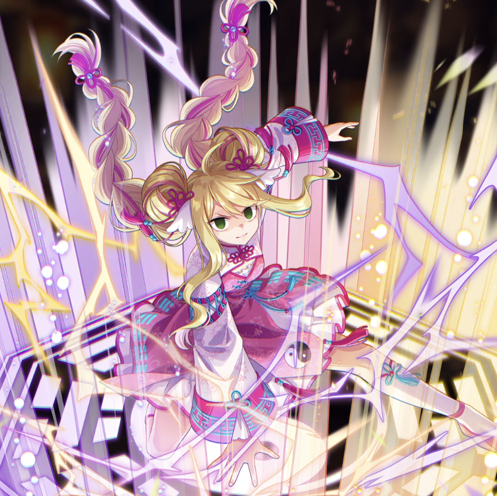

**Rarity:** UR

**Attribute:** 💛 Heart

**Class:** Ranged

**Identity:** Mavis Vermillion

**Normal attack range:** Ranged

**Signature lacrima:** [[lacrimas/moonlit-reverie-mavis-398a5228|✨ Moonlit Reverie Mavis]]

## Game text

### 🗡️ Normal Skill (Ranged)

Deals damage equal to 150% of ATK to the target. After the attack hits, has a 30% chance to apply the following to the target for 4 seconds: &#91;High&#93; Burn.

### 🗡️ Special Skill – Teachings of Qigong

When a critical hit occurs, applies the following to all Heart-type allies for 5 seconds: &#91;Top&#93; ATK Increase, &#91;Top&#93; Critical Rate Increase.

### 💥 Ultimate – Yin-Yang Conversion

Deals damage equal to 850% of ATK to targets within range every 9 seconds. After the attack hits, has a 40% chance per target to apply the following for 5 seconds: &#91;Top&#93; Paralysis, &#91;Top&#93; Evasion Decrease.

## Effect applications

### High Burn
| Property | Value |
| --- | --- |
| Family | Burn |
| Target | Single Enemy |
| Activation | Normal SKill Hit |
| Chance | 30% |
| Duration | 4 sec |
| Value | 25 Percentage of Source ATK per second |
| Source skill | Normal Attack |

Deals damage equal to 150% of ATK to the target. After the attack hits, has a 30% chance to apply the following to the target for 4 seconds: &#91;High&#93; Burn.

### Top ATK Increase
| Property | Value |
| --- | --- |
| Family | ATK |
| Target | Heart Allies |
| Activation | Critical Hit |
| Duration | 5 sec |
| Value | 30 Percent |
| Source skill | Special Skill |

When a critical hit occurs, applies the following to all Heart-type allies for 5 seconds: &#91;Top&#93; ATK Increase, &#91;Top&#93; Critical Rate Increase.

### Top Critical Rate Increase
| Property | Value |
| --- | --- |
| Family | Critical Rate |
| Target | Heart Allies |
| Activation | Critical Hit |
| Duration | 5 sec |
| Value | 20 Percent |
| Source skill | Special Skill |

When a critical hit occurs, applies the following to all Heart-type allies for 5 seconds: &#91;Top&#93; ATK Increase, &#91;Top&#93; Critical Rate Increase.

### Top Paralysis
| Property | Value |
| --- | --- |
| Family | Paralysis |
| Target | Each Target Hit |
| Activation | Every 9 sec, After Attack Hits |
| Chance | 40% |
| Duration | 5 sec |
| Value | 30 Percent of ATK per sec |
| Source skill | Ultimate |

Deals damage equal to 850% of ATK to targets within range every 9 seconds. After the attack hits, has a 40% chance per target to apply the following for 5 seconds: &#91;Top&#93; Paralysis, &#91;Top&#93; Evasion Decrease.

### Top Evasion Decrease
| Property | Value |
| --- | --- |
| Family | Evasion |
| Target | Each Target Hit |
| Activation | Every 9 sec, After Attack Hits |
| Chance | 40% |
| Duration | 5 sec |
| Value | 20 Percent |
| Source skill | Ultimate |

Deals damage equal to 850% of ATK to targets within range every 9 seconds. After the attack hits, has a 40% chance per target to apply the following for 5 seconds: &#91;Top&#93; Paralysis, &#91;Top&#93; Evasion Decrease.

Unspecified values remain unknown. Text is transcribed from game records; localization and entry errors may remain.
