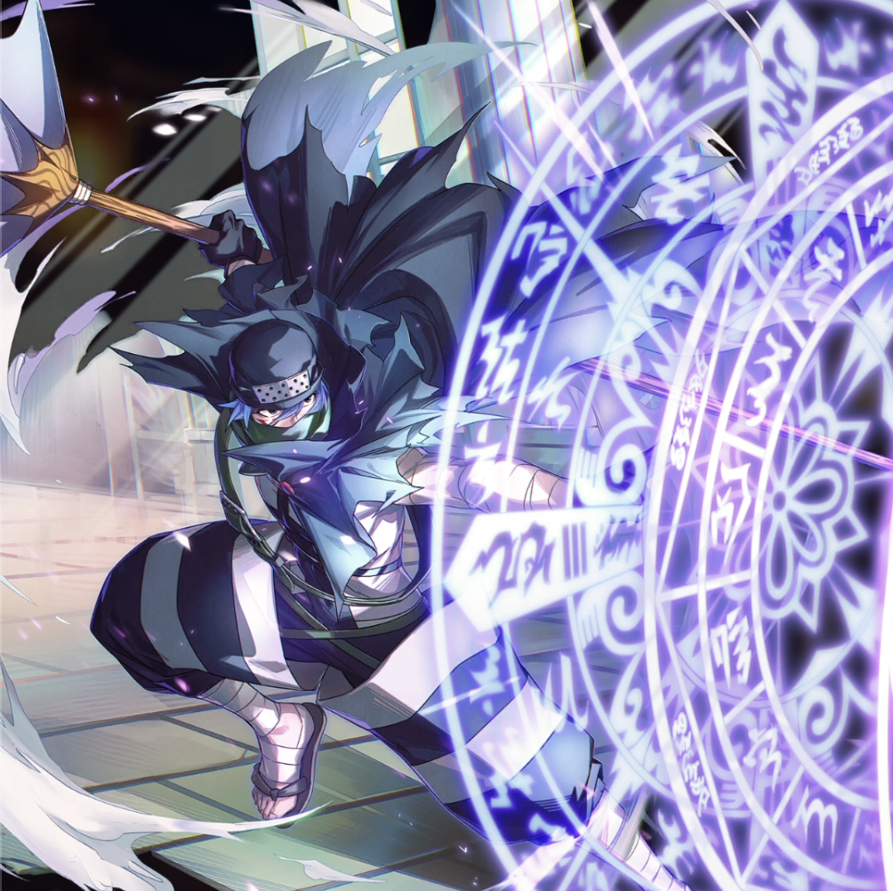

**Rarity:** UR

**Attribute:** 💙 Mind

**Class:** Ranged

**Identity:** Mystogan

**Normal attack range:** Ranged

**Signature lacrima:** [[lacrimas/mystogan-lacrima-b13083a0|✨ Mystogan Lacrima]]

## Game text

### Normal Attack (Ranged)

Deals 140% ATK damage to the target.

### Special Skill – Sleep Magic

After a normal skill hits, there is a 10% chance to inflict on the target for 4 sec Bind.

### Ultimate – Fivefold Magic Circle: Kagura

Every 9 sec, deal damage equal to 850% of ATK to enemies within the target area.

## Effect applications

### Bind
| Property | Value |
| --- | --- |
| Family | Bind |
| Target | Single Enemy |
| Activation | Normal SKill Hit |
| Chance | 10% |
| Duration | 4 sec |
| Source skill | Special Skill |

After a normal skill hits, there is a 10% chance to inflict on the target for 4 sec Bind.

Unspecified values remain unknown. Text is transcribed from game records; localization and entry errors may remain.
