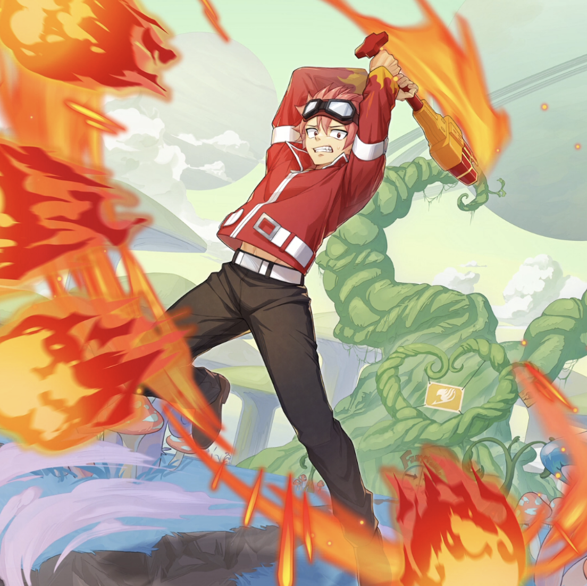

**Rarity:** UR

**Attribute:** ❤️ Brave

**Class:** Ranged

**Identity:** Natsu Dragion

**Normal attack range:** Ranged

**Signature lacrima:** [[lacrimas/natsu-dragion-lacrima-734887ce|✨ Natsu Dragion Lacrima]]

## Game text

### 🗡️ Normal Skill (Ranged)

Deals 150% ATK damage to the target. After the attack hits, has a 30% chance to grant self for 3 seconds: &#91;High&#93; ATK Increase.

### 🗡️ Special Skill - Mana Load

Each time you defeat an enemy, grants self for 7 seconds: &#91;Top&#93; ATK Increase, &#91;Top&#93; Critical Damage Increase, &#91;Top&#93; Critical Rate Increase, and &#91;Top&#93; Accuracy Increase.

### 💥 Ultimate – Natsu the Fireball

Deals 600% damage to all enemies every 10 seconds. After the attack hits, applies to all enemies afflicted with Burn for 5 seconds: &#91;Top&#93; Evasion Decrease and &#91;Top&#93; Critical Defense Decrease. ​

## Effect applications

### High ATK Increase
| Property | Value |
| --- | --- |
| Family | ATK |
| Target | Self |
| Activation | Normal SKill Hit |
| Chance | 30% |
| Duration | 3 sec |
| Value | 25 Percent |
| Source skill | Normal Attack |

Deals 150% ATK damage to the target. After the attack hits, has a 30% chance to grant self for 3 seconds: &#91;High&#93; ATK Increase.

### Top ATK Increase
| Property | Value |
| --- | --- |
| Family | ATK |
| Target | Self |
| Activation | On Enemy Defeated |
| Duration | 7 sec |
| Value | 30 Percent |
| Source skill | Special Skill |

Each time you defeat an enemy, grants self for 7 seconds: &#91;Top&#93; ATK Increase, &#91;Top&#93; Critical Damage Increase, &#91;Top&#93; Critical Rate Increase, and &#91;Top&#93; Accuracy Increase.

### Top Critical Damage Increase
| Property | Value |
| --- | --- |
| Family | Critical Damage |
| Target | Self |
| Activation | On Enemy Defeated |
| Duration | 7 sec |
| Value | 50 Percent |
| Source skill | Special Skill |

Each time you defeat an enemy, grants self for 7 seconds: &#91;Top&#93; ATK Increase, &#91;Top&#93; Critical Damage Increase, &#91;Top&#93; Critical Rate Increase, and &#91;Top&#93; Accuracy Increase.

### Top Critical Rate Increase
| Property | Value |
| --- | --- |
| Family | Critical Rate |
| Target | Self |
| Activation | On Enemy Defeated |
| Duration | 7 sec |
| Value | 20 Percent |
| Source skill | Special Skill |

Each time you defeat an enemy, grants self for 7 seconds: &#91;Top&#93; ATK Increase, &#91;Top&#93; Critical Damage Increase, &#91;Top&#93; Critical Rate Increase, and &#91;Top&#93; Accuracy Increase.

### Top Accuracy Increase
| Property | Value |
| --- | --- |
| Family | Accuracy |
| Target | Self |
| Activation | On Enemy Defeated |
| Duration | 7 sec |
| Value | 20 Percent |
| Source skill | Special Skill |

Each time you defeat an enemy, grants self for 7 seconds: &#91;Top&#93; ATK Increase, &#91;Top&#93; Critical Damage Increase, &#91;Top&#93; Critical Rate Increase, and &#91;Top&#93; Accuracy Increase.

### Top Evasion Decrease
| Property | Value |
| --- | --- |
| Family | Evasion |
| Target | All Enemies |
| Activation | Every 10 sec, After Attack Hits |
| Duration | 5 sec |
| Value | 20 Percent |
| Required effects | Burn |
| Match rule | Any |
| Condition subject | Target |
| Evaluation timing | After Attack Hits |
| Required state | Present |
| Source skill | Ultimate |

Deals 600% damage to all enemies every 10 seconds. After the attack hits, applies to all enemies afflicted with Burn for 5 seconds: &#91;Top&#93; Evasion Decrease and &#91;Top&#93; Critical Defense Decrease. ​

### Top Critical Defense Decrease
| Property | Value |
| --- | --- |
| Family | Critical Defense |
| Target | All Enemies |
| Activation | Every 10 sec, After Attack Hits |
| Duration | 5 sec |
| Value | 50 Percent |
| Required effects | Burn |
| Match rule | Any |
| Condition subject | Target |
| Evaluation timing | After Attack Hits |
| Required state | Present |
| Source skill | Ultimate |

Deals 600% damage to all enemies every 10 seconds. After the attack hits, applies to all enemies afflicted with Burn for 5 seconds: &#91;Top&#93; Evasion Decrease and &#91;Top&#93; Critical Defense Decrease. ​

Unspecified values remain unknown. Text is transcribed from game records; localization and entry errors may remain.
