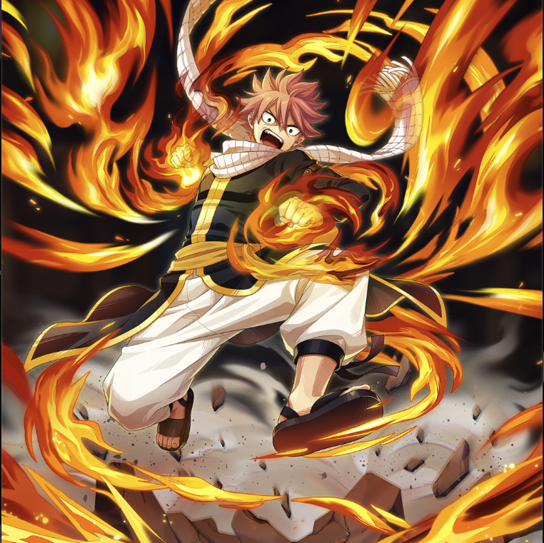

**Rarity:** UR

**Attribute:** 💛 Heart

**Class:** Melee

**Identity:** Natsu Dragneel

**Normal attack range:** Melee

**Signature lacrima:** [[lacrimas/natsu-lacrima-8ac48e99|✨ Natsu Lacrima]]

## Game text

### 🗡️ Normal Skill (Melee)

Deals 140% ATK damage to the target.

### 🗡️ Special Skill - Fire Dragon Slayer

Every 5 sec, grant yourself for 5 sec &#91;Top&#93; Critical Rate Increase.

### 💥 Ultimate - Fire Dragon Wing Attack

Every 10 sec, deal damage equal to 700% of ATK to enemies within the target area. After the attack hits, there is a 30% chance to inflict on each target for 5 sec, &#91;Top&#93; Burn.

## Effect applications

### Top Critical Rate Increase
| Property | Value |
| --- | --- |
| Family | Critical Rate |
| Target | Self |
| Activation | Every 5 sec |
| Duration | 5 sec |
| Value | 20 Percent |
### Top Burn
| Property | Value |
| --- | --- |
| Family | Burn |
| Target | Each Target Hit |
| Activation | Every 10 sec, After Attack Hits |
| Chance | 30% |
| Duration | 5 sec |
| Value | 30 Percent of ATK per sec |
| Source skill | Ultimate |

Every 10 sec, deal damage equal to 700% of ATK to enemies within the target area. After the attack hits, there is a 30% chance to inflict on each target for 5 sec, &#91;Top&#93; Burn.

Unspecified values remain unknown. Text is transcribed from game records; localization and entry errors may remain.
