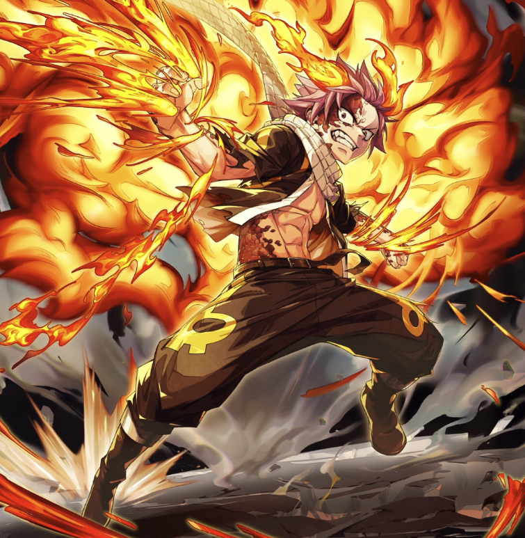

**Rarity:** UR

**Attribute:** ❤️ Brave

**Class:** Ranged

**Identity:** Natsu Dragneel

**Normal attack range:** Ranged

**Signature lacrima:** [[lacrimas/natsu-dragon-force-lacrima-c4beb0a3|✨ Natsu -Dragon Force- Lacrima]]

## Game text

### 🗡️ Normal Skill (Ranged)

Deals 150% ATK damage to the target. After hitting, 20% change to inflict 3s of &#91;High&#93; Burn.

### 🗡️ Special Skill – Roar of the Fire Dragon

After a normal skill hits, there is a 20% chance to deal damage equal to 300% of ATK to enemies within the target area. If the target is in a Burn state, deal additional damage equal to 300% of ATK.

### 💥 Ultimate – Crimson Exploding Flame Blade

Every 8 sec, deal damage equal to 850% of ATK to enemies within the target area. After the attack hits, inflict on the target for 10 sec &#91;Top&#93; Burn.

## Effect applications

### High Burn
| Property | Value |
| --- | --- |
| Family | Burn |
| Target | Single Enemy |
| Activation | Normal SKill Hit, After Attack Hits |
| Chance | 20% |
| Duration | 3 sec |
| Value | 25 Percentage of Source ATK per second |
| Source skill | Normal Attack |

Deals 150% ATK damage to the target. After hitting, 20% change to inflict 3s of &#91;High&#93; Burn.

### Additional Damage
| Property | Value |
| --- | --- |
| Family | Damage |
| Target | Enemies in Target Area |
| Activation | Normal SKill Hit, After Attack Hits |
| Chance | 20% |
| Parent skill chance | 20% |
| Value | 300 Percent of own ATK |
| Required effects | Burn |
| Match rule | Any |
| Condition subject | Target Hit |
| Evaluation timing | At Attack Hit |
| Required state | Present |
| Source skill | Special Skill |

After a normal skill hits, there is a 20% chance to deal damage equal to 300% of ATK to enemies within the target area. If the target is in a Burn state, deal additional damage equal to 300% of ATK.

### Top Burn
| Property | Value |
| --- | --- |
| Family | Burn |
| Target | Each Target Hit |
| Activation | Every 8 sec, After Attack Hits |
| Duration | 10 sec |
| Value | 30 Percent of ATK per sec |
| Source skill | Ultimate |

Every 8 sec, deal damage equal to 850% of ATK to enemies within the target area. After the attack hits, inflict on the target for 10 sec &#91;Top&#93; Burn.

Unspecified values remain unknown. Text is transcribed from game records; localization and entry errors may remain.
