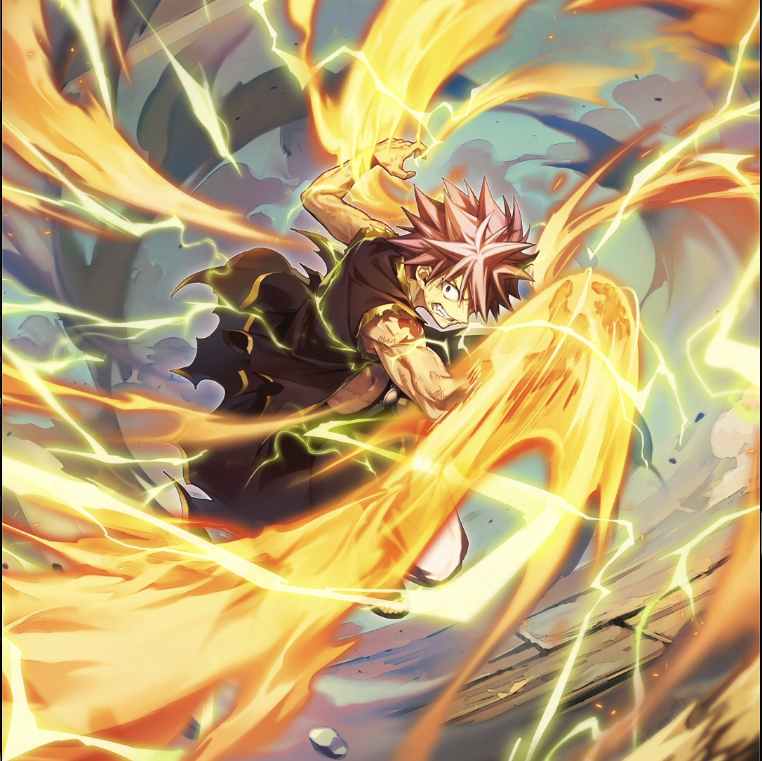

**Rarity:** UR

**Attribute:** 💛 Heart

**Class:** Melee

**Identity:** Natsu Dragneel

**Normal attack range:** Ranged

**Signature lacrima:** [[lacrimas/natsu-lightning-fire-dragon-mode-lacrima-a2a71a30|✨ Natsu -Lightning Fire Dragon Mode- Lacrima]]

## Game text

### 🗡️ Normal Skill (Ranged)

Deals damage equal to 170% of ATK to the target. When a Critical Hit occurs, applies the following to Heart-type allies for 3 seconds: &#91;High&#93; ATK Increase, &#91;High&#93; Critical Rate Increase.

### 🗡️ Special Skill - Lightning Fire Dragon&#x27;s Firing Hammer

After a normal skill hits, has a 30% chance to deal 400% damage to the target. After the attack hits, applies the following to the target for 5 seconds: &#91;Top&#93; Burn, &#91;Top&#93; Paralysis.

### 💥 Ultimate - Crimson Lotus: Exploding Lightning Blade

Deals damage equal to 850% of ATK to all enemies every 10 seconds. After the attack hits, if the target is affected by Burn or Paralysis, applies the following to the target for 5 seconds: &#91;Top&#93; Critical Defense Decrease, Heal Block, Silence.

## Effect applications

### High ATK Increase
| Property | Value |
| --- | --- |
| Family | ATK |
| Target | Heart Allies |
| Activation | Critical Hit |
| Duration | 3 sec |
| Value | 25 Percent |
### High Critical Rate Increase
| Property | Value |
| --- | --- |
| Family | Critical Rate |
| Target | Heart Allies |
| Activation | Critical Hit |
| Duration | 3 sec |
| Value | 15 Percent |
### Top Burn
| Property | Value |
| --- | --- |
| Family | Burn |
| Target | Single Enemy |
| Activation | Normal SKill Hit, After Attack Hits |
| Parent skill chance | 30% |
| Duration | 5 sec |
| Value | 30 Percent of ATK per sec |
| Source skill | Special Skill |

After a normal skill hits, has a 30% chance to deal 400% damage to the target. After the attack hits, applies the following to the target for 5 seconds: &#91;Top&#93; Burn, &#91;Top&#93; Paralysis.

### Top Paralysis
| Property | Value |
| --- | --- |
| Family | Paralysis |
| Target | Single Enemy |
| Activation | Normal SKill Hit, After Attack Hits |
| Parent skill chance | 30% |
| Duration | 5 sec |
| Value | 30 Percent of ATK per sec |
| Source skill | Special Skill |

After a normal skill hits, has a 30% chance to deal 400% damage to the target. After the attack hits, applies the following to the target for 5 seconds: &#91;Top&#93; Burn, &#91;Top&#93; Paralysis.

### Top Critical Defense Decrease
| Property | Value |
| --- | --- |
| Family | Critical Defense |
| Target | Each Target Hit |
| Activation | Every 10 sec, After Attack Hits |
| Duration | 5 sec |
| Value | 50 Percent |
| Required effects | Burn, Paralysis |
| Match rule | Any |
| Condition subject | Target Hit |
| Evaluation timing | After Attack Hits |
| Required state | Present |
### Heal Block
| Property | Value |
| --- | --- |
| Family | Heal Block |
| Target | Each Target Hit |
| Activation | Every 10 sec, After Attack Hits |
| Duration | 5 sec |
| Required effects | Burn, Paralysis |
| Match rule | Any |
| Condition subject | Target Hit |
| Evaluation timing | After Attack Hits |
| Required state | Present |
| Source skill | Ultimate |

Every 10 sec... After the attack hits, if the target is affected by Burn or Paralysis, applies the following to the target for 5 seconds: ... Heal Block

### Silence
| Property | Value |
| --- | --- |
| Family | Silence |
| Target | Each Target Hit |
| Activation | Every 10 sec, After Attack Hits |
| Duration | 5 sec |
| Required effects | Burn, Paralysis |
| Match rule | Any |
| Condition subject | Target Hit |
| Evaluation timing | After Attack Hits |
| Required state | Present |
| Source skill | Ultimate |

Deals damage equal to 850% of ATK to all enemies every 10 seconds. After the attack hits, if the target is affected by Burn or Paralysis, applies the following to the target for 5 seconds: &#91;Top&#93; Critical Defense Decrease, Heal Block, Silence.

Unspecified values remain unknown. Text is transcribed from game records; localization and entry errors may remain.
