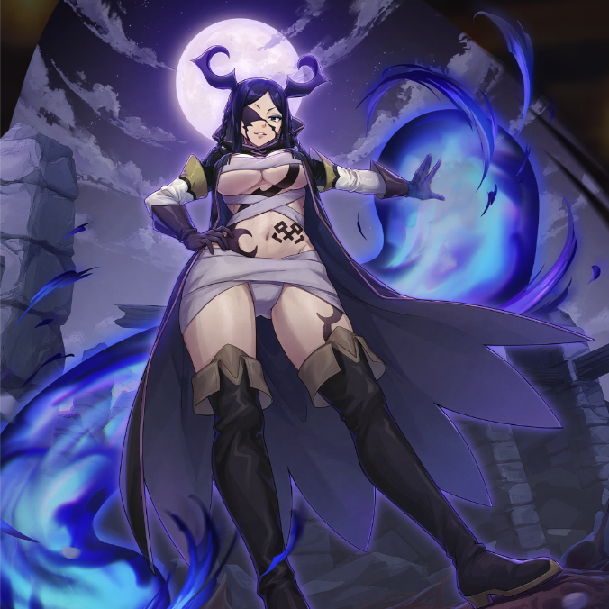

**Rarity:** UR

**Attribute:** ❤️ Brave

**Class:** Defense

**Identity:** Minerva Orland

**Normal attack range:** Ranged

**Signature lacrima:** [[lacrimas/neo-minerva-lacrima-73ff7d3b|✨ Neo Minerva Lacrima]]

## Game text

### 🗡️ Normal Skill (Ranged)

Deals 160% ATK damage to the target. After the attack hits, has a 30% chance to restore own HP by 700% of ATK and grants Critical Shield for 3 sec.

### 🗡️ Special Skill – Merciless Demon

When HP falls 50% or below, once only, grants self 30% Damage Reflection Shield and &#91;Top&#93; DEF Increase,  &#91;Top&#93; ATK Increase for 5 sec, and restores HP by 1500% of ATK.

### 💥 Ultimate - Territory Nihility

Every 8 sec, deals 850% ATK damage to targets within range. After the attack hits, has a 50% chance for each target to inflict &#91;Top&#93; ATK Decrease and &#91;High&#93; Burn, Silence for 5 sec

## Effect applications

### Heal
| Property | Value |
| --- | --- |
| Family | Heal |
| Target | Self |
| Activation | Normal SKill Hit |
| Chance | 30% |
| Value | 700 Percent of own ATK |
| Source skill | Normal Attack |

Deals 160% ATK damage to the target. After the attack hits, has a 30% chance to restore own HP by 700% of ATK and grants Critical Shield for 3 sec.

### Critical Shield
| Property | Value |
| --- | --- |
| Family | Critical Shield |
| Target | Self |
| Activation | Normal SKill Hit |
| Chance | 30% |
| Duration | 3 sec |
| Source skill | Normal Attack |

Deals 160% ATK damage to the target. After the attack hits, has a 30% chance to restore own HP by 700% of ATK and grants Critical Shield for 3 sec.

### 30% Damage Reflection Shield
| Property | Value |
| --- | --- |
| Family | Damage Reflection |
| Target | Self |
| Activation | HP Reaches Threshold |
| Duration | 5 sec |
| Value | 30 Percent |
| Condition | Own HP ≤ 50%; once only |
| Source skill | Special Skill |

When HP falls 50% or below, once only, grants self 30% Damage Reflection Shield and &#91;Top&#93; DEF Increase,  &#91;Top&#93; ATK Increase for 5 sec, and restores HP by 1500% of ATK.

### Top DEF Increase
| Property | Value |
| --- | --- |
| Family | DEF |
| Target | Self |
| Activation | HP Reaches Threshold |
| Duration | 5 sec |
| Value | 30 Percent |
| Condition | Own HP ≤ 50%; once only |
| Source skill | Special Skill |

When HP falls 50% or below, once only, grants self 30% Damage Reflection Shield and &#91;Top&#93; DEF Increase,  &#91;Top&#93; ATK Increase for 5 sec, and restores HP by 1500% of ATK.

### Top ATK Increase
| Property | Value |
| --- | --- |
| Family | ATK |
| Target | Self |
| Activation | HP Reaches Threshold |
| Duration | 5 sec |
| Value | 30 Percent |
| Condition | Own HP ≤ 50%; once only |
| Source skill | Special Skill |

When HP falls 50% or below, once only, grants self 30% Damage Reflection Shield and &#91;Top&#93; DEF Increase,  &#91;Top&#93; ATK Increase for 5 sec, and restores HP by 1500% of ATK.

### Heal
| Property | Value |
| --- | --- |
| Family | Heal |
| Target | Self |
| Activation | HP Reaches Threshold |
| Value | 1500 Percent of own ATK |
| Condition | Own HP ≤ 50%; once only |
| Source skill | Special Skill |

When HP falls 50% or below, once only, grants self 30% Damage Reflection Shield and &#91;Top&#93; DEF Increase,  &#91;Top&#93; ATK Increase for 5 sec, and restores HP by 1500% of ATK.

### Top ATK Decrease
| Property | Value |
| --- | --- |
| Family | ATK |
| Target | Each Target Hit |
| Activation | Every 8 sec, After Attack Hits |
| Chance | 50% |
| Duration | 5 sec |
| Value | 30 Percent |
| Source skill | Ultimate |

Every 8 sec, deals 850% ATK damage to targets within range. After the attack hits, has a 50% chance for each target to inflict &#91;Top&#93; ATK Decrease and &#91;High&#93; Burn, Silence for 5 sec

### High Burn
| Property | Value |
| --- | --- |
| Family | Burn |
| Target | Each Target Hit |
| Activation | Every 8 sec, After Attack Hits |
| Chance | 50% |
| Duration | 5 sec |
| Value | 25 Percentage of Source ATK per second |
| Source skill | Ultimate |

Every 8 sec, deals 850% ATK damage to targets within range. After the attack hits, has a 50% chance for each target to inflict &#91;Top&#93; ATK Decrease and &#91;High&#93; Burn, Silence for 5 sec

### Silence
| Property | Value |
| --- | --- |
| Family | Silence |
| Target | Each Target Hit |
| Activation | Every 8 sec, After Attack Hits |
| Chance | 50% |
| Duration | 5 sec |
| Source skill | Ultimate |

Every 8 sec, deals 850% ATK damage to targets within range. After the attack hits, has a 50% chance for each target to inflict &#91;Top&#93; ATK Decrease and &#91;High&#93; Burn, Silence for 5 sec

Unspecified values remain unknown. Text is transcribed from game records; localization and entry errors may remain.
