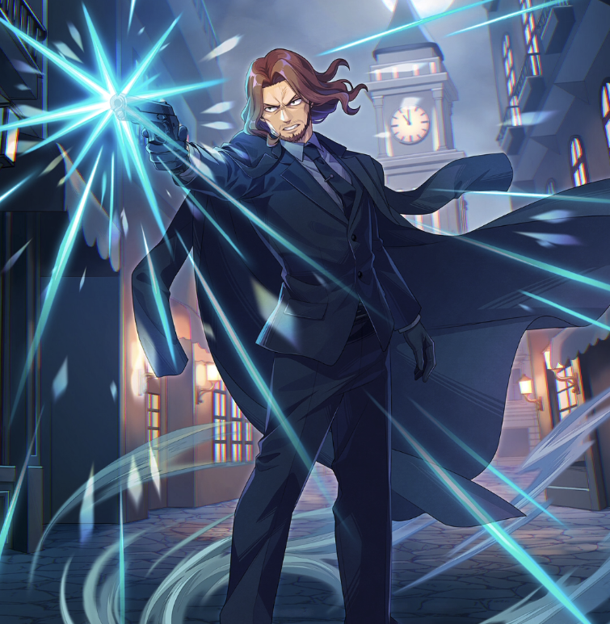

**Rarity:** UR

**Attribute:** ❤️ Brave

**Class:** Defense

**Identity:** Gildarts Clive

**Normal attack range:** Ranged

**Signature lacrima:** [[lacrimas/noir-gildarts-lacrima-8fb9ebd3|✨ Noir Gildarts Lacrima]]

## Game text

### 🗡️ Normal Skill (Ranged)

Deals damage equal to 130% of ATK to the target. On hit, has a 20% chance to grant self for 3 sec: &#91;High&#93; DEF Increase.

### 🗡️ Special Skill - Noir Protect

Every 7 sec, grants self for 5 sec: &#91;Top&#93; DEF Increase &#91;Top&#93; Critical Defense Increase

### 💥 Ultimate - Law of Destruction

Deals damage equal to 750% of ATK to all enemies every 10 sec. Attacks have a 50% chance on hit to inflict the following on each target for 5 sec: Taunt, &#91;Top&#93; Burn, &#91;Top&#93; Critical Rate Decrease.

## Effect applications

### High DEF Increase
| Property | Value |
| --- | --- |
| Family | DEF |
| Target | Self |
| Activation | Normal SKill Hit |
| Chance | 20% |
| Duration | 3 sec |
| Value | 25 Percent |
| Source skill | Normal Attack |

Deals damage equal to 130% of ATK to the target. On hit, has a 20% chance to grant self for 3 sec: &#91;High&#93; DEF Increase.

### Top DEF Increase
| Property | Value |
| --- | --- |
| Family | DEF |
| Target | Self |
| Activation | Every 7 sec |
| Duration | 5 sec |
| Value | 30 Percent |
| Source skill | Special Skill |

Every 7 sec, grants self for 5 sec: &#91;Top&#93; DEF Increase &#91;Top&#93; Critical Defense Increase

### Top Critical Defense Increase
| Property | Value |
| --- | --- |
| Family | Critical Defense |
| Target | Self |
| Activation | Every 7 sec |
| Duration | 5 sec |
| Value | 50 Percent |
| Source skill | Special Skill |

Every 7 sec, grants self for 5 sec: &#91;Top&#93; DEF Increase &#91;Top&#93; Critical Defense Increase

### Taunt
| Property | Value |
| --- | --- |
| Family | Taunt |
| Target | Each Target Hit |
| Activation | Every 10 sec, After Attack Hits |
| Chance | 50% |
| Duration | 5 sec |
| Source skill | Ultimate |

Deals damage equal to 750% of ATK to all enemies every 10 sec. Attacks have a 50% chance on hit to inflict the following on each target for 5 sec: Taunt, &#91;Top&#93; Burn, &#91;Top&#93; Critical Rate Decrease.

### Top Burn
| Property | Value |
| --- | --- |
| Family | Burn |
| Target | Each Target Hit |
| Activation | Every 10 sec, After Attack Hits |
| Chance | 50% |
| Duration | 5 sec |
| Value | 30 Percent of ATK per sec |
| Source skill | Ultimate |

Deals damage equal to 750% of ATK to all enemies every 10 sec. Attacks have a 50% chance on hit to inflict the following on each target for 5 sec: Taunt, &#91;Top&#93; Burn, &#91;Top&#93; Critical Rate Decrease.

### Top Critical Rate Decrease
| Property | Value |
| --- | --- |
| Family | Critical Rate |
| Target | Each Target Hit |
| Activation | Every 10 sec, After Attack Hits |
| Chance | 50% |
| Duration | 5 sec |
| Value | 20 Percent |
| Source skill | Ultimate |

Deals damage equal to 750% of ATK to all enemies every 10 sec. Attacks have a 50% chance on hit to inflict the following on each target for 5 sec: Taunt, &#91;Top&#93; Burn, &#91;Top&#93; Critical Rate Decrease.

Unspecified values remain unknown. Text is transcribed from game records; localization and entry errors may remain.
